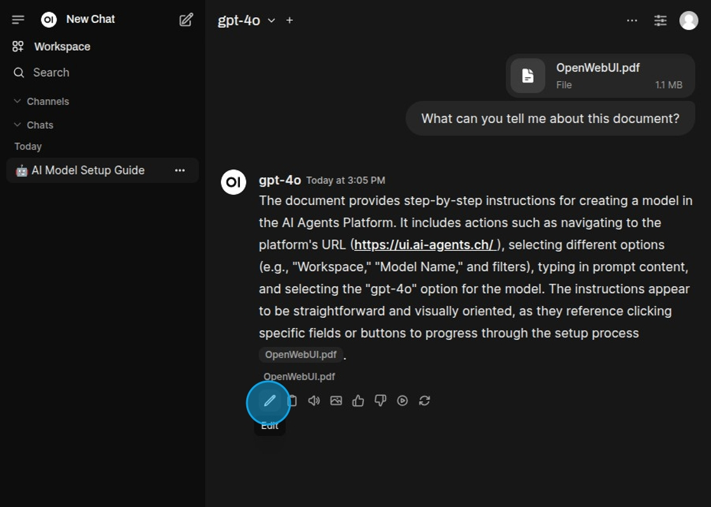
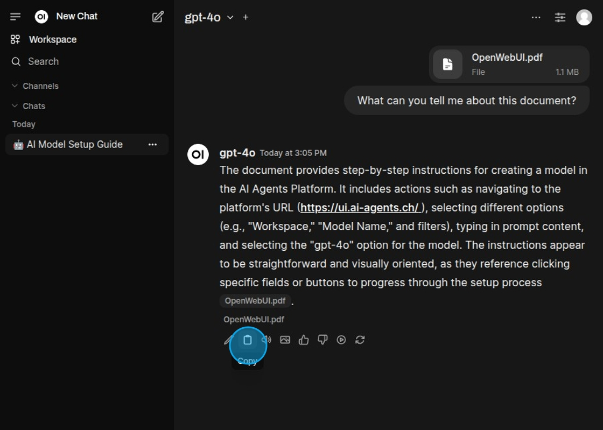
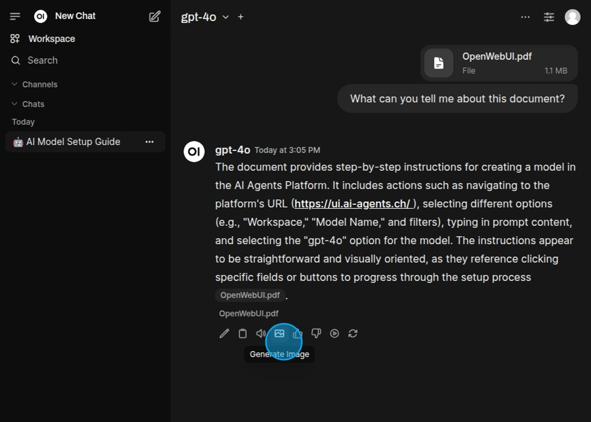
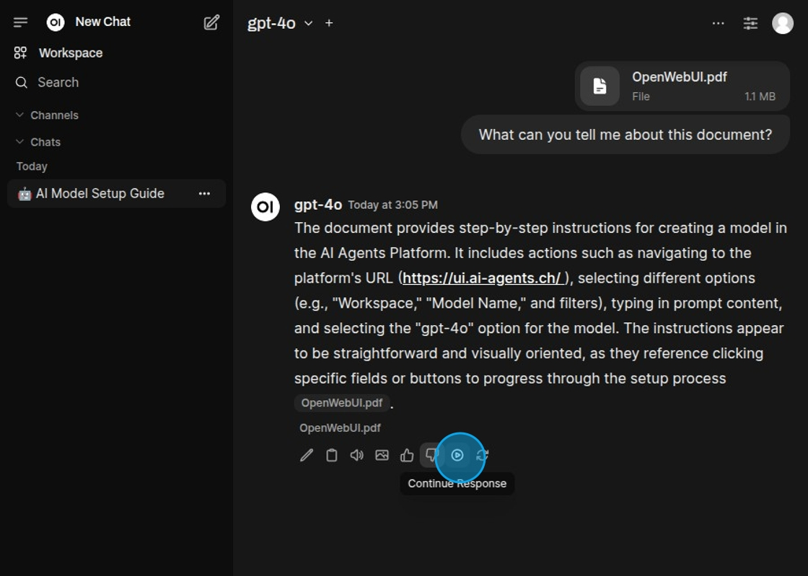
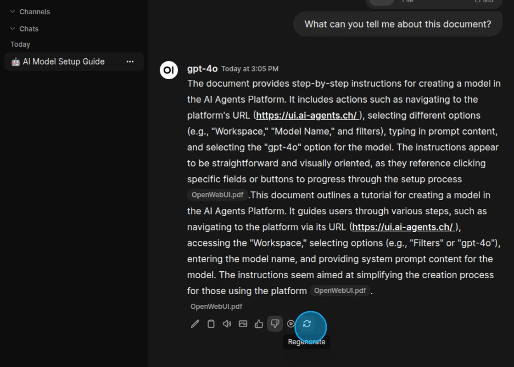
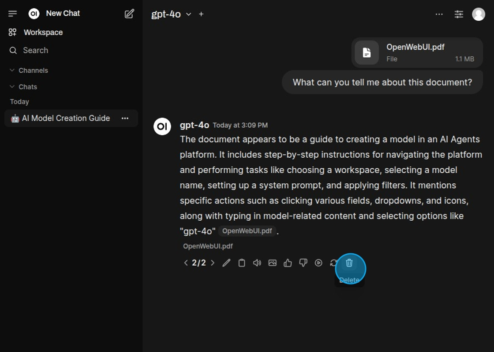

# Chat-Nachrichten

Mithilfe von Aktionen können erweiterte Operationen an Modellantworten durchgeführt werden. Aktionen sind die kleinen
Icons unterhalb jeder Antwort des Modells. Diese können verschiedene Dinge ausführen, vom Vorlesen der Antwort bis zu
ihrer Neugenerierung.

Die Antwort kann bearbeitet werden.

Die Antwort in die Zwischenablage kopieren.

Die Antwort vorlesen.

Ein Bild basierend auf der Antwort generieren.

Die Antwort kann fortgesetzt werden.

Die Antwort kann neu generiert werden.

Neu generierte Antworten können wieder gelöscht werden.

