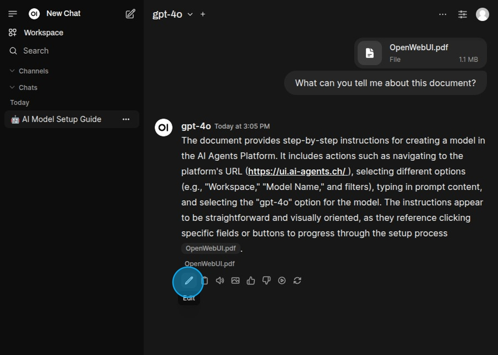
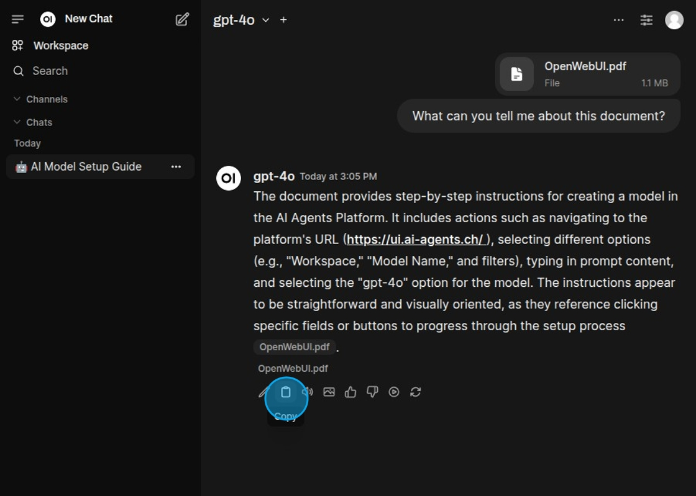
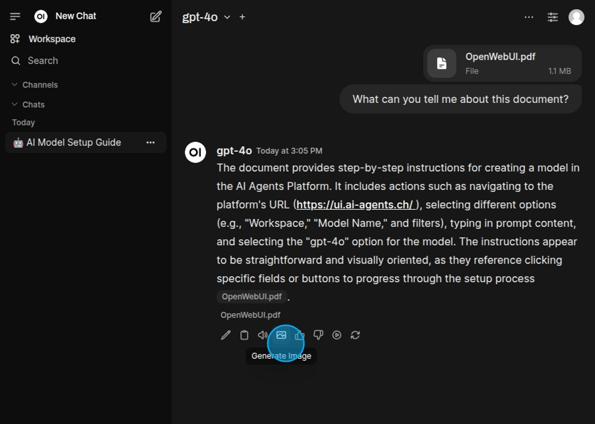
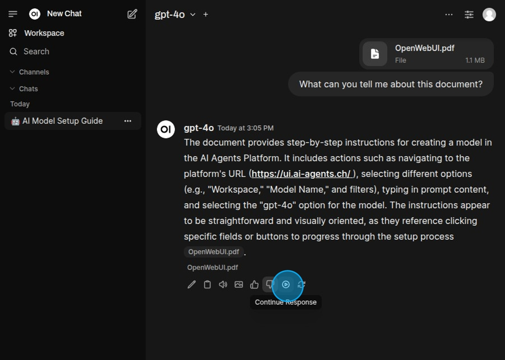
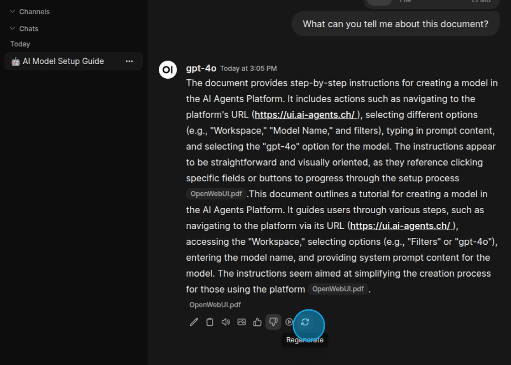
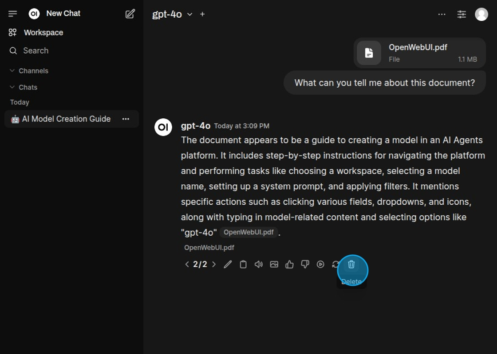

## Chat Messages

Using Actions, advanced operations can be performed on model responses. Actions are the small icons underneath each
response from the model. These can perform different things, from reading the response aloud to regenerating it.

The response can be edited.

Copy the response to clipboard.

Read the response aloud.

Generate an image based on the response.

The response can be continued.

The response can be regenerated.

Regenerated responses can be deleted again.

