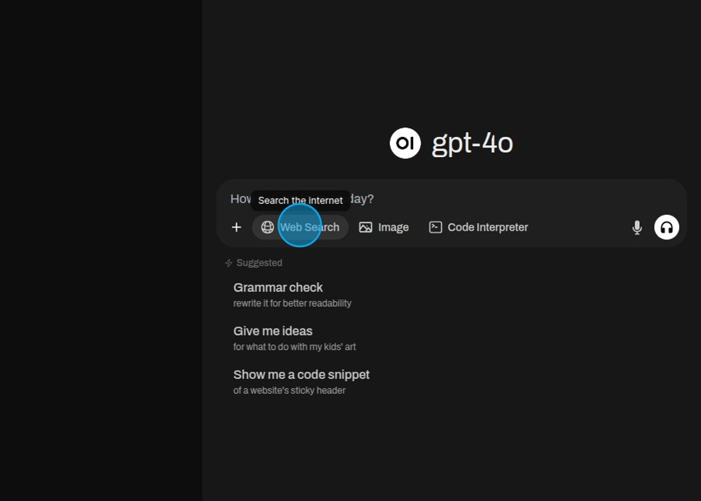
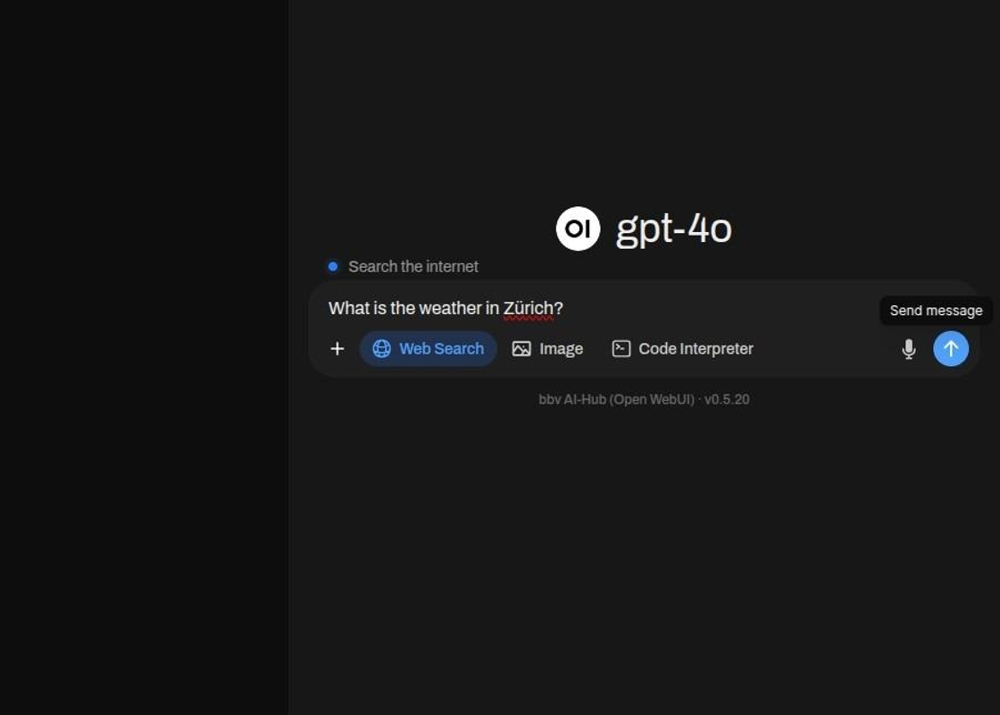
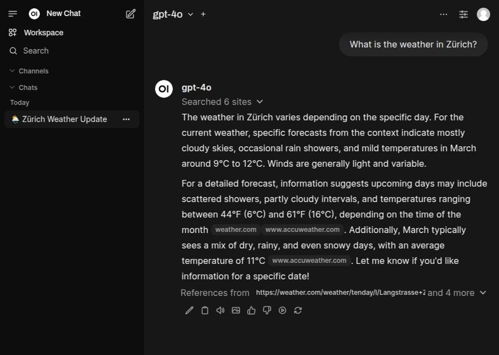
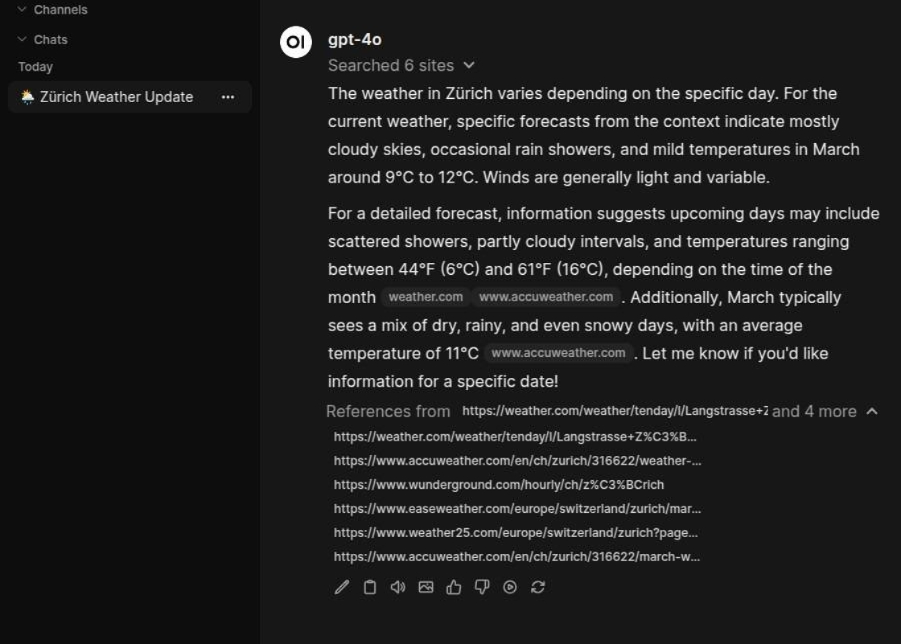

# Web search capability

Chats with a plain language model can reach out to the web to answer questions requiring current data beyond the model's
training. Organizations control this through configuration.

Agents search the web too, when their profile allows it: see [Web search in agents](#web-search-in-agents). An agent
whose profile has web search off shows no "Web Search" button.

Select "Web Search".

Enter something you want to search for.

The model will take some time coming up with a search query and then executing that search. After which it will output
what it found.

The websites it retrieved the information from are listed as references.

## Search configuration

Web search can be enabled or disabled platform-wide, and restricted to specific user roles through role-based access
control, so different policies apply to different use cases or user groups. It can be modified at runtime without system
changes.

## Search restrictions

Organizations can limit searches to approved domains, trusted sources, or specific content types like academic
institutions or government websites.

Search queries can be validated, filtered, or transformed to ensure compliance with data protection policies and prevent
sensitive information leakage.

Retrieved web content can be validated against organizational standards before presentation.

Search restrictions can align with industry regulations, internal policies, or contractual obligations.

## Source attribution

When a chat uses web search, the system provides traceable attribution of external sources.

Users see clear distinctions between internal knowledge and external web sources. Web results appear as structured,
clickable citations with URLs, titles, and content previews. Users receive information about why specific sources were
retrieved.

Every search query, retrieved result, and user interaction is captured for audit purposes. The entire search process -
from query validation through result filtering to presentation - is traceable through the observability infrastructure.

## Use cases

Users supplement the model's own knowledge with current market data, regulatory updates, industry news, or technical
documentation from external sources.

Where a topic is too recent or too niche for the model to know, external information fills the gap while sources stay
clearly attributed.

Claims can be validated against authoritative external sources.

## Governance and security

Organizations can ensure that search queries don't expose sensitive information to external providers through query
validation and filtering.

Web content is validated against organizational standards before presentation, preventing inappropriate or unreliable
sources from reaching users.

The permission system allows control over which users or groups can use web search for which purposes.

Complete audit trails and transparent source attribution support compliance with data governance regulations and
industry standards.

Configurable restrictions and validation mechanisms let organizations balance the value of external information with
their risk tolerance and compliance obligations.

## Web search in agents

An agent built on a blueprint that can search the web, such as the
[Universal Agent](../../5_agents/13_universal_agent/), searches with the platform's own SearXNG instead of Open WebUI's
search. Each search is a step of the agent's run, so it appears in the run's events and its trace, and its cost counts
towards the agent like any other step.

- **Admins switch it on per profile.** In the profile's settings, turn on **Web Search** and choose how many results a
  search keeps, how many of the best are read whole, which search engines are asked, the result language, safe search
  and how recent the results must be. While it is off, the profile shows no "Web Search" button in the chat.
- **Users switch it on per message.** With the button on, the agent decides for itself whether the question needs a
  search; with it off, nothing is searched. Admins who want every search confirmed first set an approval rule for the
  `search_web` tool in the profile's tool settings.
- **The chat shows it like Open WebUI's own search.** The queries appear while the agent searches, then "Searched N
  sites" with the sites listed, and every result the answer cites is a numbered, clickable source.

The best results are read whole through the platform's browser, which only reaches public addresses; the others reach
the model as the search engine's snippet, marked as such. A search sends the queries the model wrote, which come from
the conversation, to the search engines SearXNG asks. Switching on "Web Search" for a message is the user's consent to
that.
