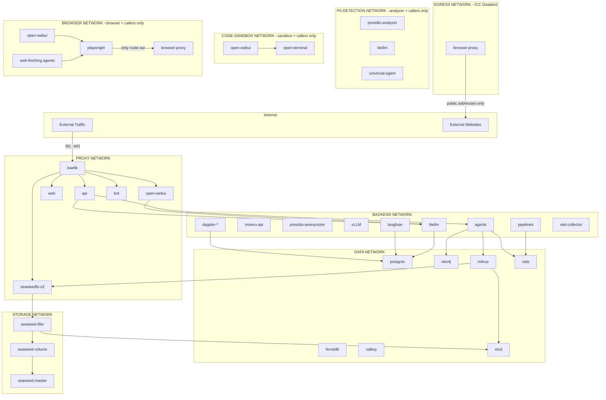

# Docker-Netzwerkisolation

Die Swiss AI Hub-Plattform implementiert Netzwerksegmentierung, um Sicherheitsgrenzen zwischen Services durchzusetzen.
Dieser Defence-in-Depth-Ansatz begrenzt den Auswirkungsbereich potenzieller Sicherheitsverletzungen und erzwingt das
Prinzip der geringsten Rechte auf der Netzwerkebene.

## Netzwerkzonen

Die Plattform verwendet sieben isolierte Docker-Netzwerke:

| Netzwerk        | Zweck                                               | Externer Zugriff | ICC aktiviert |
| --------------- | --------------------------------------------------- | ---------------- | ------------- |
| `proxy`         | Externer Traffic über Traefik                       | Ingress + Egress | Ja            |
| `backend`       | Interne Anwendungs-Services                         | Nein             | Ja            |
| `data`          | Datenbanken und Message Broker                      | Nein             | Ja            |
| `storage`       | SeaweedFS Objekt-Speicher                           | Nein             | Ja            |
| `egress`        | Nur ausgehender Internetzugriff                     | Nur Egress       | Nein          |
| `code-sandbox`  | Code-Execution-Sandbox + ihre Caller                | Nein             | Ja            |
| `browser`       | Playwright-Browser + seine Caller + `browser-proxy` | Nein             | Ja            |
| `pii-detection` | PII-Erkennung + ihre Caller                         | Nein             | Ja            |

Das `egress`-Netzwerk ist für Services konzipiert, die das Internet erreichen müssen (ausgehend), aber nicht aus dem
Internet erreichbar sein sollten (kein Ingress). Die Inter-Container-Kommunikation (ICC) ist in diesem Netzwerk
deaktiviert, was bedeutet, dass Container über dieses Netzwerk nicht miteinander kommunizieren können – sie können es
nur für den ausgehenden Internetzugriff nutzen.

Das `code-sandbox`-Netzwerk ist eine Single-Tenant-Zone für die `open-terminal` Code-Execution-Sandbox, die beliebigen,
von Benutzern übermittelten Code ausführt. Ihre Mitglieder sind die Sandbox plus **genau ihre Caller** (`open-webui`,
`universal-agent`, der einzige AI-Hub Agent, der Code ausführt, und `api`, das die eigenen Dateien jedes Benutzers
ausliefert). Da Docker-Netzwerke bidirektional sind, verhindert der Ausschluss der Sandbox aus `backend`, dass ein
Sandbox-Breakout lateral `litellm`, `vLLM`, `mineru`, `presidio`, `speaches` oder `otel-collector` erreichen kann. ICC
bleibt aktiviert (die Caller müssen `open-terminal:8000` erreichen), und `internal: true` in Nicht-Dev-Stages verwehrt
der Sandbox zusätzlich jeden ausgehenden Internetzugriff.

Das `browser`-Netzwerk wendet dasselbe Muster auf `playwright` an, den Headless-Browser, der die von Benutzern
verlinkten Webseiten lädt (siehe [Verlinkte Webseiten](../../10_chat_ui/15_linked_web_pages/)). Seine Mitglieder sind
der Browser plus **genau seine Caller**: `open-webui` (dessen Web Loader) und die Agents, die verlinkte Seiten lesen,
sowie `browser-proxy`. Der Browser befindet sich **ausschliesslich** in `browser` und hat selbst keine Route ins
Internet. Sein einziger Weg nach draussen ist `browser-proxy`, ein Squid-Forward-Proxy in `browser` und `egress`. Der
Proxy löst jeden Host selbst auf, lehnt jedes Ziel ab, dessen Adresse nicht öffentlich ist (privat, Loopback, Link-Local
einschliesslich der Cloud-Metadaten-Adresse, CGNAT, Multicast, reserviert sowie die IPv6-Entsprechungen einschliesslich
NAT64 und 6to4), und verbindet sich mit der geprüften Adresse, sodass DNS-Rebinding die Adresse nicht austauschen kann.
Er erlaubt nur die Ports 80, 443 und 1025-65535 und lehnt seine eigene Cache-Manager-Seite ab. Websites sehen weder die
Adressen der Plattform noch den Proxy. Da der Browser weder in `backend` noch in `egress` liegt, hat das Laden einer
Seite keinen Netzwerkpfad zu `litellm`, `langfuse`, `mineru` oder dem Docker-Socket-Proxy und keinen ins Internet ausser
über den Proxy. Die URL-Prüfung der Agents lehnt nur ab, was der URL-Text zeigt (Schemas, interne Namen,
nicht-öffentliche IP-Literale); ob ein Name auf eine private Adresse führt, entscheidet der Proxy. Siehe ADR
`docs/arc42/decisions/2026_10_29_browser_reaches_the_internet_only_through_a_filtering_proxy.md`.

Das `pii-detection`-Netzwerk enthält den `presidio-analyzer`, der die Personendaten erhält, die die Plattform
anonymisiert, plus **genau seine Caller** (`litellm` und `universal-agent`). Seine Modelle sind im Image enthalten und
der Hugging-Face-Hub ist zur Laufzeit offline, daher verwehrt `internal: true` in Nicht-Dev-Stages den ausgehenden
Internetzugriff, ohne ihn zu beeinträchtigen. Jede Anfrage ausser dem Health-Check benötigt den API-Key des Analyzers.

## Service-Netzwerkzuweisungen

Jeder Service wird nur den Netzwerken zugewiesen, die er für den Betrieb benötigt:

### Proxy-Netzwerk-Services

Services, die von außerhalb des Docker-Netzwerks zugänglich sind:

- **traefik**: Reverse Proxy und API-Gateway
- **api**: REST API und WebSocket-Endpunkte
- **web**: Admin UI Frontend
- **open-webui**: Chat-Oberfläche
- **bot**: MS Teams/Slack-Integration
- **seaweedfs-s3**: S3-kompatible Speicher-API
- **oauth2proxy-**\*: Authentifizierungs-Proxys

### Backend-Netzwerk-Services

Interne Anwendungs- und Verarbeitungs-Services:

- **litellm**: LLM-Gateway und Request-Routing
- **mineru-api**: Dokumenten-Parsing und -Extraktion
- **presidio-anonymizer**: PII-Anonymisierung
- **vLLM**: Lokale LLM-Inferenz (Chat, Embedding, Reranking) – nur GPU Deployments
- **speaches**: Spracherkennung und Text-zu-Sprache
- **agents**: Alle Agent Workers (RAG, Expert, Wrapping)
- **pipelines**: Datenverarbeitungs-Pipelines
- **dagster-**\*: Pipeline-Orchestrierung
- **langfuse**: KI-Observability
- **otel-collector**: Telemetrie-Aggregation

### Daten-Netzwerk-Services

Persistenz- und Messaging-Infrastruktur:

- **postgres**: Primäre PostgreSQL-Datenbank
- **pgbouncer**: Connection Pooler für Dagster
- **postgres-ferretdb**: PostgreSQL-Backend für FerretDB
- **ferretdb**: MongoDB-kompatibler Dokumentenspeicher
- **neo4j**: Graphdatenbank für Mem0-Speicher
- **milvus-standalone**: Vektordatenbank
- **etcd**: Verteilter Key-Value-Speicher (Milvus-Metadaten)
- **valkey**: Redis-kompatibler In-Memory-Cache
- **nats**: Message Broker für ereignisgesteuerte Kommunikation

### Speicher-Netzwerk-Services

Verteilter Objektspeicher-Cluster:

- **seaweedfs-master**: Cluster-Koordinator
- **seaweedfs-volume**: Datenspeicherknoten
- **seaweedfs-filer**: Dateisystem-Schnittstelle
- **seaweedfs-s3**: S3-API-Gateway
- **etcd**: Filer-Metadaten-Backend

### Egress-Netzwerk-Services

Services, die ausgehenden Internetzugriff, aber keinen eingehenden Zugriff benötigen:

- **browser-proxy**: Filternder Forward-Proxy, der der einzige Weg des Browsers ins Internet ist
- **searxng**: Websuche (fragt externe Suchmaschinen ab)
- **rclone**: Der Daemon, den die rclone-Source-Pipeline steuert (erreicht den Cloud-Speicher, aus dem sie
  synchronisiert)
- **structured_pipeline**: Die Structured-Source-Pipeline (ruft APIs von Geschäftsanwendungen wie Jira auf)
- **imap_agent**, **email_classification_agent**: Lesen E-Mails auf externen IMAP-Servern und legen sie ab
- **release_notes_agent**: Liest die Tickets einer Fix-Version aus Jira Cloud oder einem On-Premise-Jira-Data-Center
- **otel-collector**: Exportiert Telemetrie an externe Backends

Dieses Netzwerk hat die ICC (Inter-Container Communication) deaktiviert, was die laterale Bewegung zwischen Containern
in diesem Netzwerk verhindert. Services nutzen `egress` ausschließlich für den ausgehenden Internetzugriff und müssen
andere Netzwerke (z.B. `browser` für `browser-proxy`) für die Inter-Service-Kommunikation verwenden.

### Code-Sandbox-Netzwerk-Services

Die Single-Tenant-Zone für die Code-Execution-Sandbox:

- **open-terminal**: Code-Execution-Sandbox für OpenWebUI (einfache LLM-Modelle; Home-Isolation pro Benutzer – siehe ADR
  `docs/arc42/decisions/2026_06_22_openwebui_code_execution_open_terminal.md`)

Die Sandbox ist der **einzige** Bewohner; ihre Caller treten diesem Netzwerk zusätzlich zu ihren eigenen bei.
`open-webui` ist an `code-sandbox` angebunden (neben `proxy`/`backend`/`data`/`storage`), damit es `open-terminal:8000`
erreichen kann, und `universal-agent` tritt ihm bei (neben `backend`/`data`/`storage`), um Code im Sandbox-Home des
anfragenden Benutzers auszuführen, und `api` tritt ihm bei, um die eigenen Dateien jedes Benutzers von dort
auszuliefern. Der `sandbox-mirror`-Sidecar, der die Homes nach S3 kopiert, liest das Homes-Volume und befindet sich
ausschließlich in `backend`, nie in `code-sandbox`. Da die Sandbox ein Netzwerk nur mit ihren Callern teilt, hat ein
Breakout keinen Netzwerkpfad zu den `backend`- oder `data`-Tiers. Im Dev-Stage verwendet `open-webui`
`network_mode: host` und die Agents laufen lokal außerhalb von Docker, sodass beide die Sandbox stattdessen über den
veröffentlichten Port `localhost:8200` erreichen.

### Browser-Netzwerk-Services

Die Zone für den Headless-Browser:

- **playwright**: Lädt die von Benutzern verlinkten Webseiten für den Web Loader von Open WebUI und den Webseitenabruf
  der Agents (siehe ADR `docs/arc42/decisions/2026_10_20_agents_read_linked_web_pages_through_playwright.md`)

Der Browser befindet sich nur in `browser`; `browser-proxy` tritt ebenfalls bei (und `egress`). Seine Caller treten
`browser` zusätzlich zu ihren eigenen Netzwerken bei: `open-webui` und die Agents, die verlinkte Seiten lesen
(`llm-wrapping-agent`, `web-fetch-agent`, `rag-agent`, `expert-rag-agent` und `universal-agent`). Ein neuer Agent, der
Webseiten liest, muss ebenfalls beitreten, sonst kann er `ws://playwright:3000` und `browser-proxy` nicht erreichen. Die
Agents übergeben dem Browser-Kontext den Proxy (`PLAYWRIGHT_PROXY_URL=http://browser-proxy:3128`, ein fester Wert im
Compose-Template; Betreiber setzen nichts). Open WebUI erhält keine Proxy-Einstellung: Sein Loader führt jede Anfrage
selbst aus und nutzt Playwright nur zum Rendern. Im Dev-Stage erreichen Open WebUI und die Agents den Browser
stattdessen über den veröffentlichten Port `localhost:3036`; die Dev-Netzwerke sind nicht internal, daher belegt nur der
`local`-Stage die Isolation. Das Zugriffsprotokoll des Proxys (Container-Stdout) erfasst Host und Port jeder Anfrage,
nie den Pfad. Kubernetes (Helm-Chart) ist noch nicht abgedeckt.

## Netzwerk-Topologie



## Sicherheitsimplikationen

### Was jede Netzwerkgrenze schützt

**Proxy → Backend-Grenze**

- Externe Benutzer können nicht direkt auf interne Verarbeitungs-Services zugreifen
- Kompromittiertes Traefik kann Datenbanken nicht erreichen, ohne die API zu durchlaufen

**Backend → Daten-Grenze**

- Verarbeitungs-Services greifen über definierte Schnittstellen auf Datenbanken zu
- Kompromittierter KI-Service kann andere Datenbanken nicht direkt manipulieren

**Daten → Speicher-Grenze**

- Die interne Cluster-Kommunikation von SeaweedFS ist isoliert
- Datenbank-Services können Speicheroperationen nicht beeinträchtigen
- Der Filer hängt an `storage` und `data` (für etcd) und meldet dem Master deshalb seinen Service-Namen
  (`-ip=seaweedfs-filer`). Das S3-Gateway findet den Filer über den Master und erreicht keine Adresse im `data`-Netz.
- Auch das S3-Gateway registriert sich beim Master und hängt an `storage` und `backend`, daher meldet es auf die gleiche
  Weise seinen Service-Namen (`-ip=seaweedfs-s3`).

### Service-Sichtbarkeitsmatrix

| Von \\ Nach  | proxy | backend | data | storage | egress | code-sandbox | browser   | Internet |
| ------------ | ----- | ------- | ---- | ------- | ------ | ------------ | --------- | -------- |
| External     | ✓     | ✗       | ✗    | ✗       | ✗      | ✗            | ✗         | -        |
| proxy        | ✓     | ✓       | ✗    | ✗       | ✗      | ✗            | ✗         | ✓        |
| backend      | ✗     | ✓       | ✓    | ✓       | ✗      | ✗            | ✗         | ✗        |
| data         | ✗     | ✗       | ✓    | ✓       | ✗      | ✗            | ✗         | ✗        |
| storage      | ✗     | ✗       | ✗    | ✓       | ✗      | ✗            | ✗         | ✗        |
| egress       | ✗     | ✗       | ✗    | ✗       | ✗\*    | ✗            | ✗         | ✓        |
| code-sandbox | ✗     | ✗       | ✗    | ✗       | ✗      | ✓\*\*        | ✗         | ✗\*\*\*  |
| browser      | ✗     | ✗       | ✗    | ✗       | ✗      | ✗            | ✓\*\*\*\* | ✗\*\*\*  |

\*ICC im Egress-Netzwerk deaktiviert – Container können über dieses Netzwerk nicht miteinander kommunizieren.

\*\*Nur `open-terminal` und seine Caller (`open-webui`, `universal-agent`, `api`) befinden sich in `code-sandbox`,
sodass die Sandbox ihre Caller, aber keinen anderen Tier erreichen kann.

\*\*\*`internal: true` in Nicht-Dev-Stages blockiert ausgehenden Internetzugriff über dieses Netzwerk; im `dev`-Stage
ist das Netzwerk nicht-internal (localhost-Zugriff), sodass diese Garantie nur für `local`/`build`/`nightly`/`latest`
gilt. `playwright` erreicht das Internet stattdessen nur über `browser-proxy` (in `egress`).

\*\*\*\*Nur `playwright`, `browser-proxy` und die Caller (`open-webui` und die Agents, die verlinkte Seiten lesen)
befinden sich in `browser`, sodass der Browser seine Caller und den Proxy, aber keinen anderen Tier erreichen kann.

## Betriebliche Überlegungen

### Neue Services hinzufügen

Wenn Sie einen neuen Service hinzufügen, bestimmen Sie, welche Netzwerke dieser benötigt:

1. **Benötigt externen Zugriff (Ingress)?** → Zum `proxy` hinzufügen
2. **Ist es ein Anwendungs-Service?** → Zum `backend` hinzufügen
3. **Benötigt Datenbankzugriff?** → Zum `data` hinzufügen
4. **Benötigt Objektspeicher?** → Zum `storage` hinzufügen
5. **Benötigt nur ausgehenden Internetzugriff (kein Ingress)?** → Zum `egress` hinzufügen
6. **Ruft die Code-Sandbox oder den Browser auf?** → Den Caller zu `code-sandbox` bzw. `browser` hinzufügen; die Sandbox
   und der Browser treten nie den anderen Zonen des Callers bei

Hinweis: Das `egress`-Netzwerk ist speziell für Services gedacht, die externe Websites/APIs erreichen müssen, aber nicht
von außen erreichbar sein sollten. Es hat ICC deaktiviert, sodass Services auf `egress` nicht miteinander kommunizieren
können – verwenden Sie `backend` für die Inter-Service-Kommunikation.

### Netzwerkprobleme debuggen

Wenn ein Service einen anderen Service nicht erreichen kann:

1. Überprüfen Sie, ob beide Services in einem gemeinsamen Netzwerk sind
2. Überprüfen Sie, ob das Zielnetzwerk als `internal: true` markiert ist
3. Verwenden Sie `docker network inspect <network>`, um verbundene Container anzuzeigen
4. Überprüfen Sie, ob die Service-Namen den DNS-Erwartungen entsprechen (container_name)

### Befehle zur Netzwerkprüfung

```bash
# List all networks
docker network ls

# Inspect a specific network
docker network inspect backend

# See which networks a container is connected to
docker inspect <container> --format '{{json .NetworkSettings.Networks}}'
```
