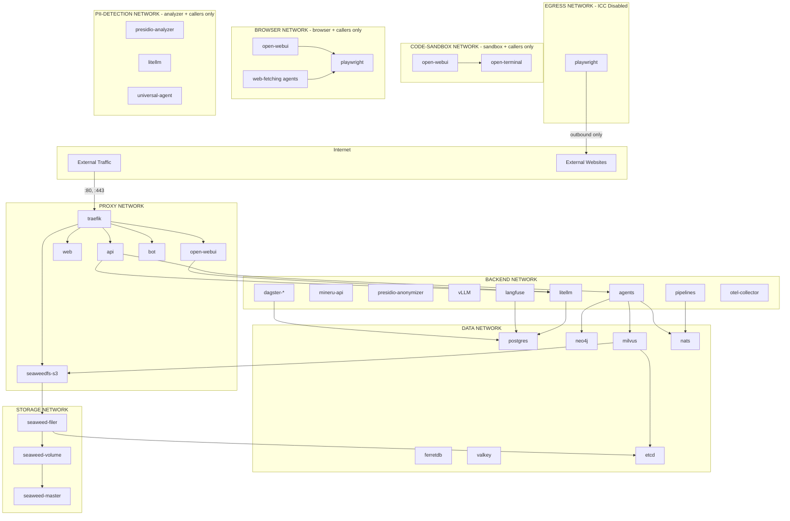

# Docker Network Isolation

The Swiss AI Hub platform implements network segmentation to enforce security boundaries between services. This
defense-in-depth approach limits the blast radius of potential security breaches and enforces the principle of least
privilege at the network layer.

## Network Zones

The platform uses seven isolated Docker networks:

| Network         | Purpose                              | External Access  | ICC Enabled |
| --------------- | ------------------------------------ | ---------------- | ----------- |
| `proxy`         | External traffic via Traefik         | Ingress + Egress | Yes         |
| `backend`       | Internal application services        | No               | Yes         |
| `data`          | Databases and message broker         | No               | Yes         |
| `storage`       | SeaweedFS object storage             | No               | Yes         |
| `egress`        | Outbound internet access only        | Egress only      | No          |
| `code-sandbox`  | Code-execution sandbox + its callers | No               | Yes         |
| `browser`       | Playwright browser + its callers     | No               | Yes         |
| `pii-detection` | PII detection + its callers          | No               | Yes         |

The `egress` network is designed for services that need to reach the internet (outbound) but should not be reachable
from the internet (no ingress). Inter-Container Communication (ICC) is disabled on this network, meaning containers
cannot communicate with each other via this network—they can only use it for outbound internet access.

The `code-sandbox` network is a single-tenant zone for the `open-terminal` code-execution sandbox, which runs arbitrary
user-submitted code. Its membership is the sandbox plus **exactly its callers** (`open-webui`, `universal-agent`, the
one AI-Hub agent that runs code, and `api`, which serves each user's own files). Because Docker networks are
bidirectional, keeping the sandbox off `backend` is what prevents a sandbox breakout from laterally reaching `litellm`,
`vLLM`, `mineru`, `presidio`, `speaches`, or `otel-collector`. ICC stays enabled (the callers must reach
`open-terminal:8000`), and `internal: true` in non-dev stages also denies the sandbox any outbound internet.

The `browser` network applies the same pattern to `playwright`, the headless browser that loads the web pages users link
(see [Linked web pages](../../10_chat_ui/15_linked_web_pages/)). Its members are the browser plus **exactly its
callers**: `open-webui` (its web loader) and the agents that read linked pages. The agents check every URL before the
browser loads it, but the browser resolves the name again, so a name that answers with a public address first and an
internal one second (DNS rebinding) would slip through. Keeping the browser off `backend` means such a page load has no
network path to `litellm`, `langfuse`, `mineru` or the Docker socket proxy. The browser reaches the internet through
`egress`.

The `pii-detection` network holds the `presidio-analyzer`, which receives the personal data the platform anonymises,
plus **exactly its callers** (`litellm` and `universal-agent`). Its models are baked into the image and the Hugging Face
hub is offline at run time, so `internal: true` in non-dev stages denies it outbound internet without breaking it, and
every request except the health probe needs the analyzer's API key.

## Service Network Assignments

Each service is assigned to only the networks it requires for operation:

### Proxy Network Services

Services accessible from outside the Docker network:

- **traefik**: Reverse proxy and API gateway
- **api**: REST API and WebSocket endpoints
- **web**: Admin UI frontend
- **open-webui**: Chat interface
- **bot**: MS Teams/Slack integration
- **seaweedfs-s3**: S3-compatible storage API
- **oauth2proxy-**\*: Authentication proxies

### Backend Network Services

Internal application and processing services:

- **litellm**: LLM gateway and request routing
- **mineru-api**: Document parsing and extraction
- **presidio-anonymizer**: PII anonymization
- **vLLM**: Local LLM inference (chat, embedding, reranking) — GPU deployments only
- **speaches**: Speech-to-text and text-to-speech
- **agents**: All agent workers (rag, expert, wrapping)
- **pipelines**: Data processing pipelines
- **dagster-**\*: Pipeline orchestration
- **langfuse**: AI observability
- **otel-collector**: Telemetry aggregation

### Data Network Services

Persistence and messaging infrastructure:

- **postgres**: Primary PostgreSQL database
- **pgbouncer**: Connection pooler for Dagster
- **postgres-ferretdb**: PostgreSQL backend for FerretDB
- **ferretdb**: MongoDB-compatible document store
- **neo4j**: Graph database for Mem0 memory storage
- **milvus-standalone**: Vector database
- **etcd**: Distributed key-value store (Milvus metadata)
- **valkey**: Redis-compatible in-memory cache
- **nats**: Message broker for event-driven communication

### Storage Network Services

Distributed object storage cluster:

- **seaweedfs-master**: Cluster coordinator
- **seaweedfs-volume**: Data storage nodes
- **seaweedfs-filer**: File system interface
- **seaweedfs-s3**: S3 API gateway
- **etcd**: Filer metadata backend

### Egress Network Services

Services that require outbound internet access but no inbound access:

- **playwright**: Headless browser that loads the web pages users link (needs to fetch web pages)
- **searxng**: Web search (queries external search engines)
- **rclone**: The daemon the rclone source pipeline drives (reaches the cloud storage it syncs from)
- **structured_pipeline**: The structured source pipeline (calls business application APIs such as Jira)
- **imap_agent**, **email_classification_agent**: Read and file mail on external IMAP servers
- **release_notes_agent**: Reads the tickets of a fix version from Jira Cloud or an on-premise Jira Data Center
- **otel-collector**: Exports telemetry to external backends

This network has ICC (Inter-Container Communication) disabled, preventing lateral movement between containers on this
network. Services use `egress` solely for outbound internet access and must use other networks (e.g., `browser` for
`playwright`) for inter-service communication.

### Code-Sandbox Network Services

The single-tenant zone for the code-execution sandbox:

- **open-terminal**: Code execution sandbox for OpenWebUI (plain LLM models; per-user home isolation — see ADR
  `docs/arc42/decisions/2026_06_22_openwebui_code_execution_open_terminal.md`)

The sandbox is the **only** resident; its callers join this network in addition to their own. `open-webui` is attached
to `code-sandbox` (alongside `proxy`/`backend`/`data`/`storage`) so it can reach `open-terminal:8000`, and
`universal-agent` joins it (alongside `backend`/`data`/`storage`) to run code in the asking user's sandbox home, and
`api` joins it to serve each user's own files from there. The `sandbox-mirror` sidecar that copies the homes to S3 reads
the homes volume and sits on `backend` only, never on `code-sandbox`. Because the sandbox shares a network only with its
callers, a breakout has no network path to the `backend` or `data` tiers. In dev, `open-webui` uses `network_mode: host`
and the agents run locally outside Docker, so both reach the sandbox via the published `localhost:8200` port instead.

### Browser Network Services

The zone for the headless browser:

- **playwright**: Loads the web pages users link, for Open WebUI's web loader and the agents' web fetch (see ADR
  `docs/arc42/decisions/2026_10_20_agents_read_linked_web_pages_through_playwright.md`)

The browser is the **only** resident; it also sits on `egress` for the internet. Its callers join `browser` in addition
to their own networks: `open-webui`, and the agents that read linked pages (`llm-wrapping-agent`, `web-fetch-agent`,
`rag-agent`, `expert-rag-agent` and `universal-agent`). A new agent that reads web pages must join it too, or it cannot
reach `ws://playwright:3000`. In dev, Open WebUI and the agents reach the browser via the published `localhost:3036`
port instead.

## Network Topology



## Security Implications

### What Each Network Boundary Protects

**Proxy → Backend Boundary**

- External users cannot directly access internal processing services
- Compromised Traefik cannot reach databases without going through API

**Backend → Data Boundary**

- Processing services access databases through defined interfaces
- Compromised AI service cannot directly manipulate other databases

**Data → Storage Boundary**

- SeaweedFS internal cluster communication is isolated
- Database services cannot interfere with storage operations
- The filer sits on both `storage` and `data` (for etcd), so it advertises its service name (`-ip=seaweedfs-filer`) to
  the master. The S3 gateway looks up the filer through the master and cannot reach a `data` network address.
- The S3 gateway registers with the master too and sits on `storage` and `backend`, so it advertises its service name
  (`-ip=seaweedfs-s3`) the same way.

### Service Visibility Matrix

| From \\ To   | proxy | backend | data | storage | egress | code-sandbox | browser   | Internet |
| ------------ | ----- | ------- | ---- | ------- | ------ | ------------ | --------- | -------- |
| External     | ✓     | ✗       | ✗    | ✗       | ✗      | ✗            | ✗         | -        |
| proxy        | ✓     | ✓       | ✗    | ✗       | ✗      | ✗            | ✗         | ✓        |
| backend      | ✗     | ✓       | ✓    | ✓       | ✗      | ✗            | ✗         | ✗        |
| data         | ✗     | ✗       | ✓    | ✓       | ✗      | ✗            | ✗         | ✗        |
| storage      | ✗     | ✗       | ✗    | ✓       | ✗      | ✗            | ✗         | ✗        |
| egress       | ✗     | ✗       | ✗    | ✗       | ✗\*    | ✗            | ✗         | ✓        |
| code-sandbox | ✗     | ✗       | ✗    | ✗       | ✗      | ✓\*\*        | ✗         | ✗\*\*\*  |
| browser      | ✗     | ✗       | ✗    | ✗       | ✗      | ✗            | ✓\*\*\*\* | ✗\*\*\*  |

\*ICC disabled on egress network - containers cannot communicate with each other via this network.

\*\*Only `open-terminal` and its callers (`open-webui`, `universal-agent`, `api`) reside on `code-sandbox`, so the
sandbox can reach its callers but no other tier.

\*\*\*`internal: true` in non-dev stages blocks outbound internet through this network; in `dev` the network is
non-internal (localhost access), so this guarantee applies to `local`/`build`/`nightly`/`latest` only. `playwright`
reaches the internet through `egress` instead.

\*\*\*\*Only `playwright` and its callers (`open-webui` and the agents that read linked pages) reside on `browser`, so
the browser can reach its callers but no other tier.

## Operational Considerations

### Adding New Services

When adding a new service, determine which networks it needs:

1. **Needs external access (ingress)?** → Add to `proxy`
2. **Is an application service?** → Add to `backend`
3. **Needs database access?** → Add to `data`
4. **Needs object storage?** → Add to `storage`
5. **Needs outbound internet only (no ingress)?** → Add to `egress`
6. **Calls the code sandbox or the browser?** → Add the caller to `code-sandbox` or `browser`; the sandbox and the
   browser never join the caller's other zones

Note: The `egress` network is specifically for services that need to reach external websites/APIs but should not be
reachable from outside. It has ICC disabled, so services on `egress` cannot communicate with each other—use `backend`
for inter-service communication.

### Debugging Network Issues

If a service cannot reach another service:

1. Verify both services are on a common network
2. Check if the target network is marked `internal: true`
3. Use `docker network inspect <network>` to see connected containers
4. Check service names match DNS expectations (container_name)

### Network Inspection Commands

```bash
# List all networks
docker network ls

# Inspect a specific network
docker network inspect backend

# See which networks a container is connected to
docker inspect <container> --format '{{json .NetworkSettings.Networks}}'
```
