# Invite users by email

Some people need access to Swiss AI-Hub but cannot sign in through Entra ID: the organization has no Entra directory, or
the person is external. A Keycloak administrator gives them an account by sending Keycloak's invitation mail. The person
opens the link, verifies the address, sets a password and signs in with email and password.

This page walks through the invitation in the Keycloak admin console and shows what the invited person sees.

<video controls="controls" src="../../../../../media/platform/inviting_users/invite_user_by_email.webm" type="video/webm" />

## Before you start

| You need                                         | Why                                                                                                                                       |
| ------------------------------------------------ | ----------------------------------------------------------------------------------------------------------------------------------------- |
| Realm mail is set up                             | Without a mail server, Keycloak cannot send the invitation. The operator sets it up, see [Realm mail and invitations](../).               |
| A Keycloak admin account for the realm **aihub** | The steps run in the Keycloak admin console. The account needs the `manage-users` role of the `realm-management` client (or realm admin). |
| The tenant already exists                        | The person joins an existing tenant group under `tenants`, see [Setting up tenants](../../../16_multi_tenancy/2_creating_tenants/).       |
| The person's email address                       | It becomes their sign-in name.                                                                                                            |

To check that mail is working, open the sign-in page, choose **Forgot password?** and enter the address of an existing
account that does not sign in through Entra ID. If no mail arrives within a minute, ask the operator to follow
[Check that mail arrives](../#check-that-mail-arrives) before inviting anyone.

## Step 1: Create the user

1. Open the admin console at `https://auth.<domain>/admin` and select the realm **aihub** (shown as *Swiss AI-Hub*).
2. Choose **Users** → **Add user**.
3. Enter the **Email**, and optionally **First name** and **Last name**.
4. Leave **Email verified** off. Opening the invitation link verifies the address.

Don't choose **Create** yet: first add the tenant group in step 2.

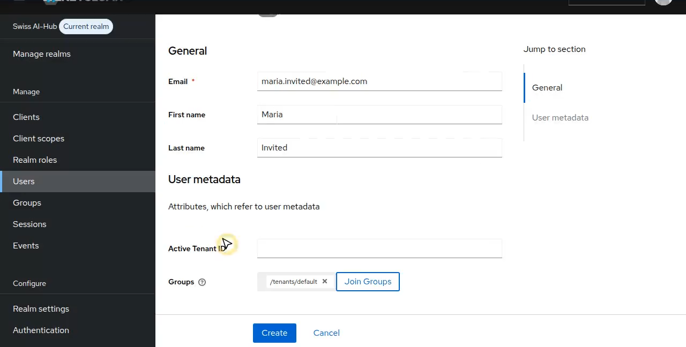

## Step 2: Add the user to the tenant

1. On the same form, next to **Groups**, choose **Join Groups**.
2. Open `tenants`, tick the tenant the person belongs to (for example `default`) and choose **Join**.
3. The group, for example `/tenants/default`, now shows under **Groups**. Choose **Create**.

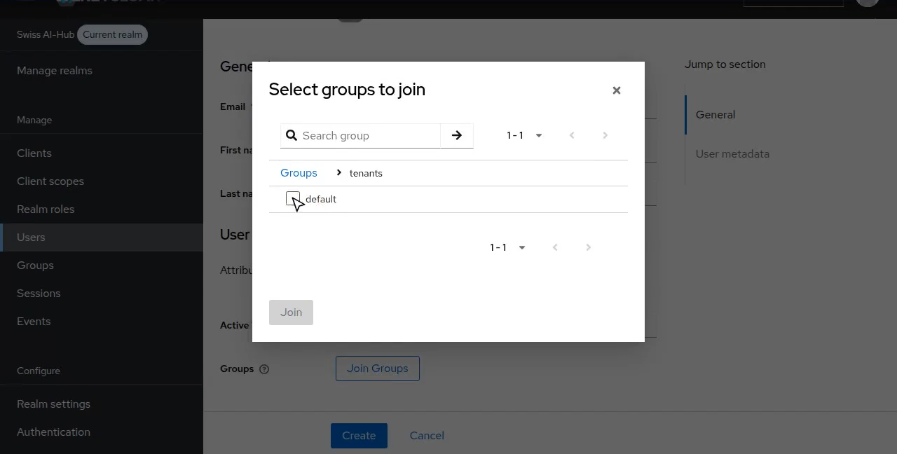

If you created the user without a group, open the user's **Groups** tab and choose **Join Group** there.

## Step 3: Assign the AIHubAccess role

Without the realm role `AIHubAccess`, sign-in to Swiss AI-Hub is denied.

1. On the new user's page, open the **Role mapping** tab.

2. Choose **Assign role** → **Realm roles**.

   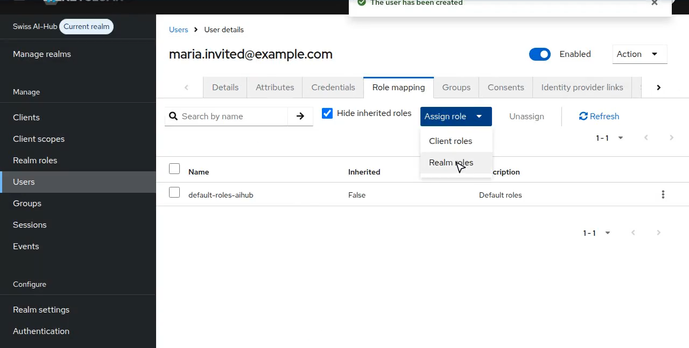

3. Search for `AIHubAccess`, tick it and choose **Assign**.

   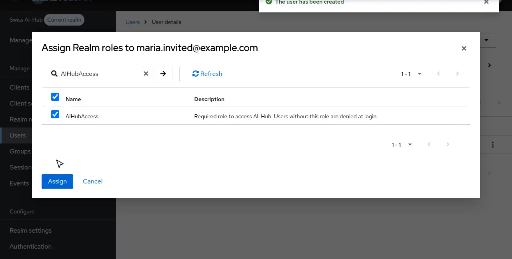

Don't assign `AIHubFederatedUser`. It marks people who sign in through an identity provider, and it blocks password
sign-in.

## Step 4: Send the invitation

1. Open the **Credentials** tab and choose **Credential Reset**.
2. Under **Reset action**, select **Update Password** and **Verify Email**. With both actions, opening the link verifies
   the address and asks for a new password.
3. Under **Expires In**, choose how long the link stays valid, for example 12 hours. Pick a time the person can
   realistically act within, such as one or two working days for external people.
4. Choose **Send Email**.

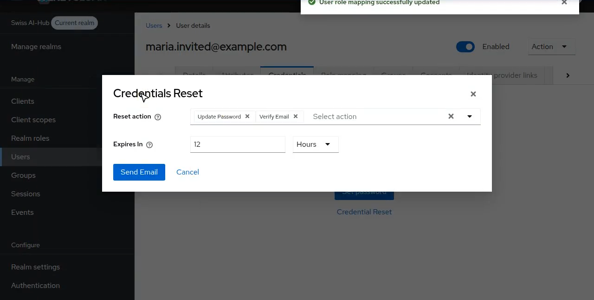

Keycloak confirms with **Email sent to user.**

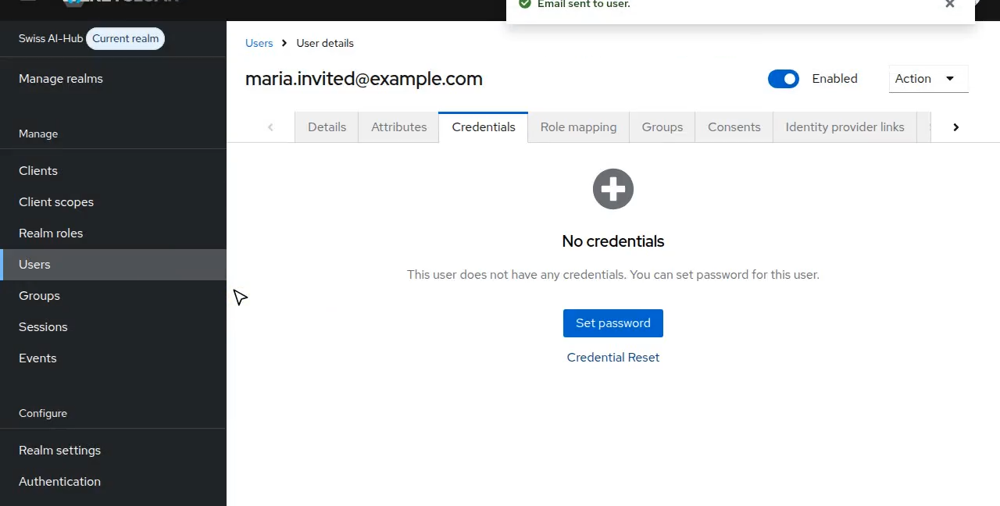

## What the invited person sees

1. A mail titled **Update Your Account** arrives from the realm mail sender (by default "Swiss AI-Hub"). It contains
   **Link to account update** and says how long the link is valid.

   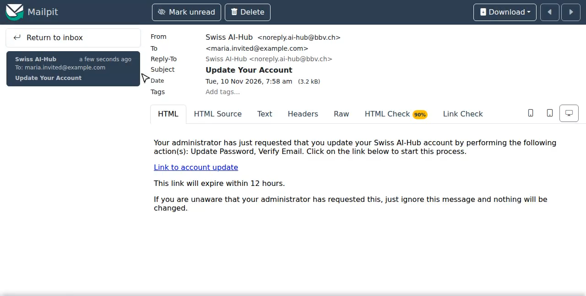

2. The link opens the sign-in page, which asks for a new password. After **Submit**, Keycloak shows **Account updated**
   with a **Go to Swiss AI-Hub** link. The address is now verified.

   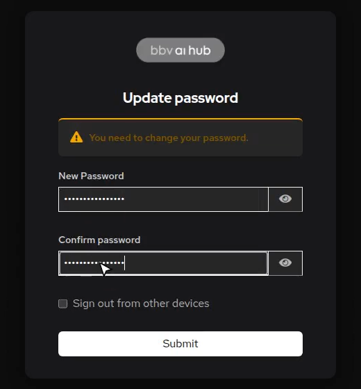

   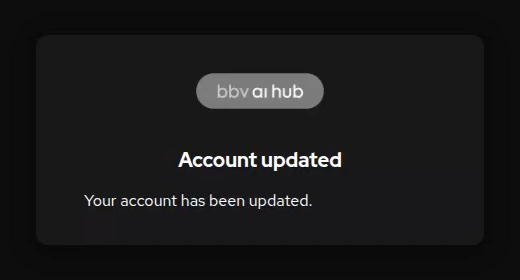

3. The link opens Swiss AI-Hub. The person chooses **Login with Keycloak** and signs in with their email address and the
   new password, and Swiss AI-Hub opens their tenant. They sign in the same way from then on. This also works on
   instances whose other users sign in through Entra ID.

   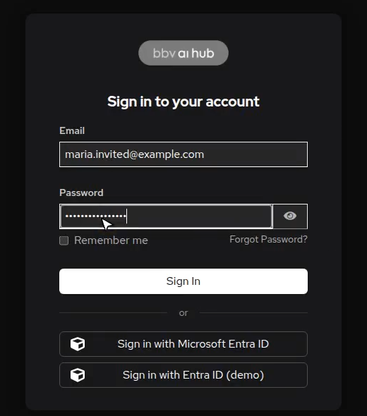

   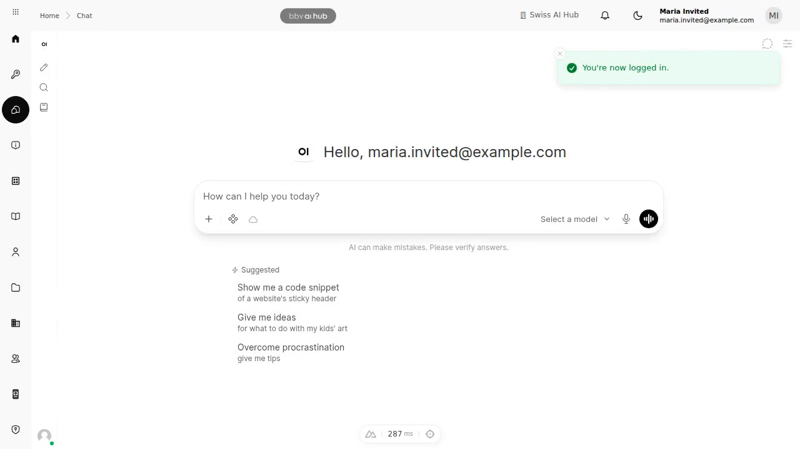

::: tip Screenshots
The screenshots come from a development instance, where a local test mailbox stands in for Microsoft 365. On your
instance, the mail arrives in the person's normal inbox and the sign-in page may show other identity providers.
:::

## Step 5: Give the user a tenant role

The invitation gives access to the platform and the tenant, but no role inside the tenant yet. A tenant administrator
assigns one (for example `AIHubUser`) in the Swiss AI-Hub admin UI under the tenant's users, as for every other user.
See [Managing users and roles](../../../16_multi_tenancy/3_user_management/).

## Resend an invitation

If the link expired or the mail got lost, repeat [step 4](#step-4-send-the-invitation) on the same user. The person uses
the link in the newest mail.

## Troubleshooting

| Problem                                                                                         | Cause and fix                                                                                                                                                                                                                                                             |
| ----------------------------------------------------------------------------------------------- | ------------------------------------------------------------------------------------------------------------------------------------------------------------------------------------------------------------------------------------------------------------------------- |
| **Send Email** fails, or the console shows an error                                             | Realm mail is not set up or not working. The operator checks the Keycloak log, see [Check that mail arrives](../#check-that-mail-arrives).                                                                                                                                |
| Keycloak says the mail was sent, but nothing arrives                                            | Ask the person to check the spam or quarantine folder. Their mail server may block mail from the sender address; their IT can allow it.                                                                                                                                   |
| The link says it has expired                                                                    | The time under **Expires In** has passed. Resend the invitation with a longer lifetime.                                                                                                                                                                                   |
| The person signs in, but access is denied                                                       | `AIHubAccess` is missing. Assign it ([step 3](#step-3-assign-the-aihubaccess-role)).                                                                                                                                                                                      |
| The person signs in, but sees no tenant or an empty tenant                                      | The tenant group is missing ([step 2](#step-2-add-the-user-to-the-tenant)), or no tenant role is assigned ([step 5](#step-5-give-the-user-a-tenant-role)).                                                                                                                |
| **Add user** says the email already exists                                                      | The person already has an account, for example from an earlier Entra sign-in. Don't create a second one: add the existing user to the tenant instead.                                                                                                                     |
| The link or sign-in shows "This account signs in through your organisation's identity provider" | The user has `AIHubFederatedUser` because they signed in through Entra ID at least once. They keep using Entra. To switch them to a password, see [Users who sign in through Entra ID never use a password](../#users-who-sign-in-through-entra-id-never-use-a-password). |
