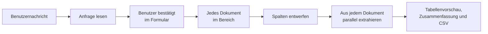

# Wissensextraktions-Agent

Der **Wissensextraktions-Agent** beantwortet Anfragen, die jede passende Zeile aus vielen Dokumenten brauchen, nicht die
wenigen ähnlichsten Abschnitte, die eine Wissenssuche liefert. Ein Benutzer fragt in einer Chat-Nachricht, zum Beispiel
*«Finde alle Rechnungspositionen zu Hardware auf den Rechnungen 2025 von Acme»*, und erhält eine Tabelle zurück: eine
Zeile pro gefundenem Datensatz, jede Zeile mit Pfad und Datei, aus der sie stammt, dazu eine Zusammenfassung, wie viele
Dateien gelesen und wie viele Zeilen gefunden wurden und welche Dateien nicht gelesen werden konnten. Die ganze Tabelle
steht zudem als CSV-Datei zum Herunterladen bereit.

::: tip Wann Sie diesen Agenten einsetzen
Setzen Sie ihn ein, wenn die Antwort eine Liste von Datensätzen ist, die über Dokumente hinweg gesammelt werden:
Rechnungspositionen, Vertragsparteien, Service-Levels, Fristen. Für eine Frage, die ein Abschnitt beantwortet, ist der
[Document Intelligence Assistant](../5_document_intelligence_assistant/) schneller und nennt seine Quellen. Der
[Universal Agent](../13_universal_agent/) bietet dieselbe Extraktion als eines seiner Werkzeuge an, wenn sein Profil die
Dokumentwerkzeuge einschaltet, mit demselben Anfrageformular, bevor er extrahiert.
:::

## Was er tut

1. **Anfrage lesen.** Ein Modellaufruf liest die Nachricht: die Spalten, nach denen der Benutzer fragt, welche Dokumente
   zählen (die Dokumentbedingung), welche Zeilen behalten werden, jeden Ordner und jede Datei, die der Benutzer nennt,
   den Zeitraum, auf den die gesuchten Dokumente datiert sind, und jede verlangte Berechnung. Eine Folgefrage wie
   *«dasselbe für 2024»* wird zusammen mit der Unterhaltung gelesen.
2. **Anfrage bestätigen.** Bevor ein Dokument gelesen wird, zeigt der Agent in einem Formular, was er verstanden hat,
   und der Benutzer bestätigt oder korrigiert es (siehe [Das Anfrageformular](#das-anfrageformular)). Was der Benutzer
   bestätigt, wird gelesen und extrahiert.
3. **Jedes Dokument im Bereich nehmen.** Jedes Dokument in den Sammlungen und im Pfadfilter des Profils wird gelesen,
   eingegrenzt nur durch den bestätigten Ablageort. Eine Datei, die der Benutzer nennt, mit ihrem Pfad oder nur mit
   ihrem Namen, mit oder ohne Endung, meint nur diese Datei, nicht ihren Ordner. Keine Suche entscheidet, welche
   Dokumente zählen, sodass ein Dokument nie übersehen wird, weil es Dinge anders formuliert als die Anfrage. Ein
   Lieferant, eine Vertragspartei oder ein Status ist kein Ort, sondern eine *Dokumentbedingung* (*«von Acme»*, *«nur
   unterschriebene Fassungen»*), die am Anfang jedes Dokuments geprüft wird. Ein Wert, den die Zeilen selbst tragen,
   etwa der Lieferant auf jeder Zeile eines Kontoauszugs, bleibt eine Bedingung an die Zeilen, ebenso ein Zeitraum für
   Zeilen mit eigenem Datum, etwa *Auszugszeilen vom Februar 2025*: Er filtert die Zeilen und wird nicht mit den Pfaden
   abgeglichen, denn der Pfad eines Auszugs nennt den Tag, an dem er ausgestellt wurde, nicht die Tage seiner Buchungen.
   Auch ein Jahr, ein Quartal oder ein anderer Zeitraum ist nie ein Ort: Er wird als Daten gelesen und mit den Daten in
   den Pfaden abgeglichen, sodass ein Dokument, dessen Pfad es ausserhalb des Zeitraums datiert, nicht gelesen wird
   (siehe [Zeiträume und Daten in Pfaden](#zeitr%C3%A4ume-und-daten-in-pfaden)). Mit eingeschaltetem
   [Discovery-Modus](#discovery-modus) sucht stattdessen das Modell nach den Dokumenten.
4. **Spalten entwerfen.** Die Spalten werden aus den Worten des Benutzers entworfen, etwa *Datum, Position, Betrag,
   Währung*. Eine Bedingung wie *«nur Hardware»* entscheidet, welche Zeilen behalten werden, und wird nie zur Spalte.
5. **Extrahieren.** Jedes Dokument wird gelesen und seine passenden Datensätze werden extrahiert, viele Dokumente
   gleichzeitig. Dokumente werden in überlappenden Teilen gelesen, sodass eine Zeile auf der letzten Seite gefunden und
   eine Zeile an der Grenze zwischen zwei Teilen nicht doppelt gezählt wird. Eine Zeile, die die Bedingung vielleicht
   nicht erfüllt, bleibt erhalten und wird in einer Spalte **Treffer** als *unsicher* markiert, sodass eine Person sie
   prüfen kann, statt dass sie verworfen wird. Ein Dokument, dessen Anfang der Dokumentbedingung widerspricht, etwa weil
   er einen anderen Lieferanten nennt, wird nicht weiter gelesen: Es liefert keine Zeilen und wird mit seinem Grund
   unter «Übersprungen» aufgeführt. Ein Dokument, dessen Anfang es nicht entscheidet, wird ganz gelesen, und seine
   Zeilen werden mit *unsicher, bitte prüfen* markiert. Der Zeitraum gehört nur dort zu dieser Prüfung, wo der Pfad ihn
   offenlässt: Ein Dokument, dessen Pfad es ganz innerhalb des Zeitraums datiert, wird nicht daran geprüft.
6. **Antworten.** Die Antwort zeigt die ersten Zeilen der Tabelle (bis zu 100), gefolgt von der Zusammenfassung, und die
   ganze Tabelle als CSV-Datei: im Chat an die Antwort angehängt, über die API als Download-Link. Ein Dokument, das
   nicht gelesen werden konnte, wird mit dem Grund unter der Tabelle aufgeführt; die Zeilen der anderen Dokumente sind
   davon nicht betroffen. Dokumente, die gelesen wurden, aber keine Zeilen ergaben, stehen unter «Keine Zeilen aus»,
   damit ein leeres Ergebnis nie wie eine fehlende Klausel aussieht.

Der Chat zeigt jeden Schritt, während er geschieht: eine Zeile dazu, wie viele Dokumente gelesen werden, welche Spalten
die Tabelle hat und wie lange es ungefähr dauert; eine Zeile, wenn ein langes Dokument beginnt; eine Zeile pro Dokument,
sobald es extrahiert ist, mit seinen ersten Zeilen («12 von 150 · invoice.pdf: 3 Zeilen — Laptop X1, 1,200; Dock D2,
180») oder dem Grund, aus dem es übersprungen wurde («14 von 150 · initech-0412.pdf: übersprungen, Lieferant: Initech
AG»); und, solange ein Dokument länger als eine Minute braucht, eine Zeile, dass es noch gelesen wird. Eine Antwort kann
viele Minuten dauern, wenn viele Dokumente gelesen werden; der Fortschritt zeigt, dass sie noch läuft.

### Das Anfrageformular

Ein falsch gelesener Teil einer Anfrage zeigte sich früher erst in der fertigen Tabelle, nachdem jedes Dokument gelesen
war. Deshalb wird jede neue Tabellenanfrage zuerst zurückgefragt, in vier Teilen:

| Teil                       | Was er sagt                                                                                                                                                                                                                                                                                              | Alternative    |
| -------------------------- | -------------------------------------------------------------------------------------------------------------------------------------------------------------------------------------------------------------------------------------------------------------------------------------------------------- | -------------- |
| **Ablageort**              | Die zu lesenden Ordner oder Dateien. Der Hinweis nennt die grössten Ordner des Bereichs mit ihrer Anzahl.                                                                                                                                                                                                | Alle Dokumente |
| **Dokumentbedingung**      | Welche Dokumente zählen, etwa *von Acme* oder *nur unterschriebene Fassungen*, gefolgt vom Zeitraum, auf den sie datiert sind, etwa *datiert zwischen dem 2026-01-01 und dem 2026-03-31*; am Anfang jedes Dokuments geprüft. *Jedes Dokument*, gewählt oder geschrieben, lässt auch den Zeitraum fallen. | Jedes Dokument |
| **Filterbedingung**        | Welche Datensätze die Tabelle behält, etwa *nur Hardware-Positionen* oder die Zeilen eines Lieferanten auf einem Kontoauszug.                                                                                                                                                                            | Jede Zeile     |
| **Zu extrahierende Werte** | Die Spalten der Tabelle; sie entscheiden, was eine Zeile ist: Rechnungsnummer und Total ergeben eine Zeile pro Rechnung.                                                                                                                                                                                 | —              |

Mit eingeschaltetem **Discovery-Modus** folgen zwei weitere Teile: **Exakte Stichwörter**, Wörter, die die gesuchten
Dokumente wörtlich enthalten (der Name eines Lieferanten, eine Rechnungsnummer), und **Semantische Stichwörter**, wovon
die Dokumente handeln (*Lieferantenrechnung mit Positionen*). Beide sind optionale Hinweise für die Suche, nie Filter,
und jeder bietet *Keine* an.

Jeder Teil ist so ausgefüllt, wie das Modell ihn gelesen hat (*Wie verstanden: …*). Der Benutzer behält ihn, wählt die
Alternative oder schreibt eine eigene Antwort. Ein Teil, den die Anfrage nicht genannt hat, bietet nur die Alternative
an.

Nicht jede Nachricht erhält das Formular. Ein *ja* zu einer
[wartenden Stichprobe](#wenn-mehr-als-100-dokumente-gelesen-w%C3%BCrden) extrahiert sie sofort, und eine Begrüssung oder
eine Frage über den Agenten wird ohne Formular beantwortet.

**Was jeder Client zeigt.** In OpenWebUI ist das Formular ein Dialog mit einer Seite pro Teil, und die Antworten werden
nach dem Absenden im Chat aufgelistet. Der Dialog schliesst sich nach vier Minuten ohne Antwort, eine Grenze, die
OpenWebUI setzt. Wird er abgebrochen, schliesst er sich oder kann er sich nicht öffnen, erscheinen dieselben Fragen als
Chat-Nachricht, die kein Zeitlimit hat. Jeder andere Client (die OpenAI-kompatible API, die Teams- und Slack-Bots, der
Web-Chat) zeigt diese Nachricht, und die nächste Nachricht beantwortet sie:

- *ja* (auch *yes*, *ok*, *oui*, *sì*, *weiter*) extrahiert die Anfrage wie verstanden;
- *nein* (auch *no*, *non*, *cancel*, *stop*, *abbrechen*, *annuler*, *annulla*) lehnt sie ab, und nichts wird gelesen;
- alles andere gilt als Korrektur, etwa *«Ablageort: invoices/2024»*. Die Anfrage wird damit noch einmal gelesen und
  extrahiert, ohne zweites Formular.

**Berechnungen werden genannt, nicht ausgeführt.** Der Agent listet Werte auf; er zählt sie nicht zusammen. Verlangt
eine Anfrage eine Summe, einen Durchschnitt, eine Anzahl, ein Maximum oder einen Vergleich, sagt das Formular *«Ich
berechne … nicht»*, und die Tabelle listet stattdessen den Wert jedes Datensatzes auf. Derselbe Hinweis steht unter der
Tabelle, sodass sich das Total aus der CSV-Datei bilden oder bei einem Assistenten erfragen lässt, der Fragen
beantwortet, etwa dem Wissensassistenten.

### Wenn mehr als 100 Dokumente gelesen würden

Jedes Dokument eines grossen Bereichs zu lesen dauert lange, daher fragt der Agent ab 100 Dokumenten zuerst nach. Die
Antwort zeigt:

- wie viele Dokumente gelesen würden und wie lange das ungefähr dauert;
- was die Tabelle enthalten würde: ihre Spalten und welche Zeilen behalten werden;
- eine **Stichprobe** als Tabelle aus fünf der Dokumente, jenen, die am ehesten enthalten, wonach gefragt wurde: die
  Dokumente, die der Anfrage inhaltlich am nächsten sind; wenn diese Rangfolge keines einordnet, oder mit
  eingeschaltetem **Discovery-Modus**, Dokumente, deren Text nennt, was sie kennzeichnet (einen Lieferanten, eine
  Nummer), danach jene, die typische Wörter der gesuchten Zeilen enthalten;
- wie sich die Dokumente **nach Ordner**, **nach Jahr im Pfad** und **nach Sammlung** aufteilen;
- was Sie tun können: mit *ja* antworten, um alle in einer Antwort zu lesen, oder die Anfrage eingrenzen, zum Beispiel
  auf einen Ordner oder einen kürzeren Zeitraum.

Die Stichprobe kann keine Zeile enthalten, zum Beispiel wenn die gesuchten Datensätze selten sind; die Antwort sagt das
dann und zeigt trotzdem, was die Tabelle enthalten würde. Fragen Sie statt *ja* etwas Neues, ersetzt das die wartende
Anfrage. Bestätigen setzt dieselbe Unterhaltung voraus, daher übergibt ein Client der OpenAI-kompatiblen API bei jeder
Nachricht die `thread_id` der Unterhaltung in `metadata`, wie es die Chat-Oberfläche tut.

Über **Höchstens Dokumente pro Tabelle** (standardmässig 1000) wird nichts gelesen: Die Antwort zeigt eine Stichprobe,
bittet darum, die Anfrage einzugrenzen, und listet die Ordner und Jahre der ersten 1000 Dokumente nach Pfad ohne
Anzahlen auf, da der Rest nicht angesehen wurde.

### Discovery-Modus

Ein Profil kann den **Discovery-Modus** einschalten. Nachdem der Benutzer das Formular bestätigt hat, findet das Modell
die Dokumente mit vier Werkzeugen: Es listet ihre Pfade auf, durchsucht ihren Text nach exakten Begriffen wie einem
Lieferantennamen, ordnet sie nach Bedeutung, um Dokumente zu finden, die andere Wörter oder eine andere Sprache
verwenden, und liest ein Dokument, wenn es unsicher ist. Die bestätigten Stichwörter leiten es: Die exakten Stichwörter
gehen an die Textsuche, die semantischen an die Rangfolge. Dann wählt es die zu lesenden Dokumente aus, und nur diese
werden extrahiert. Das ist bei grossen Sammlungen schneller, aber ein Dokument, das die Suche nicht findet, fehlt in der
Tabelle. Die Suche ist durch **Maximale Entscheidungen** und **Maximale Werkzeugaufrufe** begrenzt; an der Grenze wählt
der Agent nach Ordner aus und prüft die Bedingungen der Anfrage in jedem Dokument, und die Antwort sagt es.

Was immer die Suche gewählt hat, die bestätigten Teile entscheiden: Der bestätigte **Ablageort** ersetzt jeden Pfad, den
die Suche gesetzt hat, die bestätigten **Zu extrahierenden Werte**, die **Dokumentbedingung** und die
**Filterbedingung** werden extrahiert, und der bestätigte Zeitraum wird auf die Daten in den Pfaden der Dokumente
angewendet, die die Suche ausgewählt hat. Die Suche wird angewiesen, nicht nach einem Jahr auszuwählen: Die Anzahl, die
`select_knowledge_documents` meldet, wird gezählt, bevor der Zeitraum angewendet wird.

Ohne Discovery-Modus entscheidet die Rangfolge nach Bedeutung nur, welche Dokumente in die Stichprobe kommen und zuerst
gelesen werden; kein Dokument wird je wegen seines Rangs weggelassen.

::: warning Profile, die vor der Umbenennung gespeichert wurden
Der **Discovery-Modus** ersetzt die Profileinstellung **Zuerst nach den Dokumenten suchen** und steht jetzt unter
**Knowledge Documents**; das Kontrollkästchen **Dokumente nach Bedeutung ordnen** entfällt, da die Rangfolge immer
angeboten wird. Die alten Werte werden ignoriert: Ein Profil, das die Suche eingeschaltet hatte, liest jedes Dokument,
bis der **Discovery-Modus** wieder angekreuzt ist.
:::

::: tip Welcher Modus für welches Profil
Jedes Dokument zu lesen ist der sichere Standard: Nichts wird übersehen. Nennt eine Anfrage einen Lieferanten oder eine
Vertragspartei unter vielen in denselben Ordnern (*"die Hardware von Acme 2025"* über die Rechnungen aller Lieferanten),
überspringt die **Dokumentbedingung** das Dokument jedes anderen Lieferanten nach seinem ersten Teil, sodass seine
Zeilen nie in die Tabelle gelangen; doch jedes Dokument kostet weiterhin mindestens einen Modellaufruf, und ein
Dokument, dessen Anfang seinen Lieferanten nicht nennt, wird ganz gelesen und zur Prüfung markiert. Für Profile, die für
solche genauen, engen Anfragen über grosse gemischte Sammlungen genutzt werden, schalten Sie den **Discovery-Modus**
ein: Nur die Dokumente, die die Suche auswählt, werden gelesen, was schneller und günstiger ist, mit dem Risiko, dass
ein Dokument fehlt, das die Suche nicht findet.
:::

### Zeiträume und Daten in Pfaden

Ein Zeitraum, den die Anfrage nennt, etwa *«die Rechnungen 2025»*, *«Q1 2026»* oder *«seit März 2025»*, wird als sein
erster und letzter Tag gelesen, nie als Ordner: Ein Bestand ohne Jahresordner wird gleich gelesen wie einer mit
Jahresordnern. Der Agent vergleicht den Zeitraum dann per Code mit dem Datum, das der Pfad jedem ausgewählten Dokument
gibt, bevor ein Dokument gelesen wird. Ein Zeitraum für Zeilen mit eigenem Datum, etwa Auszugszeilen, Buchungen,
Transaktionen oder Zeiteinträge, wird nicht mit den Pfaden verglichen: Er bleibt eine Bedingung an die Zeilen, sodass
kein Auszug wegen des Datums in seinem Pfad ausgelassen wird.

Ein Modell kann *«Rechnungssummen 2025»* trotzdem als Ordner `invoices/2025/**` neben dem Zeitraum lesen, was jede
Rechnung ohne Datum im Pfad auslassen würde. Deshalb nimmt der Agent solche Datumsordner aus den Orten, die die erste
Lesung geschrieben hat, bevor das Formular erscheint: Ein Ordner, der nur ein Datum ist (`2025`, `2025/q1`, `2025-03`)
und innerhalb des Zeitraums liegt, wird durch «beliebige Ordner» ersetzt, sodass aus `invoices/2025/**` `invoices/**`
und aus `2025/**` jedes Dokument wird. Das geschieht, nachdem eine Datei, die die Nachricht nennt, den Ordner ersetzt
hat, den das Modell aus ihr gemacht hat, sodass der erweiterte Ordner neben der Datei gelesen wird. Ohne Discovery wird
der Ort nur erweitert. Im [Discovery-Modus](#discovery-modus) erhält die Suche den erweiterten Ort, und ihre eigene
Auswahl entscheidet, welche Dokumente gelesen werden. Ein Datumsordner ausserhalb des Zeitraums oder breiter als dieser
(`invoices/2024/**`, oder `invoices/2025/**` für Q1 2025), ein Ordner, der mehr als ein Datum nennt (`invoices-2025`),
ein Pfad, den der Benutzer schreibt, in dieser oder einer früheren Nachricht und mit `/` oder `\` (*«aus
invoices/2025»*), ein regulärer Ausdruck und ein im Formular geschriebener Ort bleiben, wie sie sind. Behält der Dialog
des Formulars den Ort wie angezeigt bei und wird ein anderer Teil geschrieben, wird die Anfrage noch einmal gelesen und
dieselben Datumsordner werden wieder herausgenommen, während eine Datei oder ein Ordnerpfad, der in diesen Teil
geschrieben wurde, gelesen wird.

| Ein Pfad wie                                                                 | ist datiert auf             |
| ---------------------------------------------------------------------------- | --------------------------- |
| `invoices/2025/a.pdf`, `invoices_2025/a.pdf`                                 | das Jahr 2025               |
| `2026/03/a.pdf`, `2026-03/a.pdf`, `März 2026/a.pdf`, `202603/a.pdf`          | März 2026                   |
| `2026-04-06_scan.pdf`, `20260406.pdf`, `06.04.2026.pdf`, `6. April 2026.pdf` | 6. April 2026               |
| `Q1 2026/a.pdf`, `2026_Q1/a.pdf`, `1. Quartal 2026/a.pdf`                    | das erste Quartal 2026      |
| `Kontoauszug_01.01.2025-31.03.2025.pdf`, `Jan-März 2025/a.pdf`               | 1. Januar bis 31. März 2025 |
| `1-15 März 2025.pdf`, `du 1 au 15 mars 2025.pdf`                             | 1. bis 15. März 2025        |

- **Ordner verschachteln sich.** `2026/03/14/a.pdf` ist der 14. März 2026. Ein Monats-, Quartals- oder Tagesordner zählt
  nur unter einem Ordner, der auf ein Jahr oder einen Monat datiert ist; Monatsnamen werden auf Deutsch, Englisch,
  Französisch und Italienisch gelesen.
- **Tag zuerst.** Numerische Daten werden mit dem Tag zuerst gelesen, wie in der Schweiz: `04-06-2026` ist der 4. Juni
  2026\. Ein Datum, das es so nicht gibt, etwa `04-13-2026`, ergibt kein Datum; die Teile werden nie vertauscht. Eine
  zweistellige Jahreszahl wird nur in `06.04.26` gelesen.
- **Zähler stören nicht.** `Scan_2025-03-15_001.pdf` und `2025-03-15-0001.pdf` sind der 15. März 2025.
- **Ein Monat nach seiner Nummer.** `03 März 2026/` ist der ganze März 2026, da eine zweistellige Zahl, die der eigenen
  Nummer des Monats entspricht, den Monat nummerieren kann; `3. März 2026` und `15 März 2026` sind Tage.
- **Im Zweifel kein Datum.** Ein Pfad, dessen Datum das wahre Datum des Dokuments vielleicht nicht enthält, ergibt
  keines: eine mehrdeutige zweistellige Jahreszahl (`06-04-26`), aufgezählte Monate, Quartale oder Tage, die kein
  Bereich abdeckt (`Jan_Feb_2025`, `Q1_Q2_2025`, `1 und 15 März 2025`), ein Datum, das ein Ende eines offenen Zeitraums
  ist (`ab 2020`, `seit März 2025`, `ab Mitte 2020`, `up to 2019`, `2020-heute`, `Archiv bis 2019`, `2024 und älter`,
  `2020 onwards`, `2020 to date`, `2020+`, `-2019`), eine Zahl mit einem Bindestrich zwischen Leerzeichen vor einem
  Monat (`Kapitel 3 - März 2025`), ein Bereich von Jahren (`2025-2026`, `FY2025`), eine an Buchstaben angehängte
  Jahreszahl, auch neben einem anderen Datum (`Offerte_2024_rev2025.pdf`, `2025er Rechnungen/2024-12-30.pdf`), eine Zahl
  hinter einer Kennung (`Nr. 2024`, `SIA 2024`, `v2025`), ein Jahr vor 1990 oder nach dem nächsten Jahr und Ordner,
  deren Daten sich widersprechen (`2025/20260406.pdf`).

Jedes ausgewählte Dokument ist dann:

- **im Zeitraum**, wenn sein Pfad es ganz innerhalb datiert: Es wird gelesen und nicht am Zeitraum geprüft;
- **über den Rand des Zeitraums hinweg** oder **ohne Datum im Pfad**: Es wird gelesen und an seinem Anfang zusammen mit
  der Dokumentbedingung am Zeitraum geprüft;
- **ausserhalb des Zeitraums**: Es wird nicht gelesen.

Ein Dokument wird nur ausgelassen, wenn sein Pfad es eindeutig ausserhalb des Zeitraums datiert. Die Zusammenfassung
nennt den Zeitraum mit der Dokumentbedingung, dann eine Zeile **Zeitraum nach Pfad** mit der Anzahl der Dokumente, die
darin oder darüber hinweg datiert sind, der ausgelassenen und jener ohne Datum im Pfad, und listet bis zu zehn der
ausgelassenen Pfade auf. Lässt der Zeitraum jedes Dokument aus, sagt die Antwort, wie viele er ausgelassen hat, nennt
einige davon und die Jahre, auf die sie datiert sind, sodass eine Anfrage für das falsche Jahr sofort auffällt.

::: warning Daten mit dem Monat zuerst und Postleitzahlen
Ein Dateiname mit dem Monat zuerst, etwa `04-06-2026` für den 6. April, wird als 4. Juni gelesen, sodass eine Anfrage
für April ihn auslässt. Ein Ordner, der nach einer Postleitzahl im Jahresbereich benannt ist, etwa `2000 Neuchâtel`,
wird als Jahr 2000 gelesen. Die Liste der ausgelassenen Pfade unter der Tabelle zeigt beides.
:::

Das Werkzeug `list_knowledge_documents` des Universal Agent nimmt denselben Zeitraum als `period_start` und `period_end`
entgegen. Siehe die ADR `2026_11_21_document_periods_matched_against_path_dates_by_code`.

### Lange Dokumente

Ein Dokument, das länger ist als **Längstes vollständig gelesenes Dokument** (standardmässig 500.000 Zeichen, einige
hundert Seiten), wird nur in seinen relevanten Teilen gelesen: seinem Anfang, der nennt, was allen Zeilen gemeinsam ist,
und den Teilen, in denen die gesuchten Zeilen am wahrscheinlichsten stehen. Seine Zeilen sind neben dem Dateinamen mit
**(teilweise gelesen)** markiert, und die Zusammenfassung führt es unter «Teilweise gelesen (Zeilen können fehlen)» auf,
weil eine Zeile in einem nicht gelesenen Teil nicht gefunden wird. Siehe ADR
`2026_10_21_partial_reads_of_long_documents_in_record_extraction`.

Ein langes Dokument, das die Dokumentbedingung nicht erfüllt, wird nur in seinem ersten Teil gelesen: Sein Anfang
entscheidet, und seine anderen Teile werden gar nicht gelesen. Siehe ADR
`2026_11_18_document_condition_judged_in_the_first_extraction_window`.

## Was er *nicht* tut

- **Er vergleicht oder gleicht keine Dokumente ab.** Eine Rechnungsposition ihrer Vertragsposition zuzuordnen oder
  Abweichungen zu markieren ist eine andere Aufgabe.
- **Er bewahrt die Datei nicht für immer auf.** Die CSV-Datei wird sieben Tage aufbewahrt; die an einen Chat angehängte
  Kopie bleibt beim Chat.
- **Er liest nie ausserhalb seines Bereichs.** Es werden nur die Sammlungen des Profils verwendet, eingegrenzt auf
  diejenigen, die der anfragende Benutzer lesen darf, und auf den Pfadfilter des Profils. Eine Anfrage nach anderen
  Dokumenten oder eine `#`-Referenz auf eine Sammlung, die das Profil nicht enthält, wird weggelassen, und die Antwort
  sagt es; eine Datei, die der Benutzer ausserhalb des Bereichs nennt, wird als nicht gefunden gemeldet und nie durch
  eine ähnliche ersetzt.

## Grenzen

Jede Anfrage ist begrenzt, und nichts wird gekürzt, ohne dass die Antwort es sagt:

| Grenze                                        | Was an der Grenze geschieht                                                                                               |
| --------------------------------------------- | ------------------------------------------------------------------------------------------------------------------------- |
| **Höchstens Dokumente pro Tabelle**           | Darüber wird nichts gelesen; die Antwort zeigt eine Stichprobe und bittet darum, die Anfrage einzugrenzen.                |
| **Mehr als 100 Dokumente**                    | Zuerst eine Stichprobe; alles wird gelesen, sobald der Benutzer bestätigt.                                                |
| **Längstes vollständig gelesenes Dokument**   | Ein längeres Dokument wird in seinen relevanten Teilen gelesen, und seine Zeilen werden als *teilweise gelesen* markiert. |
| **Gleichzeitige Modellaufrufe**               | Wie viele Extraktionsaufrufe eine Agenteninstanz gleichzeitig macht; begrenzt die Last und wie lange es dauert.           |
| **Maximale Entscheidungen / Werkzeugaufrufe** | Nur mit **Discovery-Modus**: Die Suche bricht ab, und der Agent wählt nach Ordner aus.                                    |
| **In der Antwort gezeigte Zeilen**            | Die ersten 100 Zeilen (weniger, wenn sie sehr lang sind); die CSV-Datei enthält jede Zeile, mit jeder Zelle vollständig.  |

Ist eine Sammlung, aus der die Stichprobe stammt, beim Bestätigen nicht mehr verfügbar, wird nichts gelesen, und die
Antwort sagt es; fragen Sie erneut, um aus dem Verfügbaren zu extrahieren.

## Einrichtung

1. **Blueprint freigeben.** Der Wissensextraktions-Agent gehört nicht zum Standardumfang eines neuen Mandanten; ein
   Sysadmin gibt ihn frei (siehe [Zugriffskontrolle](../../16_multi_tenancy/4_access_control/)).
2. **Profil erstellen.** Wählen Sie unter **Admin > Agents > Blueprints** den **Wissensextraktions-Agent** und klicken
   Sie auf **Create Profile**, oder starten Sie mit der Vorlage **Dokumenttabellen**.
3. **Sammlungen wählen.** Listen Sie unter **Knowledge Tool** die Datenbanken und Sammlungen auf, mit denen der Agent
   arbeitet. Beim Speichern wird geprüft, ob Sie sie lesen dürfen.
4. **Pfadfilter setzen** (empfohlen). Unter **Knowledge Documents** beschränkt ein Muster wie `invoices/**` den Agenten
   auf passende Dokumente; er kann nie ausserhalb davon suchen. Jede Anfrage liest jedes Dokument in diesem Bereich,
   daher hält ein enger Bereich die Antworten schnell.
5. **Modelle wählen.** Das Hauptmodell liest die Anfrage und entwirft die Spalten. Das **Extraktionsmodell** liest jedes
   Dokument; ein kleineres, günstigeres Modell genügt.
6. **Grenzen prüfen** und speichern.

## Konfigurationsreferenz

| Feld                                                           | Standard    | Beschreibung                                                                                                         |
| -------------------------------------------------------------- | ----------- | -------------------------------------------------------------------------------------------------------------------- |
| **Anweisungen**                                                | *(leer)*    | Werden den Anweisungen des Agenten angefügt, z. B. wie Dokumente benannt sind.                                       |
| **Knowledge Tool > Sammlungen**                                | —           | Die Datenbanken und Sammlungen, mit denen der Agent arbeitet.                                                        |
| **Knowledge Documents > Filter für Dokumentpfade**             | *(leer)*    | Nur Dokumente, deren Pfad diesem Muster entspricht, z. B. `invoices/2025/**`.                                        |
| **Knowledge Documents > Discovery-Modus**                      | aus         | Das Modell sucht nach den Dokumenten und liest nur die ausgewählten; das Formular fragt dann auch nach Stichwörtern. |
| **Table Extraction > Extraktionsmodell**                       | Hauptmodell | Das Modell, das jedes Dokument liest und seine Zeilen extrahiert.                                                    |
| **Table Extraction > Höchstens Dokumente pro Tabelle**         | `1000`      | Darüber wird der Benutzer nur gebeten, die Anfrage einzugrenzen.                                                     |
| **Table Extraction > Längstes vollständig gelesenes Dokument** | `500000`    | Längere Dokumente (in Zeichen) werden in ihren relevanten Teilen gelesen.                                            |
| **Table Extraction > Gleichzeitige Modellaufrufe**             | `4`         | Extraktionsaufrufe, die eine Agenteninstanz gleichzeitig macht.                                                      |
| **Tools > Maximale Entscheidungen / Maximale Werkzeugaufrufe** | `15` / `30` | Wie lange das Modell suchen darf, mit **Discovery-Modus**.                                                           |
