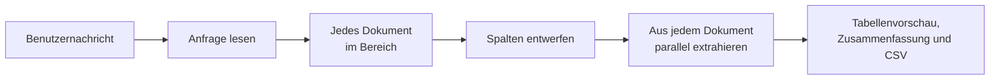

# Wissensextraktions-Agent

Der **Wissensextraktions-Agent** beantwortet Anfragen, die jede passende Zeile aus vielen Dokumenten brauchen, nicht die
wenigen ähnlichsten Abschnitte, die eine Wissenssuche liefert. Ein Benutzer fragt in einer Chat-Nachricht, zum Beispiel
*«Finde alle Rechnungspositionen zu Hardware auf den Rechnungen 2025 von Acme»*, und erhält eine Tabelle zurück: eine
Zeile pro gefundenem Datensatz, jede Zeile mit Pfad und Datei, aus der sie stammt, dazu eine Zusammenfassung, wie viele
Dateien gelesen und wie viele Zeilen gefunden wurden und welche Dateien nicht gelesen werden konnten. Die ganze Tabelle
steht zudem als CSV-Datei zum Herunterladen bereit.

::: tip Wann Sie diesen Agenten einsetzen
Setzen Sie ihn ein, wenn die Antwort eine Liste von Datensätzen ist, die über Dokumente hinweg gesammelt werden:
Rechnungspositionen, Vertragsparteien, Service-Levels, Fristen. Für eine Frage, die ein Abschnitt beantwortet, ist der
[Document Intelligence Assistant](../5_document_intelligence_assistant/) schneller und nennt seine Quellen. Der
[Universal Agent](../13_universal_agent/) bietet dieselbe Extraktion als eines seiner Werkzeuge an, wenn sein Profil die
Dokumentwerkzeuge einschaltet.
:::

## Was er tut

1. **Anfrage lesen.** Ein Modellaufruf liest die Nachricht: die Spalten, nach denen der Benutzer fragt, welche Zeilen
   behalten werden, und jeden Ordner, jede Datei oder jedes Jahr, die der Benutzer nennt. Eine Folgefrage wie *«dasselbe
   für 2024»* wird zusammen mit der Unterhaltung gelesen.
2. **Jedes Dokument im Bereich nehmen.** Jedes Dokument in den Sammlungen und im Pfadfilter des Profils wird gelesen,
   eingegrenzt nur durch die Ordner, Dateien oder Jahre, die der Benutzer genannt hat. Keine Suche entscheidet, welche
   Dokumente zählen, sodass ein Dokument nie übersehen wird, weil es Dinge anders formuliert als die Anfrage. Ein
   Lieferant oder ein Thema ist eine Bedingung an die Zeilen, kein Ort: *«von Acme»* behält die Zeilen von Acme, es
   wählt keine Dokumente aus.
3. **Spalten entwerfen.** Die Spalten werden aus den Worten des Benutzers entworfen, etwa *Datum, Position, Betrag,
   Währung*. Eine Bedingung wie *«nur Hardware»* entscheidet, welche Zeilen behalten werden, und wird nie zur Spalte.
4. **Extrahieren.** Jedes Dokument wird gelesen und seine passenden Datensätze werden extrahiert, viele Dokumente
   gleichzeitig. Dokumente werden in überlappenden Teilen gelesen, sodass eine Zeile auf der letzten Seite gefunden und
   eine Zeile an der Grenze zwischen zwei Teilen nicht doppelt gezählt wird. Eine Zeile, die die Bedingung vielleicht
   nicht erfüllt, bleibt erhalten und wird in einer Spalte **Treffer** als *unsicher* markiert, sodass eine Person sie
   prüfen kann, statt dass sie verworfen wird. Eine Bedingung an das ganze Dokument, etwa sein Lieferant, eine
   Vertragspartei oder ein Jahr, gilt für jede seiner Zeilen: Ein Dokument, das sie eindeutig nicht erfüllt, liefert
   keine Zeilen und wird unter „Keine Zeilen aus“ aufgeführt.
5. **Antworten.** Die Antwort zeigt die ersten Zeilen der Tabelle (bis zu 100), gefolgt von der Zusammenfassung, und die
   ganze Tabelle als CSV-Datei: im Chat an die Antwort angehängt, über die API als Download-Link. Ein Dokument, das
   nicht gelesen werden konnte, wird mit dem Grund unter der Tabelle aufgeführt; die Zeilen der anderen Dokumente sind
   davon nicht betroffen. Dokumente, die gelesen wurden, aber keine Zeilen ergaben, stehen unter «Keine Zeilen aus»,
   damit ein leeres Ergebnis nie wie eine fehlende Klausel aussieht.

Der Chat zeigt jeden Schritt, während er geschieht: eine Zeile dazu, wie viele Dokumente gelesen werden, welche Spalten
die Tabelle hat und wie lange es ungefähr dauert; eine Zeile, wenn ein langes Dokument beginnt; eine Zeile pro Dokument,
sobald es extrahiert ist, mit seinen ersten Zeilen («12 von 150 · invoice.pdf: 3 Zeilen — Laptop X1, 1,200; Dock D2,
180»); und, solange ein Dokument länger als eine Minute braucht, eine Zeile, dass es noch gelesen wird. Eine Antwort
kann viele Minuten dauern, wenn viele Dokumente gelesen werden; der Fortschritt zeigt, dass sie noch läuft.

### Wenn mehr als 100 Dokumente gelesen würden

Jedes Dokument eines grossen Bereichs zu lesen dauert lange, daher fragt der Agent ab 100 Dokumenten zuerst nach. Die
Antwort zeigt:

- wie viele Dokumente gelesen würden und wie lange das ungefähr dauert;
- was die Tabelle enthalten würde: ihre Spalten und welche Zeilen behalten werden;
- eine **Stichprobe** als Tabelle aus fünf der Dokumente, jenen, die am ehesten enthalten, wonach gefragt wurde:
  Dokumente, deren Text nennt, was sie kennzeichnet (einen Lieferanten, eine Nummer), danach jene, die typische Wörter
  der gesuchten Zeilen enthalten;
- wie sich die Dokumente **nach Ordner**, **nach Jahr im Pfad** und **nach Sammlung** aufteilen;
- was Sie tun können: mit *ja* antworten, um alle in einer Antwort zu lesen, oder die Anfrage eingrenzen, zum Beispiel
  auf einen Ordner oder ein Jahr.

Die Stichprobe kann keine Zeile enthalten, zum Beispiel wenn die gesuchten Datensätze selten sind; die Antwort sagt das
dann und zeigt trotzdem, was die Tabelle enthalten würde. Fragen Sie statt *ja* etwas Neues, ersetzt das die wartende
Anfrage. Bestätigen setzt dieselbe Unterhaltung voraus, daher übergibt ein Client der OpenAI-kompatiblen API bei jeder
Nachricht die `thread_id` der Unterhaltung in `metadata`, wie es die Chat-Oberfläche tut.

Über **Höchstens Dokumente pro Tabelle** (standardmässig 1000) wird nichts gelesen: Die Antwort zeigt eine Stichprobe,
bittet darum, die Anfrage einzugrenzen, und listet die Ordner und Jahre der ersten 1000 Dokumente nach Pfad ohne
Anzahlen auf, da der Rest nicht angesehen wurde.

### Zuerst nach den Dokumenten suchen

Ein Profil kann **Zuerst nach den Dokumenten suchen** einschalten. Das Modell arbeitet sich dann mit drei Werkzeugen
durch die Dokumente (es listet ihre Pfade auf, durchsucht ihren Text nach exakten Begriffen wie einem Lieferantennamen
und liest ein Dokument, wenn es unsicher ist) und wählt die zu lesenden Dokumente aus; nur diese werden extrahiert. Das
ist bei grossen Sammlungen schneller, aber ein Dokument, das die Suche nicht findet, fehlt in der Tabelle. Die Suche ist
durch **Maximale Entscheidungen** und **Maximale Werkzeugaufrufe** begrenzt; an der Grenze wählt der Agent nach Ordner
aus und prüft die Bedingungen der Anfrage in jedem Dokument, und die Antwort sagt es.

Mit **Dokumente nach Bedeutung ordnen** ordnet die Suche die Dokumente zusätzlich nach Bedeutung und findet so
Dokumente, die andere Wörter oder eine andere Sprache als die Anfrage verwenden. Im Standardmodus entscheidet dieselbe
Rangfolge nur, welche Dokumente in die Stichprobe kommen und zuerst gelesen werden; kein Dokument wird je wegen seines
Rangs weggelassen.

::: tip Welcher Modus für welches Profil
Jedes Dokument zu lesen ist der sichere Standard: Nichts wird übersehen, aber die Zeilen jedes Dokuments beurteilt das
Extraktionsmodell für sich allein. Nennt eine Anfrage einen Lieferanten oder eine Vertragspartei unter vielen in
denselben Ordnern (*"die Hardware von Acme 2025"* über die Rechnungen aller Lieferanten), behält diese Beurteilung ab
und zu eine Zeile aus dem Dokument eines anderen Lieferanten, und jedes Dokument kostet einen Modellaufruf. Für Profile,
die für solche genauen, engen Anfragen über grosse gemischte Sammlungen genutzt werden, schalten Sie **Zuerst nach den
Dokumenten suchen** ein: Nur die Dokumente, die die Suche auswählt, werden gelesen, was schneller und günstiger ist, mit
dem Risiko, dass ein Dokument fehlt, das die Suche nicht findet.
:::

### Lange Dokumente

Ein Dokument, das länger ist als **Längstes vollständig gelesenes Dokument** (standardmässig 500.000 Zeichen, einige
hundert Seiten), wird nur in seinen relevanten Teilen gelesen: seinem Anfang, der nennt, was allen Zeilen gemeinsam ist,
und den Teilen, in denen die gesuchten Zeilen am wahrscheinlichsten stehen. Seine Zeilen sind neben dem Dateinamen mit
**(teilweise gelesen)** markiert, und die Zusammenfassung führt es unter «Teilweise gelesen (Zeilen können fehlen)» auf,
weil eine Zeile in einem nicht gelesenen Teil nicht gefunden wird. Siehe ADR
`2026_10_21_partial_reads_of_long_documents_in_record_extraction`.

## Was er *nicht* tut

- **Er vergleicht oder gleicht keine Dokumente ab.** Eine Rechnungsposition ihrer Vertragsposition zuzuordnen oder
  Abweichungen zu markieren ist eine andere Aufgabe.
- **Er bewahrt die Datei nicht für immer auf.** Die CSV-Datei wird sieben Tage aufbewahrt; die an einen Chat angehängte
  Kopie bleibt beim Chat.
- **Er liest nie ausserhalb seines Bereichs.** Es werden nur die Sammlungen des Profils verwendet, eingegrenzt auf
  diejenigen, die der anfragende Benutzer lesen darf, und auf den Pfadfilter des Profils. Eine Anfrage nach anderen
  Dokumenten oder eine `#`-Referenz auf eine Sammlung, die das Profil nicht enthält, wird weggelassen, und die Antwort
  sagt es; eine Datei, die der Benutzer ausserhalb des Bereichs nennt, wird als nicht gefunden gemeldet und nie durch
  eine ähnliche ersetzt.

## Grenzen

Jede Anfrage ist begrenzt, und nichts wird gekürzt, ohne dass die Antwort es sagt:

| Grenze                                        | Was an der Grenze geschieht                                                                                               |
| --------------------------------------------- | ------------------------------------------------------------------------------------------------------------------------- |
| **Höchstens Dokumente pro Tabelle**           | Darüber wird nichts gelesen; die Antwort zeigt eine Stichprobe und bittet darum, die Anfrage einzugrenzen.                |
| **Mehr als 100 Dokumente**                    | Zuerst eine Stichprobe; alles wird gelesen, sobald der Benutzer bestätigt.                                                |
| **Längstes vollständig gelesenes Dokument**   | Ein längeres Dokument wird in seinen relevanten Teilen gelesen, und seine Zeilen werden als *teilweise gelesen* markiert. |
| **Gleichzeitige Modellaufrufe**               | Wie viele Extraktionsaufrufe eine Agenteninstanz gleichzeitig macht; begrenzt die Last und wie lange es dauert.           |
| **Maximale Entscheidungen / Werkzeugaufrufe** | Nur mit **Zuerst nach den Dokumenten suchen**: Die Suche bricht ab, und der Agent wählt nach Ordner aus.                  |
| **In der Antwort gezeigte Zeilen**            | Die ersten 100 Zeilen (weniger, wenn sie sehr lang sind); die CSV-Datei enthält jede Zeile, mit jeder Zelle vollständig.  |

Ist eine Sammlung, aus der die Stichprobe stammt, beim Bestätigen nicht mehr verfügbar, wird nichts gelesen, und die
Antwort sagt es; fragen Sie erneut, um aus dem Verfügbaren zu extrahieren.

## Einrichtung

1. **Blueprint freigeben.** Der Wissensextraktions-Agent gehört nicht zum Standardumfang eines neuen Mandanten; ein
   Sysadmin gibt ihn frei (siehe [Zugriffskontrolle](../../16_multi_tenancy/4_access_control/)).
2. **Profil erstellen.** Wählen Sie unter **Admin > Agents > Blueprints** den **Wissensextraktions-Agent** und klicken
   Sie auf **Create Profile**, oder starten Sie mit der Vorlage **Dokumenttabellen**.
3. **Sammlungen wählen.** Listen Sie unter **Knowledge Tool** die Datenbanken und Sammlungen auf, mit denen der Agent
   arbeitet. Beim Speichern wird geprüft, ob Sie sie lesen dürfen.
4. **Pfadfilter setzen** (empfohlen). Unter **Knowledge Documents** beschränkt ein Muster wie `invoices/**` den Agenten
   auf passende Dokumente; er kann nie ausserhalb davon suchen. Jede Anfrage liest jedes Dokument in diesem Bereich,
   daher hält ein enger Bereich die Antworten schnell.
5. **Modelle wählen.** Das Hauptmodell liest die Anfrage und entwirft die Spalten. Das **Extraktionsmodell** liest jedes
   Dokument; ein kleineres, günstigeres Modell genügt.
6. **Grenzen prüfen** und speichern.

## Konfigurationsreferenz

| Feld                                                           | Standard    | Beschreibung                                                                               |
| -------------------------------------------------------------- | ----------- | ------------------------------------------------------------------------------------------ |
| **Anweisungen**                                                | *(leer)*    | Werden den Anweisungen des Agenten angefügt, z. B. wie Dokumente benannt sind.             |
| **Zuerst nach den Dokumenten suchen**                          | aus         | Das Modell sucht nach den Dokumenten und liest nur die ausgewählten.                       |
| **Knowledge Tool > Sammlungen**                                | —           | Die Datenbanken und Sammlungen, mit denen der Agent arbeitet.                              |
| **Knowledge Documents > Filter für Dokumentpfade**             | *(leer)*    | Nur Dokumente, deren Pfad diesem Muster entspricht, z. B. `invoices/2025/**`.              |
| **Knowledge Documents > Dokumente nach Bedeutung ordnen**      | aus         | Dokumente nach Bedeutung ordnen: in der Suche und um festzulegen, was zuerst gelesen wird. |
| **Table Extraction > Extraktionsmodell**                       | Hauptmodell | Das Modell, das jedes Dokument liest und seine Zeilen extrahiert.                          |
| **Table Extraction > Höchstens Dokumente pro Tabelle**         | `1000`      | Darüber wird der Benutzer nur gebeten, die Anfrage einzugrenzen.                           |
| **Table Extraction > Längstes vollständig gelesenes Dokument** | `500000`    | Längere Dokumente (in Zeichen) werden in ihren relevanten Teilen gelesen.                  |
| **Table Extraction > Gleichzeitige Modellaufrufe**             | `4`         | Extraktionsaufrufe, die eine Agenteninstanz gleichzeitig macht.                            |
| **Tools > Maximale Entscheidungen / Maximale Werkzeugaufrufe** | `15` / `30` | Wie lange das Modell suchen darf, mit **Zuerst nach den Dokumenten suchen**.               |
