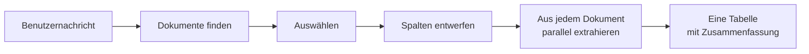

# Wissensextraktions-Agent

Der **Wissensextraktions-Agent** beantwortet Anfragen, die jede passende Zeile aus vielen Dokumenten brauchen, nicht die
wenigen ähnlichsten Abschnitte, die eine Wissenssuche liefert. Ein Benutzer fragt in einer Chat-Nachricht, zum Beispiel
*«Finde alle Rechnungspositionen zu Hardware auf den Rechnungen 2025 von Acme»*, und erhält eine Tabelle zurück: eine
Zeile pro gefundenem Datensatz, jede Zeile mit Pfad und Datei, aus der sie stammt, dazu eine Zusammenfassung, wie viele
Dateien gelesen und wie viele Zeilen gefunden wurden und welche Dateien nicht gelesen werden konnten.

::: tip Wann Sie diesen Agenten einsetzen
Setzen Sie ihn ein, wenn die Antwort eine Liste von Datensätzen ist, die über Dokumente hinweg gesammelt werden:
Rechnungspositionen, Vertragsparteien, Service-Levels, Fristen. Für eine Frage, die ein Abschnitt beantwortet, ist der
[Document Intelligence Assistant](../5_document_intelligence_assistant/) schneller und nennt seine Quellen. Der
[Universal Agent](../13_universal_agent/) bietet dieselbe Extraktion als eines seiner Werkzeuge an, wenn sein Profil die
Dokumentwerkzeuge einschaltet.
:::

## Was er tut

1. **Dokumente finden.** Das Modell arbeitet sich mit drei Werkzeugen durch die Dokumente der Sammlungen des Profils: Es
   listet ihre Pfade auf, durchsucht ihren Text nach exakten Begriffen wie einem Lieferantennamen oder einer Jahreszahl
   und liest ein Dokument, wenn es unsicher ist. Dabei bleibt es jederzeit innerhalb der Sammlungen und des Pfadfilters
   des Profils.
2. **Auswählen.** Sobald das Modell die Dokumente kennt, beschreibt es sie, zum Beispiel *«Rechnungen aus 2025, die Acme
   erwähnen»*, zusammen mit den gewünschten Spalten und den zu behaltenden Zeilen. Es sieht, wie viele Dokumente das
   sind, und passt die Beschreibung an, wenn die Anzahl oder die Beispiele nicht stimmen.
3. **Spalten entwerfen.** Die Spalten werden aus den Worten des Benutzers entworfen, etwa *Datum, Position, Betrag,
   Währung*. Eine Bedingung wie *«nur Hardware»* entscheidet, welche Zeilen behalten werden, und wird nie zur Spalte.
4. **Extrahieren.** Jedes ausgewählte Dokument wird gelesen und seine passenden Datensätze werden extrahiert, viele
   Dokumente gleichzeitig. Dokumente werden in überlappenden Teilen gelesen, sodass eine Zeile auf der letzten Seite
   gefunden und eine Zeile an der Grenze zwischen zwei Teilen nicht doppelt gezählt wird. Eine Zeile, die die Bedingung
   vielleicht nicht erfüllt, bleibt erhalten und wird in einer Spalte **Treffer** als *unsicher* markiert, sodass eine
   Person sie prüfen kann, statt dass sie verworfen wird.
5. **Antworten.** Die Tabelle erscheint im Chat, gefolgt von der Zusammenfassung. Ein Dokument, das nicht gelesen werden
   konnte, wird mit dem Grund unter der Tabelle aufgeführt; die Zeilen der anderen Dokumente sind davon nicht betroffen.
   Dokumente, die gelesen wurden, aber keine Zeilen ergaben, stehen unter «Keine Zeilen aus», damit ein leeres Ergebnis
   nie wie eine fehlende Klausel aussieht.

Der Chat zeigt jeden Schritt, während er geschieht: die Werkzeuge, die das Modell bei der Suche nach Dokumenten aufruft,
eine Zeile dazu, wie viele Dokumente gelesen werden, welche Spalten die Tabelle hat und wie lange es ungefähr dauert,
und eine Zeile pro Dokument, sobald es extrahiert ist («12 von 25 · invoice.pdf: 3 Zeilen»).

### Wenn mehr Dokumente passen, als eine Antwort extrahiert

Nichts wird stillschweigend gekürzt. Wenn das Extrahieren der Dokumente länger als etwa fünf Minuten dauern würde
(**Minuten pro Antwort**) oder es mehr als **Dateien pro Antwort** sind, extrahiert der Agent sie nicht alle auf einmal.
Die Antwort zeigt:

- wie viele Dokumente passen und wie lange es ungefähr dauern würde, sie alle zu extrahieren;
- wie sie sich **nach Ordner**, **nach Jahr im Pfad** und **nach Sammlung** aufteilen;
- eine **Stichprobe** als Tabelle aus drei von ihnen, sodass Sie die Spalten und Zeilen sehen, bevor Sie sich festlegen;
- was Sie tun können: die Anfrage eingrenzen, zum Beispiel auf einen Ordner oder ein Jahr, oder mit *weiter* antworten,
  um alle in Teilen zu extrahieren.

Jedes *weiter* extrahiert den nächsten Teil und antwortet mit dessen Tabelle, seiner Position («Teil 2 von 4: Dokumente
26–50 von 98») und dem Hinweis, wie es weitergeht; der letzte Teil nennt die Gesamtzahlen. Die Teile behalten die
Spalten des ersten. Fragen Sie stattdessen etwas Neues, ersetzt das die unvollständige Extraktion. Über **Höchstens
passende Dokumente** (standardmässig 1000) wird nur das Eingrenzen angeboten; die Antwort nennt dann «mehr als 1000» und
listet die Ordner und Jahre der ersten 1000 Dokumente nach Pfad ohne Anzahlen auf, da der Rest nicht angesehen wurde.

Fortfahren setzt dieselbe Unterhaltung voraus: Die unvollständige Extraktion wird mit dem Chat gespeichert, daher
übergibt ein Client der OpenAI-kompatiblen API bei jeder Nachricht die `thread_id` der Unterhaltung in `metadata`, wie
es die Chat-Oberfläche tut.

Dasselbe gilt für Zeilen: Findet eine Antwort mehr Zeilen als **Zeilen in der Tabelle**, werden die übrigen zuerst
gezeigt, wenn Sie mit *weiter* antworten.

### Lange Dokumente

Ein Dokument, das länger ist als **Längstes vollständig gelesenes Dokument** (standardmässig 500.000 Zeichen, einige
hundert Seiten), wird nur in seinen relevanten Teilen gelesen: seinem Anfang, der nennt, was allen Zeilen gemeinsam ist,
und den Teilen, in denen die gesuchten Zeilen am wahrscheinlichsten stehen. Seine Zeilen sind neben dem Dateinamen mit
**(teilweise gelesen)** markiert, und die Zusammenfassung führt es unter «Teilweise gelesen (Zeilen können fehlen)» auf,
weil eine Zeile in einem nicht gelesenen Teil nicht gefunden wird. Siehe ADR
`2026_10_21_partial_reads_of_long_documents_in_record_extraction`.

## Was er *nicht* tut

- **Er vergleicht oder gleicht keine Dokumente ab.** Eine Rechnungsposition ihrer Vertragsposition zuzuordnen oder
  Abweichungen zu markieren ist eine andere Aufgabe.
- **Er fragt vor dem Extrahieren nicht nach einer Freigabe.** Die Extraktion beginnt, sobald die Dokumente ausgewählt
  sind.
- **Er liefert die Tabelle nicht als Datei.** Die Tabelle ist Teil der Antwort; kopieren Sie sie oder stellen Sie eine
  Folgefrage.
- **Er liest nie ausserhalb seines Bereichs.** Es werden nur die Sammlungen des Profils verwendet, eingegrenzt auf
  diejenigen, die der anfragende Benutzer lesen darf, und auf den Pfadfilter des Profils. Eine Anfrage nach anderen
  Dokumenten oder eine `#`-Referenz auf eine Sammlung, die das Profil nicht enthält, wird weggelassen, und die Antwort
  sagt es.

## Grenzen

Jede Anfrage ist begrenzt, und nichts wird gekürzt, ohne dass die Antwort es sagt:

| Grenze                                      | Was an der Grenze geschieht                                                                                                                                                                                                                      |
| ------------------------------------------- | ------------------------------------------------------------------------------------------------------------------------------------------------------------------------------------------------------------------------------------------------ |
| **Maximale Entscheidungen**                 | Die Suche nach Dokumenten bricht ab. Hatte der Agent noch keine Dokumente gewählt, wählt er sie nach Ordner aus und prüft die Bedingungen der Anfrage in jedem; hatte er schon gewählt, können Dokumente fehlen. Die Antwort sagt, was zutrifft. |
| **Maximale Werkzeugaufrufe**                | Wie oben.                                                                                                                                                                                                                                        |
| **Minuten pro Antwort**                     | Grössere Auswahlen erhalten eine Stichprobe und das Angebot, sie einzugrenzen oder in Teilen fortzufahren.                                                                                                                                       |
| **Dateien pro Antwort**                     | Wie oben, für die Anzahl der Dokumente.                                                                                                                                                                                                          |
| **Höchstens passende Dokumente**            | Darüber wird nur das Eingrenzen angeboten.                                                                                                                                                                                                       |
| **Zeilen in der Tabelle**                   | Die übrigen Zeilen folgen, wenn Sie mit *weiter* antworten.                                                                                                                                                                                      |
| **Längstes vollständig gelesenes Dokument** | Ein längeres Dokument wird in seinen relevanten Teilen gelesen, und seine Zeilen werden als *teilweise gelesen* markiert.                                                                                                                        |
| **Gleichzeitige Modellaufrufe**             | Wie viele Extraktionsaufrufe eine Agenteninstanz gleichzeitig macht; begrenzt die Last.                                                                                                                                                          |

Zusätzlich gilt eine feste Grenze: Die Zeilen eines Dokuments werden in einer Nachricht übertragen, daher behält ein
Dokument mit sehr vielen langen Zeilen (rund 40 Zeilen mit vollständigen Vertragsklauseln) die ersten, und die
Zusammenfassung nennt das Dokument und wie viele Zeilen ausgelassen wurden. Ist eine Sammlung, aus der die Extraktion
gelesen hat, beim Fortfahren nicht mehr verfügbar, endet die Extraktion mit einem Hinweis; fragen Sie erneut, um aus dem
Verfügbaren zu extrahieren.

## Einrichtung

1. **Blueprint freigeben.** Der Wissensextraktions-Agent gehört nicht zum Standardumfang eines neuen Mandanten; ein
   Sysadmin gibt ihn frei (siehe [Zugriffskontrolle](../../16_multi_tenancy/4_access_control/)).
2. **Profil erstellen.** Wählen Sie unter **Admin > Agents > Blueprints** den **Wissensextraktions-Agent** und klicken
   Sie auf **Create Profile**, oder starten Sie mit der Vorlage **Dokumenttabellen**.
3. **Sammlungen wählen.** Listen Sie unter **Knowledge Tool** die Datenbanken und Sammlungen auf, mit denen der Agent
   arbeitet. Beim Speichern wird geprüft, ob Sie sie lesen dürfen.
4. **Pfadfilter setzen** (optional). Unter **Knowledge Documents** beschränkt ein Muster wie `invoices/**` den Agenten
   auf passende Dokumente; er kann nie ausserhalb davon suchen.
5. **Modelle wählen.** Das Hauptmodell sucht die Dokumente und entwirft die Spalten; wählen Sie eines, das zuverlässig
   Werkzeuge aufruft. Das **Extraktionsmodell** liest jedes Dokument; ein kleineres, günstigeres Modell genügt.
6. **Grenzen prüfen** und speichern.

## Konfigurationsreferenz

| Feld                                                           | Standard    | Beschreibung                                                                     |
| -------------------------------------------------------------- | ----------- | -------------------------------------------------------------------------------- |
| **Anweisungen**                                                | *(leer)*    | Nach den eingebauten Anweisungen angefügt, z. B. wie Dokumente benannt sind.     |
| **Knowledge Tool > Sammlungen**                                | —           | Die Datenbanken und Sammlungen, mit denen der Agent arbeitet.                    |
| **Knowledge Documents > Filter für Dokumentpfade**             | *(leer)*    | Nur Dokumente, deren Pfad diesem Muster entspricht, z. B. `invoices/2025/**`.    |
| **Table Extraction > Extraktionsmodell**                       | Hauptmodell | Das Modell, das jedes Dokument liest und seine Zeilen extrahiert.                |
| **Table Extraction > Dateien pro Antwort**                     | `100`       | Die meisten Dokumente, aus denen eine Antwort extrahiert.                        |
| **Table Extraction > Minuten pro Antwort**                     | `5`         | Wie lange eine Antwort ungefähr extrahieren darf, bevor der Rest angeboten wird. |
| **Table Extraction > Höchstens passende Dokumente**            | `1000`      | Darüber wird der Benutzer nur gebeten, die Anfrage einzugrenzen.                 |
| **Table Extraction > Zeilen in der Tabelle**                   | `500`       | Die meisten Zeilen, die eine Antwort zeigt; der Rest folgt bei *weiter*.         |
| **Table Extraction > Längstes vollständig gelesenes Dokument** | `500000`    | Längere Dokumente (in Zeichen) werden in ihren relevanten Teilen gelesen.        |
| **Table Extraction > Gleichzeitige Modellaufrufe**             | `4`         | Extraktionsaufrufe, die eine Agenteninstanz gleichzeitig macht.                  |
| **Tools > Maximale Entscheidungen / Maximale Werkzeugaufrufe** | `10` / `20` | Wie lange das Modell nach Dokumenten suchen darf.                                |
