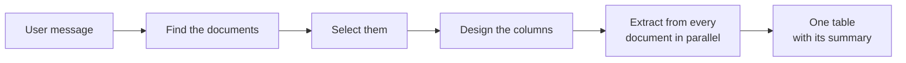

# Knowledge Extraction Agent

The **Knowledge Extraction Agent** answers requests that need every matching line from many documents, not the few most
similar passages a knowledge search returns. A user asks in one chat message, for example *"Find all billing positions
regarding hardware on the 2025 bills from Acme"*, and gets back one table: one row per record found, each row naming the
path and file it came from, with a summary of how many files were read, how many rows were found and which files could
not be read.

::: tip When to reach for this agent
Use it when the answer is a list of records collected across documents: invoice lines, contract parties, service levels,
deadlines. For a question one passage answers, the
[Document Intelligence Assistant](../5_document_intelligence_assistant/) is faster and cites its sources. The
[Universal Agent](../13_universal_agent/) offers the same extraction as one of its tools when its profile switches the
document tools on.
:::

## What it does

1. **Find the documents.** The model works through the documents of the profile's collections with three tools: it lists
   their paths, searches their text for exact terms such as a supplier name or a year, and reads a document when it is
   unsure. It stays within the profile's collections and path filter at all times.
2. **Select them.** When it knows the documents, the model describes them, for example *"invoices from 2025 that mention
   Acme"*, together with the columns the user asked for and the rows to keep. It sees how many documents that is and
   adjusts the description when the count or the examples are wrong.
3. **Design the columns.** The columns are designed from the user's words, such as *date, item, amount, currency*. A
   condition like *"only hardware"* decides which rows are kept and never becomes a column.
4. **Extract.** Every selected document is read and its matching records are extracted, many documents at the same time.
   Documents are read in overlapping parts, so a line on the last page is found and a line at the boundary between parts
   is not counted twice. A row that may not meet the condition is kept and marked *unsure* in a **Match** column, so a
   person can check it instead of it being dropped.
5. **Answer.** The table streams into the chat, followed by the summary. A document that could not be read is listed
   under the table with the reason; the other documents' rows are unaffected. Documents that were read but gave no rows
   are named under "No rows from", so an empty result never looks like a missing clause.

The chat shows each step as it happens: the tools the model calls while it looks for documents, a line saying how many
documents will be read, which columns the table has and about how long it takes, and one line per document as it is
extracted ("12 of 25 · invoice.pdf: 3 rows").

### When more documents match than one answer extracts

Nothing is cut silently. When the documents would take longer than about five minutes to extract (**Minutes per
Answer**), or are more than **Files per Answer**, the agent does not extract them all at once. The answer shows:

- how many documents match and how long extracting them all would take, about;
- how they break down **by folder**, **by year in the path** and **by collection**;
- a **sample** table from three of them, so you see the columns and rows before committing;
- what you can do: narrow the request, for example to one folder or year, or reply *continue* to extract all of them in
  parts.

Each *continue* extracts the next part and answers with its table, its place ("Part 2 of 4: documents 26–50 of 98") and
how to go on; the last part gives the totals. The parts keep the columns of the first. Asking something new instead
replaces the unfinished extraction. Above **Most Matching Documents** (1000 by default) only narrowing is offered; the
answer then says "more than 1000" and lists the folders and years of the first 1000 documents by path without counts,
since the rest were not looked at.

Continuing needs the same conversation: the unfinished extraction is kept with the chat, so a client of the
OpenAI-compatible API passes the conversation's `thread_id` in `metadata` with every message, as the chat UI does.

The same holds for rows: when one answer finds more rows than **Rows in the Table**, the rest are shown first when you
reply *continue*.

### Long documents

A document longer than **Longest Fully Read Document** (500,000 characters by default, a few hundred pages) is read only
in its relevant parts: its opening, which states what every row shares, and the parts where the wanted lines most likely
are. Its rows are marked **(partly read)** next to the file name, and the summary lists it under "Partly read (rows may
be missing)", because a line in a part that was not read is not found. See the ADR
`2026_10_21_partial_reads_of_long_documents_in_record_extraction`.

## What it does *not* do

- **It does not compare or reconcile documents.** Matching an invoice line to its contract line, or flagging deviations,
  is a different task.
- **It does not ask for approval before extracting.** The extraction starts as soon as the documents are selected.
- **It does not deliver the table as a file.** The table is part of the answer; copy it or ask a follow-up question.
- **It never reads outside its scope.** Only the profile's collections are used, narrowed to those the asking user may
  read and to the profile's path filter. A request for other documents, or a `#` reference to a collection the profile
  does not list, is left out and the answer says so.

## Limits

Every request is bounded, and nothing is cut without the answer saying so:

| Limit                           | What happens at the limit                                                                                                                                                                                     |
| ------------------------------- | ------------------------------------------------------------------------------------------------------------------------------------------------------------------------------------------------------------- |
| **Maximum Decisions**           | The search for documents stops. If the agent had not chosen documents yet, it selects them by folder and checks the request's conditions in each; if it had, documents may be missing. The answer says which. |
| **Maximum Tool Calls**          | As above.                                                                                                                                                                                                     |
| **Minutes per Answer**          | Larger selections get a sample and the offer to narrow or to continue in parts.                                                                                                                               |
| **Files per Answer**            | As above, for the number of documents.                                                                                                                                                                        |
| **Most Matching Documents**     | Above it, only narrowing is offered.                                                                                                                                                                          |
| **Rows in the Table**           | The other rows follow when you reply *continue*.                                                                                                                                                              |
| **Longest Fully Read Document** | A longer document is read in its relevant parts and its rows are marked *partly read*.                                                                                                                        |
| **Model Calls at Once**         | How many extraction calls one agent instance makes at the same time; bounds the load.                                                                                                                         |

One fixed limit applies as well: the rows of one document travel in one message, so a document with very many long rows
(around 40 rows of full contract clauses) keeps the first ones, and the summary names the document and how many rows
were left out. If a collection the extraction read from is no longer available when you continue, the extraction ends
with a notice; ask again to extract from what is available.

## Setting it up

1. **Grant the blueprint.** The Knowledge Extraction Agent is not part of a new tenant's default set; a sysadmin grants
   it (see [Access control](../../16_multi_tenancy/4_access_control/)).
2. **Create a profile.** In **Admin > Agents > Blueprints**, select **Knowledge Extraction Agent** and click **Create
   Profile**, or start from the **Document Tables** template.
3. **Choose the collections.** Under **Knowledge Tool**, list the databases and collections the agent works on. Saving
   checks that you may read them.
4. **Set a path filter** (optional). Under **Knowledge Documents**, a pattern such as `invoices/**` limits the agent to
   matching documents; it can never look outside it.
5. **Choose the models.** The main model looks for the documents and designs the columns; pick one that is reliable at
   tool calls. The **Extraction Model** reads each document; a smaller, cheaper model works well.
6. **Review the limits** and save.

## Configuration reference

| Field                                              | Default     | Description                                                              |
| -------------------------------------------------- | ----------- | ------------------------------------------------------------------------ |
| **Instructions**                                   | *(empty)*   | Added after the built-in instructions, e.g. how documents are named.     |
| **Knowledge Tool > Collections**                   | —           | The databases and collections the agent works on.                        |
| **Knowledge Documents > Document Path Filter**     | *(empty)*   | Only documents whose path matches this pattern, e.g. `invoices/2025/**`. |
| **Table Extraction > Extraction Model**            | main model  | The model that reads each document and extracts its rows.                |
| **Table Extraction > Files per Answer**            | `100`       | The most documents one answer extracts from.                             |
| **Table Extraction > Minutes per Answer**          | `5`         | About how long one answer may extract before the rest is offered.        |
| **Table Extraction > Most Matching Documents**     | `1000`      | Above it, the user is only asked to narrow the request.                  |
| **Table Extraction > Rows in the Table**           | `500`       | The most rows one answer shows; the rest follow on *continue*.           |
| **Table Extraction > Longest Fully Read Document** | `500000`    | Longer documents (in characters) are read in their relevant parts.       |
| **Table Extraction > Model Calls at Once**         | `4`         | Extraction calls one agent instance makes at the same time.              |
| **Tools > Maximum Decisions / Maximum Tool Calls** | `10` / `20` | How long the model may look for documents.                               |
