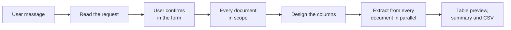

# Knowledge Extraction Agent

The **Knowledge Extraction Agent** answers requests that need every matching line from many documents, not the few most
similar passages a knowledge search returns. A user asks in one chat message, for example *"Find all billing positions
regarding hardware on the 2025 bills from Acme"*, and gets back one table: one row per record found, each row naming the
path and file it came from, with a summary of how many files were read, how many rows were found and which files could
not be read. The whole table is also a CSV file to download.

::: tip When to reach for this agent
Use it when the answer is a list of records collected across documents: invoice lines, contract parties, service levels,
deadlines. For a question one passage answers, the
[Document Intelligence Assistant](../5_document_intelligence_assistant/) is faster and cites its sources. The
[Universal Agent](../13_universal_agent/) offers the same extraction as one of its tools when its profile switches the
document tools on, with the same request form before it extracts.
:::

## What it does

1. **Read the request.** One model call reads the message: the columns the user asks for, which rows to keep, any
   folder, file or year the user names, and any calculation asked for. A follow-up such as *"the same for 2024"* is read
   with the conversation.
2. **Confirm the request.** Before any document is read, the agent shows what it understood in a form, and the user
   confirms or corrects it (see [The request form](#the-request-form)). What the user confirms is what is read and
   extracted.
3. **Take every document in scope.** Every document in the profile's collections and path filter is read, narrowed only
   by the confirmed location. A file the user names, by its path or only by its name, with or without the extension,
   means that file alone, not the folder it is in. No search decides which documents count, so a document is never
   missed because it words things differently from the request. A supplier or a topic is a condition on the rows, not a
   place: *"from Acme"* keeps Acme's rows, it does not pick documents. With [Discovery mode](#discovery-mode) on, the
   model searches for the documents instead.
4. **Design the columns.** The columns are designed from the user's words, such as *date, item, amount, currency*. A
   condition like *"only hardware"* decides which rows are kept and never becomes a column.
5. **Extract.** Every document is read and its matching records are extracted, many documents at the same time.
   Documents are read in overlapping parts, so a line on the last page is found and a line at the boundary between parts
   is not counted twice. A row that may not meet the condition is kept and marked *unsure* in a **Match** column, so a
   person can check it instead of it being dropped. A condition on the whole document, such as its supplier, party or
   year, applies to every row in it: a document that clearly does not meet it gives no rows and is listed under "No rows
   from".
6. **Answer.** The answer shows the first rows of the table (up to 100), followed by the summary, and the whole table as
   a CSV file: attached to the answer in the chat, a download link through the API. A document that could not be read is
   listed under the table with the reason; the other documents' rows are unaffected. Documents that were read but gave
   no rows are named under "No rows from", so an empty result never looks like a missing clause.

The chat shows each step as it happens: a line saying how many documents will be read, which columns the table has and
about how long it takes; a line when a long document starts; one line per document as it is extracted, with its first
rows ("12 of 150 · invoice.pdf: 3 rows — Laptop X1, 1,200; Dock D2, 180"); and, while a document takes more than a
minute, a line saying it is still being read. An answer can take many minutes when many documents are read; the progress
shows it is alive.

### The request form

A misread part of a request used to show only in the finished table, after every document had been read. So every new
table request is first asked back, in three parts:

| Part                  | What it says                                                                                             | Alternative   |
| --------------------- | -------------------------------------------------------------------------------------------------------- | ------------- |
| **Location**          | The folders, files or years to read. The hint lists the scope's largest folders with their counts.       | All documents |
| **Filter Condition**  | Which records the table keeps, such as *from Acme* or *only hardware items*.                             | Every row     |
| **Values to extract** | The table's columns, which decide what a row is: an invoice number and a total give one row per invoice. | —             |

With **Discovery mode** on, two more parts follow: **Exact keyword(s)**, words the wanted documents literally contain (a
supplier's name, an invoice number), and **Semantic keyword(s)**, what the documents are about (*supplier invoice with
line items*). Both are optional hints for the search, never filters, and each offers *None*.

Each part is filled in as the model read it (*As understood: …*). The user keeps it, chooses the alternative, or writes
their own answer. A part the request did not name offers only the alternative.

Not every message gets the form. A *yes* to a [waiting sample](#when-more-than-100-documents-would-be-read) extracts it
at once, and a greeting or a question about the agent is answered without one.

**What each client shows.** In OpenWebUI the form is a dialog with one page per part, and the answers are listed in the
chat once it is sent. If the dialog is cancelled or cannot open, the same questions appear as a chat message. Every
other client (the OpenAI-compatible API, the Teams and Slack bots, the web chat) shows that message, and the next
message answers it:

- *yes* (also *ok*, *ja*, *oui*, *sì*, *weiter*) extracts the request as understood;
- *no* (also *nein*, *non*, *cancel*, *stop*, *abbrechen*, *annuler*, *annulla*) declines it, and nothing is read;
- anything else is taken as a correction, such as *"Location: invoices/2024"*. The request is read once more with it and
  extracted, without a second form.

**Calculations are named, not done.** The agent lists values; it does not add them up. When a request asks for a sum, an
average, a count, a maximum or a comparison, the form says *"I don't calculate …"* and the table lists the value of
every record instead. The same notice stands under the table, so the total can be taken from the CSV file or asked of an
assistant that answers questions, such as the Knowledge Assistant.

### When more than 100 documents would be read

Reading every document of a large scope takes long, so above 100 documents the agent first asks. The answer shows:

- how many documents would be read and about how long that takes;
- what the table would hold: its columns and which rows are kept;
- a **sample** table from five of the documents, those most likely to hold what was asked for: the documents closest in
  meaning to the request; when that ranking places none, or with **Discovery mode** on, documents whose text names what
  identifies them (a supplier, a number), then those containing typical words of the wanted lines;
- how the documents break down **by folder**, **by year in the path** and **by collection**;
- what you can do: reply *yes* to read all of them in one answer, or narrow the request, for example to one folder or
  year.

The sample can hold no row, for example when the wanted records are rare; the answer then says so and still shows what
the table would hold. Asking something new instead of *yes* replaces the waiting request. Confirming needs the same
conversation, so a client of the OpenAI-compatible API passes the conversation's `thread_id` in `metadata` with every
message, as the chat UI does.

Above **Most Documents per Table** (1000 by default) nothing is read: the answer shows a sample and asks to narrow the
request, and lists the folders and years of the first 1000 documents by path without counts, since the rest were not
looked at.

### Discovery mode

A profile can switch on **Discovery mode**. After the user confirms the form, the model finds the documents with four
tools: it lists their paths, searches their text for exact terms such as a supplier name, ranks them by meaning to find
documents written in other words or another language, and reads a document when unsure. The confirmed keywords guide it:
the exact keywords go to the text search, the semantic keywords to the ranking. It then selects the documents to read,
and only those are extracted. This is faster on large collections, but a document the search does not find is missing
from the table. The search is bounded by **Maximum Decisions** and **Maximum Tool Calls**; at the limit the agent
selects by folder and checks the request's conditions in each document, and the answer says so.

Whatever the search chose, the confirmed parts decide: the confirmed **Location** replaces any path the search set, and
the confirmed **Values to extract** and **Filter Condition** are what is extracted.

Without Discovery mode, ranking by meaning only decides which documents are sampled and read first; no document is ever
left out because of its rank.

::: warning Profiles saved before the rename
**Discovery mode** replaces the profile setting **Search for the Documents First** and now sits under **Knowledge
Documents**; the **Rank Documents by Meaning** checkbox is gone, since ranking is always offered. The old values are
ignored: a profile that had the search switched on reads every document until **Discovery mode** is ticked again.
:::

::: tip Which mode for which profile
Reading every document is the safe default: nothing is missed, but each document's rows are judged by the extraction
model on its own. When a request names one supplier or party among many in the same folders (*"Acme's 2025 hardware"*
over every supplier's invoices), that judgement now and then keeps a row from another supplier's document, and every
document costs a model call. For profiles used for such exact, narrow requests over large mixed collections, switch on
**Discovery mode**: only the documents the search selects are read, which is faster and cheaper, at the risk that a
document the search does not find is missing.
:::

### Long documents

A document longer than **Longest Fully Read Document** (500,000 characters by default, a few hundred pages) is read only
in its relevant parts: its opening, which states what every row shares, and the parts where the wanted lines most likely
are. Its rows are marked **(partly read)** next to the file name, and the summary lists it under "Partly read (rows may
be missing)", because a line in a part that was not read is not found. See the ADR
`2026_10_21_partial_reads_of_long_documents_in_record_extraction`.

## What it does *not* do

- **It does not compare or reconcile documents.** Matching an invoice line to its contract line, or flagging deviations,
  is a different task.
- **It does not keep the file forever.** The CSV file is kept for seven days; the copy attached to a chat stays with the
  chat.
- **It never reads outside its scope.** Only the profile's collections are used, narrowed to those the asking user may
  read and to the profile's path filter. A request for other documents, or a `#` reference to a collection the profile
  does not list, is left out and the answer says so; a file the user names outside the scope is reported as not found,
  never replaced by a similar one.

## Limits

Every request is bounded, and nothing is cut without the answer saying so:

| Limit                           | What happens at the limit                                                                                   |
| ------------------------------- | ----------------------------------------------------------------------------------------------------------- |
| **Most Documents per Table**    | Above it nothing is read; the answer shows a sample and asks to narrow the request.                         |
| **More than 100 documents**     | A sample first; everything is read once the user confirms.                                                  |
| **Longest Fully Read Document** | A longer document is read in its relevant parts and its rows are marked *partly read*.                      |
| **Model Calls at Once**         | How many extraction calls one agent instance makes at the same time; bounds the load and how long it takes. |
| **Maximum Decisions / Calls**   | Only with **Discovery mode**: the search stops and the agent selects by folder.                             |
| **Rows shown in the answer**    | The first 100 rows (fewer when they are very long); the CSV file holds every row, with every cell complete. |

If a collection the sample was taken from is no longer available when you confirm, nothing is read and the answer says
so; ask again to extract from what is available.

## Setting it up

1. **Grant the blueprint.** The Knowledge Extraction Agent is not part of a new tenant's default set; a sysadmin grants
   it (see [Access control](../../16_multi_tenancy/4_access_control/)).
2. **Create a profile.** In **Admin > Agents > Blueprints**, select **Knowledge Extraction Agent** and click **Create
   Profile**, or start from the **Document Tables** template.
3. **Choose the collections.** Under **Knowledge Tool**, list the databases and collections the agent works on. Saving
   checks that you may read them.
4. **Set a path filter** (recommended). Under **Knowledge Documents**, a pattern such as `invoices/**` limits the agent
   to matching documents; it can never look outside it. Every request reads every document in this scope, so a narrow
   scope keeps answers fast.
5. **Choose the models.** The main model reads the request and designs the columns. The **Extraction Model** reads each
   document; a smaller, cheaper model works well.
6. **Review the limits** and save.

## Configuration reference

| Field                                              | Default     | Description                                                                                                  |
| -------------------------------------------------- | ----------- | ------------------------------------------------------------------------------------------------------------ |
| **Instructions**                                   | *(empty)*   | Added to the agent's instructions, e.g. how documents are named.                                             |
| **Knowledge Tool > Collections**                   | —           | The databases and collections the agent works on.                                                            |
| **Knowledge Documents > Document Path Filter**     | *(empty)*   | Only documents whose path matches this pattern, e.g. `invoices/2025/**`.                                     |
| **Knowledge Documents > Discovery mode**           | off         | Let the model search for the documents and read only those it selects; the form then also asks for keywords. |
| **Table Extraction > Extraction Model**            | main model  | The model that reads each document and extracts its rows.                                                    |
| **Table Extraction > Most Documents per Table**    | `1000`      | Above it, the user is only asked to narrow the request.                                                      |
| **Table Extraction > Longest Fully Read Document** | `500000`    | Longer documents (in characters) are read in their relevant parts.                                           |
| **Table Extraction > Model Calls at Once**         | `4`         | Extraction calls one agent instance makes at the same time.                                                  |
| **Tools > Maximum Decisions / Maximum Tool Calls** | `15` / `30` | How long the model may search, with **Discovery mode**.                                                      |
