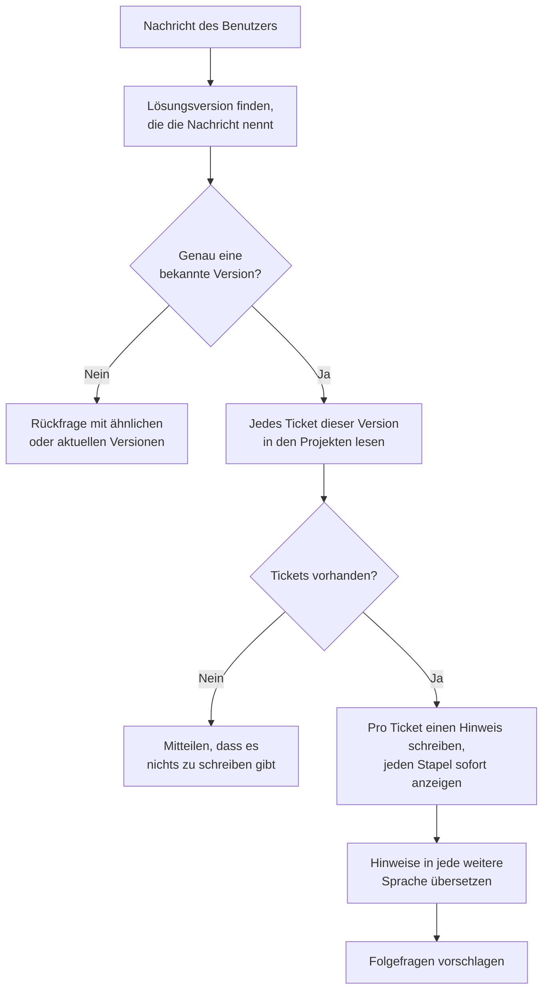

# Versionshinweis-Assistent

Der **Versionshinweis-Assistent** macht aus einer Jira-Version Versionshinweise. Fragen Sie ihn nach einer Version —
*„Versionshinweise für 2.4.0"* — und er liest jedes Ticket dieser Lösungsversion in den konfigurierten Projekten,
schreibt pro Ticket einen kurzen Hinweis für Ihre Leserschaft und antwortet mit einem Changelog, gruppiert in neue
Funktionen, Fehlerbehebungen, Verbesserungen und weitere Änderungen. Nennt das Profil weitere Sprachen, folgt derselbe
Changelog in jeder davon.

Er funktioniert mit **Jira Cloud** und **Jira Data Center** gleichermaßen und liest nur: In Jira wird nie etwas
geschrieben.

::: tip Nennen Sie die Version so, wie Jira sie schreibt
Der Assistent sucht in Ihrer Nachricht nach einem der Lösungsversionsnamen der Projekte. *„Versionshinweise für 2.4.0"*,
*„Was ist neu in 2.4.0?"* oder *„v2.4.0 bitte"* funktionieren alle. Nennt die Nachricht keine Version, mehrere oder
eine, die Jira nicht kennt, antwortet er mit den Versionen, die er kennt, statt zu raten.
:::

## Was er tut

1. **Version finden.** Der Assistent listet die Lösungsversionen der konfigurierten Projekte auf und findet diejenige,
   die die Nachricht nennt. Ein Versionsname zählt nur als ganzes Wort: *2.4* wird in *2.4.0* nicht gefunden, während
   *„für 2.4."* weiterhin 2.4 nennt. Groß- und Kleinschreibung spielen keine Rolle, ein vorangestelltes *v* ist in
   Ordnung, und Anführungszeichen, die der Chat in typografische umgewandelt hat, stören nicht. Ein Name, der in
   mehreren Projekten vorkommt, ist eine Version über alle hinweg.
2. **Tickets lesen.** Jedes Ticket dieser Lösungsversion in den konfigurierten Projekten wird gelesen, abzüglich dessen,
   was der JQL-Filter des Profils ausschließt.
3. **Hinweise schreiben.** Das Modell schreibt pro Ticket ein bis zwei Sätze für die konfigurierte Leserschaft, aus der
   Zusammenfassung und der Beschreibung des Tickets. Die Tickets werden stapelweise gesendet, mehrere Stapel
   gleichzeitig, und jeder Stapel erscheint im Chat, sobald er und die vorherigen fertig sind. So beginnt die Antwort
   auch bei einer großen Version innerhalb von Sekunden.
4. **Übersetzen.** Jede weitere Sprache folgt als eigener Block, übersetzt aus den geschriebenen Hinweisen.
5. **Folgefragen.** Wie bei jedem Chat-Assistenten erhält die Unterhaltung einen Titel, und es werden Folgefragen
   vorgeschlagen.

Den Changelog selbst setzt die Plattform zusammen, nicht das Modell: Das Modell schreibt nur die Hinweise. Deshalb passt
auch eine Version mit Hunderten von Tickets zu Modellen, die höchstens einige tausend Wörter auf einmal antworten.

### Abschnitte

Jedes Ticket kommt nach seinem Jira-Vorgangstyp in einen Abschnitt:

| Abschnitt              | Vorgangstypen                                                                                       |
| ---------------------- | --------------------------------------------------------------------------------------------------- |
| **Neue Funktionen**    | Story, User Story, New Feature, Feature sowie ihre deutschen, französischen und italienischen Namen |
| **Fehlerbehebungen**   | Bug, Defect sowie ihre deutschen, französischen und italienischen Namen                             |
| **Verbesserungen**     | Improvement, Enhancement sowie ihre deutschen, französischen und italienischen Namen                |
| **Weitere Änderungen** | Alles andere: Task, Sub-task, Epic, Serviceanfragen, Ihre eigenen Typen                             |

Innerhalb eines Abschnitts sind die Tickets nach Projekt und Nummer geordnet. Ist **Ticketschlüssel anzeigen** aktiv,
beginnt jeder Punkt mit dem Ticketschlüssel, verlinkt auf das Ticket in Jira.

### Wenn etwas schiefgeht

- **Ein Hinweis, den das Modell nicht schreiben konnte,** zeigt stattdessen die Zusammenfassung des Tickets, und ein
  Gedanke im Lauf nennt, wie viele es waren.
- **Ein Hinweis, der nicht übersetzt werden konnte,** bleibt in der Schreibsprache, ebenfalls mit einem Gedanken, der
  nennt, wie viele es waren.
- **Ein Jira-Problem** — abgelehnte Zugangsdaten, ein Projekt, das nicht existiert oder das das Konto nicht sehen kann,
  ein ungültiger JQL-Filter, ein nicht erreichbares Jira — wird mit einem Satz in der Sprache des Benutzers beantwortet,
  der sagt, wer es beheben kann. Die englische Meldung von Jira selbst steht in einem aufklappbaren Gedanken für die
  Administration.
- **Eine Version mit mehr als 300 Tickets** wird abgelehnt statt gekürzt; eine Administratorin oder ein Administrator
  kann sie mit dem JQL-Filter eingrenzen.

## Was er *nicht* tut

- **Er schreibt nie in Jira.** Er liest Versionen und Tickets, sonst nichts.
- **Er veröffentlicht nichts.** Die Versionshinweise sind eine Chat-Antwort zum Kopieren; sie werden nirgends versendet
  oder veröffentlicht.
- **Er liest keine Kommentare, Anhänge oder verknüpften Seiten** — nur Typ, Zusammenfassung und Beschreibung jedes
  Tickets.
- **Er erinnert sich nicht an frühere Changelogs.** Eine erneute Frage oder eine Version in einer Folgefrage schreibt
  den Changelog neu.
- **Er schreibt keinen Zusammenfassungsabsatz.** Die Antwort ist der Changelog: ein Titel pro Sprache, dann die
  Abschnitte.
- **Ein Jira pro Profil.** Ein Profil liest eine Jira-Site und die dort aufgeführten Projekte.

::: details Bekannte Einschränkung: „What changed in 2.0?"
Vor allem anderen prüft jeder Chat-Assistent, ob eine Nachricht eine Frage über den Assistenten selbst ist. Formuliert
als *„What changed in 2.0?"* oder *„Was hat sich in 2.0 geändert?"*, mit nichts als einer Version danach, wird die
Nachricht derzeit als solche Frage gelesen, und der Assistent beschreibt, wie er arbeitet, statt die Hinweise zu
schreiben. *„Was ist neu in 2.0?"* oder *„Versionshinweise für 2.0"* sind nicht betroffen.
:::

## Einrichtung

1. **Blueprint freigeben.** Der Versionshinweis-Assistent gehört nicht zum Standardumfang eines neuen Mandanten; eine
   Sysadmin-Rolle gibt ihn frei (siehe [Zugriffskontrolle](../../16_multi_tenancy/4_access_control/)).
2. **Profil erstellen.** Starten Sie auf der Seite **Agents** der Admin-UI entweder mit der Vorlage **Customer Release
   Notes** (Englisch und Deutsch, ohne Ticketschlüssel, ohne Unteraufgaben) oder erstellen Sie ein Profil aus dem
   Blueprint **Versionshinweis-Assistent**.
3. **Jira verbinden.** Geben Sie unter **Jira** die URL, die Edition und das Token ein:
   - **Jira Cloud:** die Site-URL (`https://acme.atlassian.net`), die E-Mail-Adresse des Kontos und ein klassisches
     **API-Token ohne Scopes**, erstellt unter *id.atlassian.com → Security → API tokens*. Tokens mit Scopes werden
     nicht unterstützt.
   - **Jira Data Center:** die Basis-URL einschließlich eines allfälligen Kontextpfads (`https://jira.acme.ch/jira`) und
     ein **Personal Access Token**.
   - Verwenden Sie ein Konto, das die Projekte durchsuchen darf und sonst nichts: Der Assistent liest mit dessen
     Berechtigungen.
4. **Projekte aufführen.** Geben Sie die Projektschlüssel ein, z. B. `ENG`. Fügen Sie einen **JQL-Filter** für Tickets
   hinzu, die nie erscheinen sollen, z. B. `issuetype not in subTaskIssueTypes()` oder `labels != internal`.
5. **Sprachen und Leserschaft wählen.** Wählen Sie die Sprache, in der die Hinweise geschrieben werden, optional weitere
   Sprachen, und beschreiben Sie, wer sie liest — *„Kundinnen und Kunden der Web-App"* ergibt andere Hinweise als *„das
   Support-Team"*.
6. **Modell wählen** und speichern. Fragen Sie das Profil nach einer Version, die Sie kennen, um die Verbindung zu
   prüfen: Jedes Verbindungsproblem wird im Chat beantwortet.

::: warning Ein Jira im Firmennetz
Die Plattform verweigert Verbindungen zu internen Adressen — Docker-Servicenamen, `localhost`, private IP-Bereiche —,
damit ein Profil nicht auf die plattformeigenen Dienste zeigen kann. Um ein nur intern erreichbares Jira Data Center
zuzulassen, trägt der Betrieb dessen Hostnamen in **`JIRA_ALLOWED_PRIVATE_HOSTS`** in der Umgebung des Deployments ein
(kommagetrennt), und der Agent-Container braucht ausgehenden Netzwerkzugriff darauf.
:::

## Konfigurationsreferenz

| Feld                          | Standard                            | Beschreibung                                                                                                             |
| ----------------------------- | ----------------------------------- | ------------------------------------------------------------------------------------------------------------------------ |
| **Jira-URL**                  | —                                   | Die Basis-URL von Jira. Weiterleitungen werden nicht verfolgt; geben Sie die Adresse ein, unter der Jira antwortet.      |
| **Jira-Edition**              | Jira Cloud                          | Jira Cloud oder Jira Data Center.                                                                                        |
| **E-Mail-Adresse des Kontos** | —                                   | Nur Jira Cloud: die E-Mail-Adresse des Kontos, zu dem das API-Token gehört.                                              |
| **Token**                     | —                                   | API-Token ohne Scopes (Cloud) oder Personal Access Token (Data Center).                                                  |
| **Jira-Projekte**             | —                                   | Schlüssel der Projekte, deren Lösungsversionen die Versionshinweise abdecken.                                            |
| **JQL-Filter**                | *(leer)*                            | JQL, die jedes Ticket zusätzlich erfüllen muss.                                                                          |
| **Sprache**                   | English                             | Die Sprache, in der die Hinweise geschrieben werden.                                                                     |
| **Zusätzlich übersetzen in**  | Aus                                 | Weitere Sprachen; zum Auswählen einschalten. Jede erhält einen eigenen Block, übersetzt aus den geschriebenen Hinweisen. |
| **Leserschaft**               | *the customers who use the product* | Für wen die Hinweise geschrieben werden.                                                                                 |
| **Ticketschlüssel anzeigen**  | Ein                                 | Jeden Punkt mit seinem Ticketschlüssel beginnen, verlinkt auf das Ticket. Für Lesende ohne Jira-Zugang ausschalten.      |
| **Maximale Eingabe-Tokens**   | `16384`                             | Der für jede Runde behaltene Gesprächsverlauf. Frühere Changelogs sind lang, und nur die Fragen zählen.                  |

Die Modelleinstellungen und das **Task LLM** (Titel, Folgefragen, die Prüfung auf Fragen über den Assistenten) sind
dieselben wie bei den anderen Chat-Assistenten.

Vom Deployment festgelegt, nicht vom Profil: höchstens **300 Tickets** pro Version, **10 Tickets** pro Modellaufruf,
**4** Modellaufrufe gleichzeitig und die ersten **4000 Zeichen** jeder Beschreibung.
