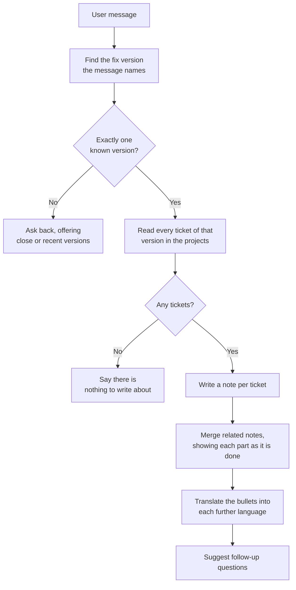

# Release Notes Assistant

The **Release Notes Assistant** turns a Jira release into release notes. Ask it for a version — *"Release notes for
2.4.0"* — and it reads every ticket of that fix version in the configured projects, writes one short note per ticket for
your readers, and answers with a changelog grouped into new features, fixes, improvements and other changes. If the
profile names further languages, the same changelog follows in each of them.

It works with **Jira Cloud** and **Jira Data Center** alike, and it only reads: nothing is ever written to Jira.

::: tip Name the version as Jira spells it
The assistant looks for one of the projects' own fix version names in your message. *"Release notes for 2.4.0"*,
*"What's new in 2.4.0?"* or *"v2.4.0 please"* all work. When the message names no version, several, or one Jira does not
have, it answers with the versions it does know instead of guessing.

Naming a language works too: *"Release notes for 2.4.0 in French"* (or *"auf Französisch"*, *"en français"*, *"in
francese"*) gives that answer in French instead of the profile's languages.
:::

## What it does

1. **Find the release.** The assistant lists the fix versions of the configured projects and finds the one the message
   names. A version name counts only as a whole word: *2.4* is not found inside *2.4.0*, while *"for 2.4."* still names
   2.4. Case does not matter, a leading *v* is fine, and quotes the chat turned curly are no problem. A name that exists
   in several of the projects is one release across all of them.
2. **Read the tickets.** Every ticket of that fix version in the configured projects is read, minus whatever the
   profile's JQL filter leaves out.
3. **Write the notes.** The model writes one sentence per ticket, two at most, for the configured audience, from the
   ticket's summary and description. The notes read like a product changelog: impersonal (no "you", no "we"), in the
   present tense, a feature naming the new capability and a fix saying what no longer goes wrong, e.g. *"Saving a draft
   no longer discards attached images."* Tickets are sent ten at a time, several batches at once.
4. **Merge related tickets.** Within each section, the model merges notes about the same kind of change into one bullet
   that names all of them, the way a hand-written changelog does: six tickets adding a CSV export to six pages become
   *"Invoices, search results, user settings, notification emails, the dashboard and the login page can be exported as
   CSV."* Every ticket still ends up in exactly one bullet: the platform checks it, and a ticket the model leaves out
   keeps a bullet of its own. Notes are merged 40 at a time and each part appears in the chat as soon as it is done, so
   the answer keeps coming even for a large release; a theme spanning more tickets of one section can therefore appear
   as two bullets. Turn **Merge related tickets** off to get one bullet per ticket.
5. **Translate.** Each further language follows as its own block, translated from the written bullets.
6. **Follow-ups.** As in every chat assistant, a title is set for the conversation and follow-up questions are
   suggested.

The changelog itself is put together by the platform, not by the model: the model writes the notes and proposes which to
merge. That is what lets a release of hundreds of tickets fit models that answer at most a few thousand words at a time.

### Sections

Each ticket goes into a section by its Jira issue type:

| Section          | Issue types                                                                         |
| ---------------- | ----------------------------------------------------------------------------------- |
| **New features** | Story, User Story, New Feature, Feature, and their German, French and Italian names |
| **Fixes**        | Bug, Defect, and their German, French and Italian names                             |
| **Improvements** | Improvement, Enhancement, and their German, French and Italian names                |
| **Other**        | Everything else: Task, Sub-task, Epic, service requests, your own types             |

Within a section, bullets are ordered by the project and number of their first ticket. With **Link to Jira tickets** on,
the keys of each bullet's tickets are linked to them in Jira. When every ticket has a bullet of its own, the bullet
leads with its key, as in **[ENG-12]** Sign-in works again after a timeout. When related tickets are merged, a bullet
can cover a dozen of them, so it ends with their keys instead: … can be exported as CSV. (ENG-12, ENG-15, ENG-19)

### When something goes wrong

- **A note the model could not write** shows the ticket's summary instead, and a thought in the run says how many did.
- **A merge the model gets wrong** cannot drop or repeat a ticket: tickets it leaves out keep bullets of their own.
- **A note that could not be translated** stays in the writing language, again with a thought saying how many.
- **A Jira problem** — rejected credentials, a project that does not exist or that the account cannot see, an invalid
  JQL filter, an unreachable Jira — is answered with one sentence in the user's language that says who can fix it.
  Jira's own English message goes into a collapsible thought for the administrator.
- **A release with more than 300 tickets** is refused rather than cut short; an administrator can narrow it with the JQL
  filter.

## What it does *not* do

- **It never writes to Jira.** It reads versions and tickets, nothing else.
- **It does not publish anything.** The release notes are a chat answer to copy from; they are not sent or posted
  anywhere.
- **It does not read comments, attachments or linked pages** — only each ticket's type, summary and description.
- **It does not remember earlier changelogs.** Asking again, or naming a version in a follow-up, writes the changelog
  anew.
- **It does not write a summary paragraph.** The answer is the changelog: a title per language, then the sections.
- **One Jira per profile.** A profile reads one Jira site and the projects listed on it.

::: details Known limitation: "What changed in 2.0?"
Before anything else, every chat assistant checks whether a message is a question about the assistant itself. Phrased as
*"What changed in 2.0?"* or *"Was hat sich in 2.0 geändert?"*, with nothing but a version after it, the message is
currently read as such a question, and the assistant describes how it works instead of writing the notes. *"What's new
in 2.0?"* or *"Release notes for 2.0"* are not affected.
:::

## Setting it up

1. **Grant the blueprint.** The Release Notes Assistant is not part of a new tenant's default set; a sysadmin grants it
   (see [Access control](../../16_multi_tenancy/4_access_control/)).
2. **Create a profile.** On the Admin UI's **Agents** page, either start from the **Customer Release Notes** template
   (English and German, without ticket keys, sub-tasks left out) or create a profile from the **Release Notes
   Assistant** blueprint.
3. **Connect Jira.** Under **Jira**, enter the URL, the edition and the token:
   - **Jira Cloud:** the site URL (`https://acme.atlassian.net`), the e-mail of the account and a classic **API token
     without scopes**, created at *id.atlassian.com → Security → API tokens*. Scoped tokens are not supported.
   - **Jira Data Center:** the base URL including any context path (`https://jira.acme.ch/jira`) and a **personal access
     token**.
   - Use an account that can browse the projects and nothing more: the assistant reads with its permissions.
4. **List the projects.** Enter the project keys, e.g. `ENG`. Add a **JQL filter** for tickets that should never appear,
   e.g. `issuetype not in subTaskIssueTypes()` or `labels != internal`.
5. **Choose the languages and the audience.** Pick the language the notes are written in, and switch on **Translate into
   other languages** for further ones. Describe the **Audience** in a few words: *"customers using the web app"* gives
   different notes than *"the internal support team"*.
6. **Choose the model** and save. Ask the profile for a version you know to check the connection: every connection
   problem is answered in the chat.

::: warning A Jira on your company network
The platform refuses to connect to internal addresses — Docker service names, `localhost`, private IP ranges — so that a
profile cannot be pointed at the platform's own services. To allow a Jira Data Center reachable only internally, an
operator adds its host name to **`JIRA_ALLOWED_PRIVATE_HOSTS`** in the deployment's environment (comma-separated), and
the agent container needs outbound network access to it.
:::

## Configuration reference

| Field                              | Default                             | Description                                                                                                                              |
| ---------------------------------- | ----------------------------------- | ---------------------------------------------------------------------------------------------------------------------------------------- |
| **Jira URL**                       | —                                   | Jira's base URL. Redirects are not followed, so enter the address Jira answers at.                                                       |
| **Jira edition**                   | Jira Cloud                          | Jira Cloud or Jira Data Center.                                                                                                          |
| **Account e-mail**                 | —                                   | Jira Cloud only: the e-mail of the account the API token belongs to.                                                                     |
| **Token**                          | —                                   | API token without scopes (Cloud) or personal access token (Data Center).                                                                 |
| **Jira projects**                  | —                                   | Keys of the projects whose fix versions the release notes cover.                                                                         |
| **JQL filter**                     | *(empty)*                           | JQL every ticket must also match.                                                                                                        |
| **Language**                       | English                             | The language the notes are written in, unless the message asks for another.                                                              |
| **Translate into other languages** | Off                                 | Switch it on to pick further **Languages**; each gets its own block, translated from the written notes.                                  |
| **Audience**                       | *the customers who use the product* | Who reads the release notes, in a few words; each note is worded for them.                                                               |
| **Link to Jira tickets**           | On                                  | Link each bullet's tickets: [ENG-12] in front, or (ENG-12, ENG-15) at the end when merged. Turn it off for readers who cannot open Jira. |
| **Merge related tickets**          | On                                  | Merge notes on related tickets of a section into one bullet that names them all. Off: one bullet per ticket.                             |
| **Max input tokens**               | `16384`                             | The conversation history kept for each turn. Earlier changelogs are long and only the questions matter.                                  |

The model settings and the **Task LLM** (titles, follow-up questions, the check for questions about the assistant) are
the same as on the other chat assistants.

Fixed by the deployment, not by the profile: at most **300 tickets** per release, **10 tickets** per model call, **4**
model calls at once, the first **4,000 characters** of each description, and **40 notes** per merge.
