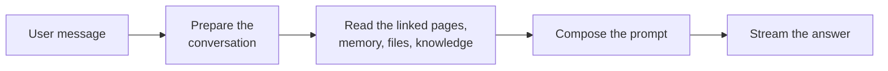

# Web Page Assistant

The **Web Page Assistant** answers from the web pages a user links. Paste one or more links into a message, or attach a
page with `#`, and it reads them, answers from what they say, and cites each page it used. A page it could not read is
named in the answer with the reason, never guessed at.

It is the [Instructed Assistant](../3_instructed_assistant/) with reading links built in: the same instructions, memory,
attached files and knowledge references, but its profiles cannot switch reading off.

::: tip When to reach for this agent
Use it for work that starts from pages: summarising articles, comparing product or offer pages, checking what a
documentation page says. To let an existing assistant read links too, turn on **Read Linked Web Pages** in its profile
instead; see [Linked web pages](../../10_chat_ui/15_linked_web_pages/).
:::

## What it does

1. **Prepare the conversation.** The profile's instructions lead, and the history is trimmed to the input budget.
2. **Gather.** Every link in the message and every page attached with `#` is read, up to the profile's link limit,
   alongside the user's memories, attached files and referenced knowledge.
3. **Compose.** The pages go into the prompt behind the instructions, each cut to the profile's character limit, with a
   note naming the links that could not be read and why.
4. **Answer.** The reply streams with numbered citations; each page read is listed as a source.

A message without links is answered like any Instructed Assistant message.

## What it does *not* do

- **It does not search the web.** It reads the pages the user links, nothing else.
- **It does not follow links on a page.** Only the linked pages are read, not the pages they link to.
- **It does not read files behind links.** PDFs, images and downloads are reported as not web pages; attach the file
  instead.
- **It does not log in.** Pages behind a login, a paywall or bot protection are reported as refused.

## Templates

| Template               | What it does                                                                                                    |
| ---------------------- | --------------------------------------------------------------------------------------------------------------- |
| **Article Summariser** | For each linked page: 3 to 5 key points and a two-sentence summary, each point cited. Answers a question first. |
| **Page Comparison**    | A table with one column per linked page and one row per criterion that matters, then the main differences.      |

## Setting it up

1. **Grant the blueprint.** The Web Page Assistant is not part of a new tenant's default set; a sysadmin grants it (see
   [Access control](../../16_multi_tenancy/4_access_control/)).
2. **Create a profile.** In **Admin > Agents**, open the **Templates** tab and pick one of the templates above, or
   select **Web Page Assistant** under **Blueprints** and click **Create Profile**.
3. **Write the instructions** in **System Prompt**: what the assistant does with the pages and how it should answer. You
   do not need to ask it to cite pages or to report the ones it could not read; that is built in.
4. **Review the limits** under **Read Linked Web Pages**, choose the model, and save.

## Configuration reference

The form is the Instructed Assistant's (see its
[configuration reference](../3_instructed_assistant/#configuration-reference)), with **Read Linked Web Pages** always
on:

| Field                       | Default | Description                                                                                                     |
| --------------------------- | ------- | --------------------------------------------------------------------------------------------------------------- |
| **Max Links per Message**   | `5`     | How many links from one message are read. Further links are reported to the user, not read. Range: 1–20.        |
| **Page Timeout (Seconds)**  | `15`    | How long one page may take to load before it is reported as unreachable. The answer waits for every page. 5–60. |
| **Max Characters per Page** | `20000` | Longer pages are cut at a paragraph break. About 4 characters make one token. Range: 1,000–200,000.             |

::: warning Pages make long prompts
Every page read goes into the prompt, so five long pages can add about 25,000 tokens. Keep **Maximum Input Tokens**
within the model's context window, and lower the limits above if answers with several pages take too long.
:::
