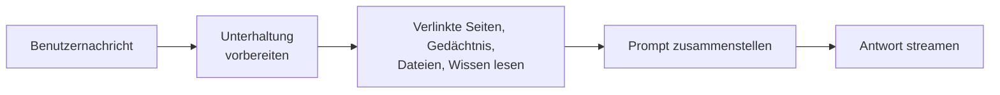

# Webseiten-Assistent

Der **Webseiten-Assistent** (Web Page Assistant) antwortet aus den Webseiten, die ein Benutzer verlinkt. Fügen Sie einen
oder mehrere Links in eine Nachricht ein oder hängen Sie eine Seite mit `#` an, und er liest sie, antwortet aus ihrem
Inhalt und zitiert jede verwendete Seite. Eine Seite, die er nicht lesen konnte, wird in der Antwort mit dem Grund
genannt, nie erraten.

Er ist der [Instructed Assistant](../3_instructed_assistant/) mit eingebautem Lesen von Links: dieselben Anweisungen,
dasselbe Gedächtnis, dieselben angehängten Dateien und Wissensreferenzen, aber seine Profile können das Lesen nicht
ausschalten.

::: tip Wann Sie diesen Agenten einsetzen
Für Arbeit, die von Seiten ausgeht: Artikel zusammenfassen, Produkt- oder Angebotsseiten vergleichen, prüfen, was eine
Dokumentationsseite sagt. Soll ein bestehender Assistent ebenfalls Links lesen, schalten Sie stattdessen in seinem
Profil **Read Linked Web Pages** ein; siehe [Verlinkte Webseiten](../../10_chat_ui/15_linked_web_pages/).
:::

## Was er tut

1. **Unterhaltung vorbereiten.** Die Anweisungen des Profils stehen am Anfang, und der Verlauf wird auf das
   Eingabebudget gekürzt.
2. **Sammeln.** Jeder Link in der Nachricht und jede mit `#` angehängte Seite wird gelesen, bis zum Link-Limit des
   Profils, zusammen mit den Erinnerungen des Benutzers, angehängten Dateien und referenziertem Wissen.
3. **Zusammenstellen.** Die Seiten kommen hinter den Anweisungen in den Prompt, jede auf das Zeichenlimit des Profils
   gekürzt, mit einem Hinweis, welche Links nicht gelesen werden konnten und warum.
4. **Antworten.** Die Antwort wird mit nummerierten Zitaten gestreamt; jede gelesene Seite erscheint als Quelle.

Eine Nachricht ohne Links wird wie jede Nachricht an einen Instructed Assistant beantwortet.

## Was er *nicht* tut

- **Er durchsucht nicht das Web.** Er liest die Seiten, die der Benutzer verlinkt, sonst nichts.
- **Er folgt keinen Links auf einer Seite.** Gelesen werden nur die verlinkten Seiten, nicht die Seiten, auf die sie
  verweisen.
- **Er liest keine Dateien hinter Links.** PDFs, Bilder und Downloads werden als keine Webseiten gemeldet; hängen Sie
  die Datei stattdessen an.
- **Er meldet sich nicht an.** Seiten hinter einem Login, einer Paywall oder einem Bot-Schutz werden als verweigert
  gemeldet.

## Vorlagen

| Vorlage                | Was sie tut                                                                                                                               |
| ---------------------- | ----------------------------------------------------------------------------------------------------------------------------------------- |
| **Article Summariser** | Für jede verlinkte Seite: 3 bis 5 Kernpunkte und eine Zusammenfassung in zwei Sätzen, jeder Punkt zitiert. Beantwortet zuerst eine Frage. |
| **Page Comparison**    | Eine Tabelle mit einer Spalte pro verlinkter Seite und einer Zeile pro relevantem Kriterium, dann die wichtigsten Unterschiede.           |

## Einrichtung

1. **Blueprint freigeben.** Der Webseiten-Assistent gehört nicht zum Standardumfang eines neuen Mandanten; ein Sysadmin
   gibt ihn frei (siehe [Zugriffskontrolle](../../16_multi_tenancy/4_access_control/)).
2. **Profil erstellen.** Öffnen Sie unter **Admin > Agents** den Reiter **Templates** und wählen Sie eine der Vorlagen
   oben, oder wählen Sie unter **Blueprints** den **Web Page Assistant** und klicken Sie auf **Profil erstellen**.
3. **Anweisungen schreiben** im Feld **System Prompt**: was der Assistent mit den Seiten tut und wie er antworten soll.
   Sie müssen ihn nicht anweisen, Seiten zu zitieren oder nicht gelesene Seiten zu melden; das ist eingebaut.
4. **Limits prüfen** unter **Read Linked Web Pages**, das Modell wählen und speichern.

## Konfigurationsreferenz

Das Formular ist das des Instructed Assistant (siehe dessen
[Konfigurationsreferenz](../3_instructed_assistant/#konfigurationsreferenz)), mit **Read Linked Web Pages** immer
eingeschaltet:

| Feld                        | Standard | Beschreibung                                                                                                              |
| --------------------------- | -------- | ------------------------------------------------------------------------------------------------------------------------- |
| **Max Links per Message**   | `5`      | Wie viele Links einer Nachricht gelesen werden. Weitere Links werden dem Benutzer gemeldet, nicht gelesen. Bereich: 1–20. |
| **Page Timeout (Seconds)**  | `15`     | Wie lange eine Seite laden darf, bevor sie als nicht erreichbar gemeldet wird. Die Antwort wartet auf jede Seite. 5–60.   |
| **Max Characters per Page** | `20000`  | Längere Seiten werden an einem Absatzende gekürzt. Etwa 4 Zeichen ergeben ein Token. Bereich: 1'000–200'000.              |

::: warning Seiten ergeben lange Prompts
Jede gelesene Seite geht in den Prompt ein, fünf lange Seiten können also etwa 25'000 Tokens hinzufügen. Halten Sie
**Maximum Input Tokens** innerhalb des Kontextfensters des Modells und senken Sie die Limits oben, wenn Antworten mit
mehreren Seiten zu lange dauern.
:::
