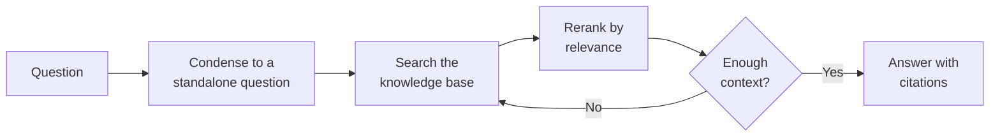

# Document Intelligence Assistant

The **Document Intelligence Assistant** (the RAG agent) answers questions using your organization's own documents. It
uses Retrieval-Augmented Generation (RAG): before answering, it searches your knowledge bases for the most relevant
passages and grounds its reply in those passages — with citations — rather than relying on the language model's general
training. It is the most capable and most configurable agent on the platform, and the one most enterprise deployments
build around.

Unlike the [Instructed Assistant](../3_instructed_assistant/) and [Teachable Assistant](../4_teachable_assistant/),
which only use the model's own knowledge, this agent can answer questions about *your* content — policies, manuals,
reports, project files — and tell the user exactly which documents it drew from.

::: tip About "training" agents
The Swiss AI Hub does not fine-tune or train models on your data. The Document Intelligence Assistant stays current by
*retrieving* from your knowledge base at query time. Update a document and the agent uses the new version on the next
question — no retraining, and you can always see which sources it used. See the [Agents overview](../) for more.
:::

## What it does

At its core the agent runs a retrieve-then-answer loop: it turns the conversation into a clean search query, fetches and
ranks the most relevant passages, checks whether what it found is actually enough to answer, and only then writes a
grounded, cited reply.

1. **Condense the question.** The recent conversation and the latest message are folded into one self-contained
   question, so follow-ups like "and what about part-timers?" still search correctly on their own.
2. **Search the knowledge base.** Semantic search runs across the configured knowledge bases (vector-indexed collections
   of your documents) and returns the most relevant passages.
3. **Rerank by relevance** *(optional).* A dedicated reranking model re-scores the passages so the best ones rise to the
   top before they reach the language model.
4. **Check sufficiency** *(optional).* A guard asks whether the retrieved passages are actually enough to answer. If
   not, the agent can search again with a refined query ("multi-hop"), up to a configured limit — or, if it still can't
   find enough, tell the user it doesn't know rather than guess.
5. **Answer with citations.** The model writes the answer using only the retrieved passages and references its sources.

Users can also bring their own material into the conversation. Files attached in the chat are read by the agent and used
next to the configured knowledge (a long file is cut to the sections that matter for the question, and the answer says
so). Typing `#` in Open WebUI adds one of the company's collections to the search for that message. Every document the
model read appears as a numbered citation chip in the answer, labelled with the document's title.

Beyond this core loop, the agent can also draw on **memory** — personal context it has learned about the individual
user, and shared organizational knowledge — and apply a **suitability guard** that politely declines questions outside
its remit. These are all optional and covered in the configuration reference below.

## What it does *not* do

- **It won't answer from general knowledge.** By design it answers from your documents. If nothing relevant is found
  (and the sufficiency guard is on), it says so rather than inventing an answer.
- **No tools or actions.** It reads and answers; it doesn't create tickets or call external systems. For that, use the
  MCP Tool Agent, or the Universal Agent when the model should choose between searching knowledge and other tools.
- **No human escalation on its own.** If you want it to fall back to a human expert when it can't answer, use the
  Company Knowledge Agent (the expert-RAG variant). See the [Expert Coordinator Agent](../9_expert_coordinator_agent/).
- **It does not ingest documents.** Filling and updating the knowledge base is the job of a
  [data pipeline](../../6_pipelines/), not the agent. The agent only reads what the pipeline has indexed.

## Typical scenarios

- **HR policy assistant.** Configured to search the HR knowledge base, it answers "How many vacation days do I carry
  over?" with a citation to the staff handbook.
- **Technical support assistant.** Points at product manuals and release notes; answers customer-facing questions with
  references to the exact section.
- **Project knowledge assistant.** Searches a project's documents so team members can ask about decisions, specs, and
  status without digging through folders.
- **Jira story assistant.** Drafts Jira stories for product owners and reviews existing ones against specifications,
  handbooks and other stories. A ready-made template sets it up, see
  [Drafting and reviewing Jira stories](#drafting-and-reviewing-jira-stories).

## Before you start: prerequisites

This is the key difference from the simpler agents — the Document Intelligence Assistant depends on infrastructure that
must exist **independently of the agent itself**. Set these up first:

1. **A populated knowledge base.** The agent searches vector-indexed collections of your documents. Those collections
   must already exist and contain indexed content. Creating and filling them is done by a
   [data ingestion pipeline](../../6_pipelines/) — the default pipeline indexes documents uploaded through the UI, and
   custom pipelines can sync from sources like SharePoint and keep the index up to date as documents change. **No
   knowledge base, nothing to retrieve.**
2. **An embedding model.** Search works by comparing the embedding (vector) of the question against the embeddings of
   your documents. The embedding model you select for the agent **must match the one used to index the knowledge base**
   — otherwise the vectors are incompatible and search returns nothing useful.
3. **A chat model.** The language model that writes the final answer, available through your platform's LiteLLM
   configuration.
4. **A reranking model** *(optional).* Required only if you enable reranking. Also made available through LiteLLM.
5. **A memory backend** *(optional).* Required only if you enable user or organization memory.

::: warning The embedding model must match the index
The single most common cause of "the agent finds nothing" is an embedding-model mismatch between the agent configuration
and the pipeline that built the knowledge base. Confirm both use the same embedding model before debugging anything
else.
:::

## Setting it up

The agent is delivered as a **blueprint** from which you create configured **profiles** — see
[Blueprints & Profiles](../2_blueprints_and_profiles/). With the prerequisites in place:

1. **Open the blueprint** under **Admin > Agents > Blueprints** and select **Document Intelligence Assistant**, or start
   from one of its ready-made profiles under **Templates**.
2. **Create a profile** with an **Agent ID**, **Name**, **Description**, and **Icon**.
3. **Add at least one knowledge source.** Pick the vector store (knowledge base) to search and the matching embedding
   model. This is mandatory — the agent needs somewhere to retrieve from. You can add several sources to search them
   together.
4. **Choose the chat model** and adjust its parameters (for factual, grounded answers, switch on the temperature
   override and set it low).
5. **Tune retrieval and answering** as needed: how many passages to fetch, whether to rerank, whether to run the
   sufficiency guard and allow multi-hop, and the system prompt.
6. **Enable memory and guards** if you want them (all optional — see below).
7. **Save and test** with real questions, checking that the cited sources are the ones you expect.

## Drafting and reviewing Jira stories

The **Jira Story Assistant** template turns this agent into an assistant for product owners. From a short description it
drafts a story that follows the project's story template. Given an existing story, it checks every section of the
template, lists contradictions and overlaps with your specifications, handbooks and other stories, and suggests a
rewrite. It only writes into the chat: nothing changes in Jira until a product owner copies a suggestion over.

### What the template sets

| Setting                           | Value                                    | Why                                                                                                          |
| --------------------------------- | ---------------------------------------- | ------------------------------------------------------------------------------------------------------------ |
| **Knowledge sources**             | One placeholder on the shared collection | A template cannot know your databases. Replace it, see below.                                                |
| **Query mode**                    | `hybrid`                                 | Keyword matching finds overlapping stories and working agreements that a draft request misses on similarity. |
| **Condense the question**         | On                                       | A follow-up such as "make criterion 2 stricter" keeps searching the story's topic.                           |
| **Check context sufficiency**     | Off                                      | A new story has no document that already answers it, so the guard would refuse to draft.                     |
| **Restrict to the user's access** | On                                       | Product owners only get content from the databases they may read.                                            |
| **User and organization memory**  | Off                                      | Facts remembered from one draft would leak into unrelated stories.                                           |
| **System prompt**                 | Story templates and answer rules         | Written in English. The agent answers in the language of the user's message.                                 |
| **Context prompt**                | The template's own                       | The default one ends with an instruction in the interface language, which pulls answers into that language.  |

### Setting it up

1. **Prepare the knowledge databases.**
   - **Jira**: a database whose source is [Jira issues](../../8_knowledges/#jira-issues), with the projects whose
     stories the product owners write. Leave service-desk projects and request types out with the source's JQL filter:
     the agent can only cite what the database holds.
   - **Confluence**: the pages holding your specifications, glossary and working agreements.
   - **Handbooks**: for example handbook folders synced from SharePoint with
     [cloud storage sync](../../8_knowledges/#files-from-cloud-storage).
2. **Create the profile** under **Admin > Agents > Templates > Jira Story Assistant**. If its Agent ID is already taken
   in this deployment, choose another one.
3. **Point it at your databases.** Change the database of the existing knowledge source instead of deleting it, so it
   keeps `hybrid`, and switch on **Search all namespaces** or pick the project and space keys. For every further
   database, **Add Item** and fill in what a new source starts without:
   - the **Embedding Model**, which is empty: pick the one the database was indexed with;
   - the **Query mode**, which starts at `default`: set it to `hybrid`;
   - the namespaces: switch on **Search all namespaces** or pick the keys, otherwise the profile cannot be saved.
4. **Add your story templates** to the system prompt, see below.
5. **Give the product owners access** to the profile and read access to every database it searches. A database a product
   owner cannot read is left out of their answers without notice.

### Adapting the prompt

- **Story templates.** The prompt holds a `<story_templates>` block with a `default` template. Add one block per project
  next to it, for example `<template project="ABC"> … </template>`, with that project's sections. The agent uses the
  template of the project the user names, or the default, and says which one it used. It never takes a template from a
  retrieved document, so copy a template kept in Confluence into the prompt.
- **Markup.** The `<output_markup>` block asks for Markdown. If your product owners paste into the text editor of Jira
  Data Center, which expects wiki markup, change it to `Write the story text in Jira wiki markup.`
- **Languages.** The prompt exists in English only, and every interface language falls back to it. If you fill in
  another language tab, users with that interface language get that version instead, so keep the copies in step. The
  agent answers in the language of the message. Set each product owner's chat interface to the language they write in,
  see the limits below.

### Using it

- **Draft**: "Draft a story for the ABC project: claimants can download a single expense report as PDF." The story comes
  in a code block with a copy button and without citation markers. The sources follow under **Context used** and
  **Related issues**, and requirements a document adds beyond the description are listed as open questions.
- **Change a draft**: "Make criterion 1 stricter: only approved reports can be downloaded." The agent answers with the
  complete updated story.
- **Review**: paste the story's summary, description and acceptance criteria. Given only an issue key, the agent asks
  for the text, because the knowledge search may return only parts of an issue. An attached export works too; name its
  topic in the message ("Review the attached story about the submission deadline"), because the search does not read
  attachments.
- **Ask for sources** with a question about the content, such as "Which documents state the 90-day limit?". A question
  about the assistant itself ("Where did you get that from?") is answered from its own description, which does not
  include the documents it cited.

### Limits

- The review is a conversation, not an exhaustive checklist: it compares the story with the few documents the search
  returns for it, not with every story in the project.
- Looking up a story by its issue key is not supported. Paste the story instead.
- The Jira source syncs the description and comments, not custom fields. Acceptance criteria kept in a custom field are
  not seen.
- Citations of Jira issues and Confluence pages open the issue or page. Documents from cloud storage sync have no web
  link, so their citations are not clickable.
- When the chat interface language differs from the language of the message, the answer can come back in the interface
  language or mix both: the platform tells the model how to cite in the interface language. A German interface with
  German messages, or an English one with English messages, gives consistent answers.

## Configuration reference

The form has a lot of options because the agent is powerful. Only the **profile identity**, **chat model**, and **at
least one knowledge source** are required; everything else has sensible defaults.

### Profile identity

| Field           | Type                | Required | Description                                                                   |
| --------------- | ------------------- | -------- | ----------------------------------------------------------------------------- |
| **Agent ID**    | Text                | Yes      | Unique, URL-safe identifier. Lowercase letters, digits, underscores, hyphens. |
| **Name**        | Text (per language) | Yes      | Display name shown to users.                                                  |
| **Description** | Text (per language) | Yes      | Short explanation shown in the assistant picker.                              |
| **Icon**        | Icon picker         | No       | Visual identifier. Defaults to a file icon.                                   |

### Language model

| Field                              | Type              | Default       | Description                                                                                                                                                                                                                                                                                                                                                                                                                                                                                                                                                                                                                                                                                                                                                              |
| ---------------------------------- | ----------------- | ------------- | ------------------------------------------------------------------------------------------------------------------------------------------------------------------------------------------------------------------------------------------------------------------------------------------------------------------------------------------------------------------------------------------------------------------------------------------------------------------------------------------------------------------------------------------------------------------------------------------------------------------------------------------------------------------------------------------------------------------------------------------------------------------------ |
| **Model**                          | Model picker      | —             | The chat model that writes the answer. Required.                                                                                                                                                                                                                                                                                                                                                                                                                                                                                                                                                                                                                                                                                                                         |
| **Temperature**                    | Number (optional) | Model default | Randomness. The checkbox **Override the model's default temperature** shows the selected model's recommended default in parentheses, e.g. "(1.0)" for gemma, "(0.7)" for Qwen3-VL, "(0.05)" for Ministral, or "(0.0)" for models without a curated default. Unticked, the field stays visible but disabled and shows that default, which is what the agent uses; it follows the model when you switch models. Ticking it pre-fills the field with the default for you to adjust (range 0.0–2.0); for grounded, factual answers use `0.0`–`0.3`. Unticking returns to the model's default. Existing profiles that stored a temperature keep it. Helper steps (checks, titles, question condensation) use `0.0` while it is unticked; a value you set applies to them too. |
| **Breadth of word choice (top_p)** | Number (optional) | Model default | How many alternatives the model considers for each next word, range 0–1; lower is more focused. Same override checkbox as **Temperature**, with the model's default in parentheses (e.g. "(0.95)" for gemma). Models without a curated default show "(provider default)": the provider decides while the checkbox is unticked.                                                                                                                                                                                                                                                                                                                                                                                                                                           |
| **Accept images**                  | Checkbox          | On            | Whether images in the conversation are passed to the model. Disabled for models that declare no image support; every chat model shipped today reads images.                                                                                                                                                                                                                                                                                                                                                                                                                                                                                                                                                                                                              |
| **Return Log Probabilities**       | Toggle            | Off           | Advanced diagnostic option for token-level confidence. Leave off unless needed.                                                                                                                                                                                                                                                                                                                                                                                                                                                                                                                                                                                                                                                                                          |
| **Top Log Probabilities**          | Number            | `0`           | Alternative tokens to report per position; only when log probabilities are on. Range 0–20.                                                                                                                                                                                                                                                                                                                                                                                                                                                                                                                                                                                                                                                                               |
| **Timeout**                        | Number (seconds)  | `600`         | How long to wait for the model before giving up.                                                                                                                                                                                                                                                                                                                                                                                                                                                                                                                                                                                                                                                                                                                         |

If a message carries images the agent cannot pass on (**Accept images** off, or a model without image support), the
agent replies that it cannot look at images instead of answering. Models with a known per-request image limit
(Ministral-3-14B: 10; Qwen3.5-122B and gemma-4-31B-it on Infomaniak: 20; local Qwen3-VL on GPU deployments: 8) drop
images from earlier turns first. If the latest message alone has more images than the limit, the agent replies "You sent
N images, but I can look at no more than M at once." instead of calling the model.

### Knowledge sources (retrievers)

The agent searches one or more **knowledge sources**. Add at least one; add several to search multiple knowledge bases
together. Each source has these settings:

| Field                      | Type                  | Default   | Description                                                                                         |
| -------------------------- | --------------------- | --------- | --------------------------------------------------------------------------------------------------- |
| **Embedding model**        | Model picker          | —         | Must match the model used to index this knowledge base (see prerequisites). Required.               |
| **Vector store**           | Knowledge-base picker | —         | The collection (and optional namespaces) to search. Required.                                       |
| **Retrieve K**             | Number                | `5`       | How many passages to fetch per search. Higher finds more but adds noise and cost. Range 1–100.      |
| **Query mode**             | Choice                | `default` | Search strategy: `default` (dense/semantic), `hybrid` (dense + keyword), or `sparse` (keyword).     |
| **Node types**             | Multi-select          | `content` | Whether to retrieve document **content**, parent **summary** nodes, or both. At least one required. |
| **Retrieve previous/next** | Optional group        | Off       | Also pull the chunks immediately before/after each hit, so passages keep their surrounding context. |
| **Retrieve summaries**     | Optional group        | Off       | Also pull parent-level summary nodes for a higher-level view of the source document.                |

### Restrict to the user's access

| Field                             | Type   | Default                                 | Description                                                                                                                                                                        |
| --------------------------------- | ------ | --------------------------------------- | ---------------------------------------------------------------------------------------------------------------------------------------------------------------------------------- |
| **Restrict to the user's access** | Toggle | On for new profiles, off for older ones | Retrieve only from the configured collections the person asking may read in the knowledge area. Without it, everyone who can use this agent gets answers from all its collections. |

If a user may read none of the configured collections, the agent says that no knowledge is available to them. Runs
without a user (scheduled or triggered by mail) keep the profile's scope. See
[Restrict to the user's access](../2_blueprints_and_profiles/#restrict-to-the-user-s-access).

### Reranking *(optional)*

Off by default. When enabled, a dedicated model re-scores retrieved passages for relevance before they reach the chat
model — usually a meaningful quality boost at some extra latency and cost.

| Field               | Type         | Default | Description                                                                       |
| ------------------- | ------------ | ------- | --------------------------------------------------------------------------------- |
| **Reranking model** | Model picker | —       | The rerank model (available through LiteLLM). Required when reranking is enabled. |
| **Top N**           | Number       | `5`     | How many passages to keep after reranking. Range 1–100.                           |

### Context-sufficiency guard *(optional)*

Off by default. When enabled, a guard checks whether the retrieved context is actually enough to answer — and can
trigger additional retrieval rounds ("multi-hop") or have the agent admit it doesn't know instead of guessing.

| Field                            | Type      | Default              | Description                                                                                                                                    |
| -------------------------------- | --------- | -------------------- | ---------------------------------------------------------------------------------------------------------------------------------------------- |
| **Check context sufficiency**    | Toggle    | Off                  | Run the guard before answering. Strongly recommended for high-stakes use where a wrong answer is worse than "I don't know."                    |
| **Max retrieval hops**           | Number    | `1`                  | How many times the agent may re-search when the guard finds the context insufficient. Higher can improve answers but adds latency. Range 1–10. |
| **Context-insufficient message** | Long text | *(default provided)* | What the agent says when it can't find enough to answer. Customize the wording and tone.                                                       |

### Suitability guard *(optional)*

A few-shot guard that decides whether a question is in scope for this assistant. Provide example requests labelled
accept/reject; leave the list empty to accept everything.

| Field              | Type                | Description                                                     |
| ------------------ | ------------------- | --------------------------------------------------------------- |
| **User request**   | Text (per language) | An example request a user might send.                           |
| **Should accept?** | Toggle              | Whether this example should be accepted (in scope) or rejected. |
| **Reason**         | Text (per language) | Why it's accepted or rejected — helps the guard generalize.     |

### User memory *(optional)*

Lets the assistant remember context about the individual user across conversations (e.g. their role or preferences) and
use it to personalize answers. On by default.

| Field                            | Type         | Default          | Description                                                                                                                                |
| -------------------------------- | ------------ | ---------------- | ------------------------------------------------------------------------------------------------------------------------------------------ |
| **Enable user memory retrieval** | Toggle       | On               | Pull personal memories into context to personalize answers.                                                                                |
| **Rerank user memory**           | Toggle       | On               | Rerank retrieved memories for relevance (shown only when retrieval is enabled). Adds cost.                                                 |
| **Enable user memory storage**   | Toggle       | On               | Save new learnings from the conversation for future personalization.                                                                       |
| **Memory model**                 | Model picker | Platform default | Model that distils and reconciles those learnings. Off = the platform-wide model; enabling it starts from that same one. Needs storage on. |

Saving happens in the background once the answer has been delivered, so none of it adds to the wait.

### Organization memory *(optional)*

Lets the assistant draw on shared knowledge captured for the whole organization (for example, answers gathered by the
[Expert Coordinator Agent](../9_expert_coordinator_agent/)). Set the organization-memory section to off to disable it.

| Field                          | Type   | Default          | Description                                                                                     |
| ------------------------------ | ------ | ---------------- | ----------------------------------------------------------------------------------------------- |
| **Tenant ID**                  | Text   | platform default | Which tenant's shared memory to read.                                                           |
| **Allowed namespaces**         | List   | *(empty)*        | Allow-list of memory namespaces to read from. Empty means unrestricted.                         |
| **Default namespace**          | Text   | platform default | Namespace used when a request doesn't specify one. Must be within the allow-list if one is set. |
| **Rerank organization memory** | Toggle | On               | Rerank retrieved organization memories for relevance. Adds cost.                                |

### Attached files and referenced knowledge

Two sections with preset models cover material users bring into the chat. Most profiles never change them.

| Field                                  | Default            | Description                                                                                                   |
| -------------------------------------- | ------------------ | ------------------------------------------------------------------------------------------------------------- |
| **Attached Files > Embedding Model**   | `embedding/bge-m3` | Shortlists the sections of an attached file that is too long to fit whole.                                    |
| **Attached Files > Reranking Model**   | `reranker/bge`     | Orders the shortlisted sections by relevance before they fill the room left in the prompt.                    |
| **Knowledge Search > Reranking Model** | `reranker/bge`     | Orders what the collections a user referenced with `#` return. Each is searched with its own embedding model. |

The agent reserves room for its retrieved passages before it sizes attached files, so a large attachment cannot crowd
out the knowledge search.

### Prompts and input budget

| Field                | Type              | Default               | Description                                                                                                                                                                                                                                                                                                                                                                                                                                                                                                                                                                                                                                                                                                                                                                                      |
| -------------------- | ----------------- | --------------------- | ------------------------------------------------------------------------------------------------------------------------------------------------------------------------------------------------------------------------------------------------------------------------------------------------------------------------------------------------------------------------------------------------------------------------------------------------------------------------------------------------------------------------------------------------------------------------------------------------------------------------------------------------------------------------------------------------------------------------------------------------------------------------------------------------ |
| **System prompt**    | Long text         | *(grounding default)* | Defines the assistant's role and rules. The default instructs it to answer only from retrieved context and quote sources.                                                                                                                                                                                                                                                                                                                                                                                                                                                                                                                                                                                                                                                                        |
| **Context prompt**   | Long text         | *(template default)*  | Template for how retrieved passages are presented to the model. Most deployments leave this at the default.                                                                                                                                                                                                                                                                                                                                                                                                                                                                                                                                                                                                                                                                                      |
| **Max input tokens** | Number (optional) | Model window (85%)    | The input budget; the conversation and retrieved context are trimmed to fit. Optional. Unticked by default: the agent fills about 85% of the selected chat model's input window, which is shown in the checkbox label and the disabled field (e.g. "(78,050)" for gemma on Infomaniak) and follows the model when you switch models. The 15% margin allows for differences between the token counter and the model's tokenizer. Tick **Set your own input limit** to set a lower limit and cut cost: minimum 1,024, maximum that same 85% figure, which the hint under the field names next to the model's full window; a higher value is blocked in the form and rejected by the API. Profiles that stored a limit above that figure have it unset automatically when the platform is upgraded. |

If a message alone is larger than the chat model's context window, the agent replies that the input is too large (and
suggests a smaller file) instead of ending in an error. The check uses the real window of the model, not only this
budget.

## Best practices

**Get the knowledge base right first.** The quality of answers is capped by the quality of what's indexed. Make sure the
[pipeline](../../6_pipelines/) is ingesting the right documents and keeping them current before tuning the agent.

**Match the embedding model to the index.** Re-read the prerequisites — a mismatch silently breaks retrieval.

**Turn on the sufficiency guard for high-stakes assistants.** For policy, legal, or compliance use, it's far better for
the agent to say "I don't have enough information" than to produce a confident wrong answer. Pair it with a small number
of multi-hop retries.

**Keep temperature low.** `0.0`–`0.3` keeps answers faithful to the retrieved sources. Switch the temperature override
on and set it, since the default now follows the model.

**Start with a few knowledge sources, not all of them.** Searching every collection at once produces noisy, mixed
results. If users span very different topics, consider the Document Navigation Assistant to route each question to the
right knowledge base instead of dumping them all into one profile.

**Tune Retrieve K and reranking together.** A common pattern is to retrieve a generous number of passages (higher
Retrieve K) and let reranking keep only the best few (Top N) — more recall without overwhelming the model.
