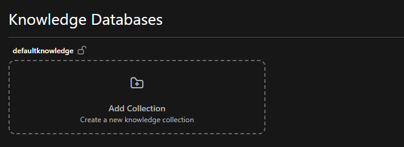

# Knowledge management

AI agents need access to relevant information to answer questions accurately. The knowledge management system processes
your documents and makes them searchable through semantic retrieval.

## Structure

Knowledge organizes into three levels:

Knowledge databases are isolated containers at the top level. Each database has its own data, permissions, and
processing pipeline. Organizations typically create databases per department, project, or security classification.

Namespaces (called "collections" in the UI) group related documents within a database. They function like folders
organized by topic or purpose. A product database might contain "technical," "guides," and "troubleshooting"
collections.

Documents are the actual files - PDFs, Word documents, PowerPoint presentations. The system processes them automatically
after upload.

::: info Multilingual support
Database names, namespace labels, and folder descriptions support German, English, French, and Italian. The interface
displays labels according to user language preference.
:::

## Creating a knowledge database

You create knowledge databases yourself from the admin UI — no deployment, configuration change, or restart is involved,
and a new database starts accepting documents immediately.

When you create one you choose:

- **The ingestion pipeline** that will process its documents. Most deployments offer one, the Generic Document Ingestion
  Pipeline; a deployment that ships its own pipeline offers that here too.
- **A text-generation model**, used for the enrichment steps — summaries, table refinement, figure descriptions.
- **An embedding model**, which turns text into the vectors agents search.

Leave the models unset to use the deployment's defaults. Because a database's vectors are only comparable to other
vectors produced by the same embedding model, the models are fixed once the database exists — to change them, create a
new database and re-upload.

Whoever creates a database is granted administrative access to it automatically, so you can use what you just made
without asking an administrator for a second step.

## Managing content

### Manual management

By default, databases allow manual control:

1. Create collections through the web interface
2. Upload documents to specific collections
3. Watch them process



You control what gets uploaded and where it lives. Uploading a document notifies the pipeline directly, so processing
normally begins within a minute or two rather than waiting for a scheduled run. A daily run still sweeps every database
as a safety net, catching anything a missed notification would otherwise have left behind.

### Syncing from an external source

Instead of uploading, a database can be given a **Source** when it is created, or later through **Edit source** on the
database. Two kinds of source are offered: **Cloud storage sync (rclone)** keeps files in sync, and **Business
application sync** keeps records such as Jira issues, Confluence pages and wiki pages in sync, each record as one
document. Credentials are stored encrypted and shown masked afterwards; re-saving the dialog without retyping them keeps
the stored ones, so a rotation is a matter of editing the source. Either way, the system then:

- Syncs from the source on a daily schedule; until the first sync has filled it, the database shows **Nothing synced
  yet**
- Creates the collections itself, as described below
- Processes each synced document within a minute or two, like an upload
- Disables manual uploads, hand-made collections and manual document deletion for that database

#### Files from cloud storage

Pick the storage system (OneDrive / SharePoint, Google Drive or S3 — the backends verified end to end), enter its
credentials, the folder to sync and optional include/exclude patterns. For SharePoint the credentials belong to an Entra
ID application with read access to the site, and the drive is the document library's; the step-by-step guide is
[Syncing a SharePoint library](./2_sync_from_sharepoint/). For Google Drive the service-account key is uploaded as the
`.json` file downloaded from Google Cloud, and the dialog shows the `client_email` to share the Drive folder with. Each
top-level folder of the synced root becomes a collection; files directly in the root are skipped and counted in the run.

If two top-level folders would end up as the same collection name (`hr docs` and `hr_docs`), the first one keeps the
name and the second is skipped: its files reach the data lake but are never ingested, and the ingestion run names the
skipped files and the reason in its metadata and logs. Other folders and the database's other files are unaffected;
renaming the folder at the source fixes it.

#### Jira issues

Pick **Jira** as the source system and enter:

- **Jira URL**: the address you open Jira at, such as `https://acme.atlassian.net` for Jira Cloud or
  `https://jira.acme.ch/jira` for a Jira Data Center served under a path. It must be a public address, without `?` or
  `#`: internal names such as Docker services, `localhost` and private network addresses are refused when the sync
  starts, and a redirect is not followed. An operator can allow a Jira reachable only on the company network with
  `STRUCTURED_PIPELINE_ALLOWED_PRIVATE_HOSTS`.
- **Jira edition**: Jira Cloud signs in with the account's e-mail and an
  [API token without scopes](https://id.atlassian.com/manage-profile/security/api-tokens); Jira Data Center with a
  personal access token (profile → *Personal Access Tokens*). Jira Data Center 11.3 is supported, as the option says.
- **Projects**: the keys of the projects to sync, such as `ABC`
- **Additional JQL filter** (optional): a clause every synced issue must also match, such as
  `issuetype != "Service Request"`

Each project becomes a collection and each issue one document. The document is titled with the issue key and summary,
links back to the issue, and carries its type, status, priority, labels, components, fix versions, reporter and
assignee, its description and its comments with author and date. Headings, lists, tables and code keep their formatting;
images and attachments are not synced. Comments restricted to a project role or group, and internal comments of Jira
Service Management, are left out.

The issue's fields reach the document as [frontmatter](#markdown-files-with-frontmatter): a citation shows the key and
summary and opens the issue in Jira, and the fields `key`, `project`, `issue_type`, `status`, `priority`, `labels`,
`components`, `fix_versions`, `reporter`, `assignee` and `updated` are metadata a retriever can filter on once they are
among its allowed filter fields. Agents see these fields with every issue they retrieve, so they can say which status,
priority or assignee an issue has.

::: warning Use a dedicated account
The database holds every issue and comment the token's account can read, and everyone with access to the database can
find them, whatever their own permissions in Jira. Sync with a dedicated read-only account that sees only what the
database's readers may see.
:::

The first sync reads every issue in scope. Later syncs read only the issues changed since the previous one, and compare
the list of issue keys in scope, so issues deleted in Jira, moved to another project or no longer matching the filter
are removed. Changing the projects or the filter reads everything again. On Jira Cloud, deleting a comment updates its
issue, so the next sync removes the comment as well.

A sync whose token Jira rejects, whose project does not exist or is not visible to the account, or whose filter is not
valid JQL fails before it changes anything. The reason is shown on the failed run in the Dagster UI, and in the failure
notification when notifications are configured.

#### Confluence pages

Pick **Confluence** as the source system and enter:

- **Confluence URL**: the address you open Confluence at, such as `https://acme.atlassian.net/wiki` for Confluence Cloud
  (including `/wiki`) or `https://confluence.acme.ch` for Confluence Data Center. As for Jira, it must be a public
  address, without `?` or `#`, and a redirect is not followed. An operator can allow a Confluence reachable only on the
  company network with `STRUCTURED_PIPELINE_ALLOWED_PRIVATE_HOSTS`.
- **Confluence edition**: Confluence Cloud signs in with the account's e-mail and an
  [API token without scopes](https://id.atlassian.com/manage-profile/security/api-tokens); Confluence Data Center with a
  personal access token (profile → *Settings* → *Personal Access Tokens*)
- **Spaces**: the keys of the spaces to sync, such as `ENG`
- **Labels** (optional): only pages carrying at least one of these labels are synced
- **Parent pages** (optional): the IDs of pages whose subtrees are synced, each page included. A page's ID is the number
  in its address, such as `123456` in `…/pages/123456/Runbook`

Each space becomes a collection and each page one document, filed under the titles of the pages above it, so the page
tree becomes folders: `Deploy` below `Runbooks` below the space's home page `Engineering` is
`Engineering/Runbooks/Deploy` in the `ENG` collection. The document is titled with the page title, links back to the
page, and holds its text: headings, lists, tables and code blocks keep their formatting, and panels and expandable
sections keep their content under their title. Images, attachments, blog posts and comments are not synced. A link to
another Confluence page keeps its text, and macros that only show content kept elsewhere, such as a table of contents,
child pages, Jira issues or an included page, are left out.

The page's fields reach the document as [frontmatter](#markdown-files-with-frontmatter): a citation shows the page title
and opens the page in Confluence, and the fields `space`, `labels`, `ancestors`, `author`, `page_id`, `page_version` and
`updated` are metadata a retriever can filter on once they are among its allowed filter fields, for example to search a
single space or the pages with a given label. Agents see these fields with every page they retrieve.

::: warning Use a dedicated account
The database holds every page the token's account can read in the listed spaces, and everyone with access to the
database can find them, whatever page restrictions apply in Confluence. Sync with a dedicated read-only account that
sees only what the database's readers may see.
:::

The first sync reads every page in scope. Later syncs list every page with its version, its place in the tree and its
labels, and read the text only of pages that are new, edited, renamed, moved or relabelled. Renaming or moving a page
moves the documents of the pages below it in the same sync. Pages deleted or archived in Confluence, moved out of the
listed spaces or parent pages, or no longer carrying a listed label are removed. Changing the spaces, labels or parent
pages reads everything again.

Two pages whose titles end up as the same file name keep one document between them, such as `Q1/Q2` and `Q1_Q2` below
the same parent, or titles that only differ after their 120th character. The run's log names both pages; renaming one of
them in Confluence brings the other back.

A sync fails before it changes anything when Confluence rejects the token, when a space or parent page does not exist or
is not visible to the account, when a parent page lies outside the listed spaces, or when the Confluence URL points to
an internal address, such as a Docker service, `localhost` or a private network address, that no operator has allowed.
The reason is shown on the failed run in the Dagster UI, and in the failure notification when notifications are
configured.

#### MediaWiki pages

Pick **MediaWiki** as the source system and enter the settings below. Any MediaWiki from version 1.27 (2016) on can be
synced, which includes every release still supported.

- **Wiki URL**: the folder holding the wiki's `api.php`, such as `https://wiki.acme.ch` or `https://acme.ch/w` for a
  wiki installed like Wikipedia. As for Jira, it must be a public address, without `?` or `#`, and a redirect is not
  followed. An operator can allow a wiki reachable only on the company network with
  `STRUCTURED_PIPELINE_ALLOWED_PRIVATE_HOSTS`.
- **Sign-in**:
  - **Bot password** (`Special:BotPasswords`) for wikis that sign in with MediaWiki's own accounts. The user name is
    `User@BotName`.
  - **Login page** for wikis whose sign-in goes through an extension such as LDAP or single sign-on (PluggableAuth),
    which the API cannot sign in through. The pipeline fills in the wiki's own login page with the account's user name
    and password.
  - **OAuth access token** for wikis with the OAuth extension, such as Wikimedia's. Register an owner-only OAuth 2
    consumer on `Special:OAuthConsumerRegistration` with the *Basic rights* grant; it is usable at once, and its access
    token is what you enter.
  - **No sign-in** for a public wiki.
- **Namespaces** (optional): the names or numbers of the namespaces to sync, such as `Main`, `Project` or `100`. Only
  the main namespace when empty.
- **Categories** (optional): only pages in at least one of these categories are synced.
- **Excluded categories** (optional): pages in any of these categories are never synced, such as a category that marks
  pages to keep away from AI assistants. A category a template assigns counts as well.
- **Sync documents** (off by default): also sync the documents the synced pages show or link to, see *Documents and
  images* below.
- **Sync images** (off by default): also sync the images the synced pages show or link to, see *Documents and images*
  below.
- **Maximum file size (MB)** (with documents or images only, 50 by default): larger files are left out.
- **Minimum image size (px)** (with images only, 100 by default): images narrower or lower than this are left out as
  icons; 0 keeps every image.

Each namespace becomes a collection and each page one document. A collection takes the namespace's canonical name, which
stays the same when the wiki's language or site name changes: `Project` for the wiki's own project namespace, `File` for
files even on a German wiki, and `Main` for the main namespace. A subpage title is split into folders, so
`Onboarding/Laptop` is `Onboarding/Laptop` in the `Main` collection. Redirects are skipped; their target is synced under
its own title. The document is titled with the page title, links back to the page, and holds the page as the wiki
renders it, with every template expanded: headings, lists, links and data tables keep their formatting, and tables used
only for layout, such as a frame around a page or a message box, are replaced by their content. Images are not part of
the page's document, talk pages are not synced, and the edit links and table of contents are left out.

The page's fields reach the document as [frontmatter](#markdown-files-with-frontmatter): a citation shows the page title
and opens the page in the wiki, and the fields `categories`, `page_id`, `revision` and `updated` are metadata a
retriever can filter on once they are among its allowed filter fields.

::: warning Use a dedicated account
The database holds every page the account can read in the listed namespaces, and everyone with access to the database
can find them. Sync with a dedicated read-only account that sees only what the database's readers may see.
:::

The first sync reads every page in scope. Later syncs list every page with its latest revision and title, and read only
the pages that are new, edited, renamed or newly in scope. Pages deleted, moved out of the listed namespaces, put in an
excluded category or taken out of every listed category are removed. Changing the namespaces or categories reads
everything again. An edit to a template changes the pages that use it without giving them a new revision, so they are
read again only when they are next edited themselves.

A sync fails before it changes anything when the wiki refuses the sign-in or the access token, when the session still
reads anonymously after signing in, when the wiki is older than MediaWiki 1.27, when a namespace or category does not
exist, when two synced namespaces would be stored in the same collection, or when the wiki URL points to an internal
address that no operator has allowed. An excluded category counts as existing when it has members or a page of its own:
give it a page, so a sync keeps running while it is empty, rather than letting a mistyped name exclude nothing.

**Documents and images.** With **Sync documents** on, the documents the synced pages show or link to are synced too:
PDF, Word, PowerPoint and Excel files (docx, pptx, xlsx, xls) and text files. With **Sync images** on, so are their
images: PNG, JPEG, GIF, BMP, WebP and TIFF (`.tiff`; `.tif` and SVG are left out). Files follow the pages: one used only
on a page that is not synced, such as one in an excluded category, stays out, and so does one whose own file page is in
an excluded category. The old Office formats doc, ppt and pps, archives and videos are left out, and so are files from a
shared repository such as Wikimedia Commons; the sync's log says how many of each.

Images that only decorate pages are left out. An image a template shows on its own page, such as the logo of a message
box or the icon of an infobox, is left out wherever it is used; an image an author passes to a template, such as an
infobox's photo, is not on the template's page and is kept. Images narrower or lower than the minimum image size are
left out as well, for icons placed by hand. An image becomes a document of the text the ingestion reads in it, so
screenshots and labelled diagrams are worth more than photos.

Each file is stored once, in the collection `File`, whatever the wiki calls its file namespace, under its file name:
`File/Handbook 2026.pdf`. It is processed like an uploaded file, and a citation shows its file name and opens its file
page in the wiki. Later syncs download only documents that were uploaded again, and remove documents no synced page uses
any more. A document the wiki refuses to serve (forbidden, or deleted in the meantime) is skipped and tried again at the
next sync; the run shows how many there were.

The first sync with documents can take long: every document is downloaded and then processed once. Try a small scope
first, such as a single namespace.

The external system becomes the source of truth. Your team continues working there, and the next sync brings changes,
including deletions, into the Swiss AI Hub. Handing a database that already holds documents to a different source,
whether it was filled by hand or by another source, asks for confirmation first, because the new source's first sync
removes everything it does not have. Editing the current source's settings saves without asking. Clearing the source
turns the database back into a manually managed one; its files stay until you delete them.

### Deleting databases and collections

You can remove a whole knowledge database or an individual collection from the web interface. Both actions are
permanent.

- **Delete a collection** removes that collection's documents from storage and the vector index; the database and its
  other collections stay.
- **Delete a database** removes the database entirely — every collection, all its documents, its vector collection, and
  its file storage.

To prevent accidents, the confirmation dialog shows how many documents will be removed and requires you to type the
exact database or collection name before the delete button becomes active.

Deletion runs in the background. The moment you confirm, the item disappears from the list and stops accepting new
uploads, while the platform frees the underlying storage shortly afterwards. If you later re-upload a document that was
deleted, it is ingested again normally.

A database with a source can be deleted as a whole, which also stops its sync and forgets its credentials. Its
individual documents and collections cannot be deleted by hand, because the next sync would bring them back; remove them
at the source instead.

## Document processing

The system processes each uploaded document through several stages:

Parsing: MinerU extracts text, tables, figures, and structure from PDFs and Office documents. It handles complex
layouts, multi-column pages, and embedded content while preserving logical structure. A file is parsed once however
often the platform needs it: results are cached by file content for seven days, so re-uploading identical bytes, or an
agent reading a file the chat already parsed, does not run MinerU again.

Chunking: Large documents split into smaller pieces that maintain context. A 50-page manual becomes hundreds of chunks,
each preserving its relationship to surrounding content.

Metadata extraction: The system captures creation dates, authors, source information, and detected language. Agents can
filter results using this metadata.

Vector embedding: Text chunks convert to vector representations that capture semantic meaning. Agents find relevant
content based on concepts, not just keyword matching. A query about "vehicle speed limits" matches content about
"maximum velocity constraints."

### Markdown files with frontmatter

A Markdown file (`.md`) may open with a YAML block between two `---` lines, its frontmatter. It carries a record's
fields next to its text, the way a page or issue exported from a wiki or tracker often looks:

```markdown
---
title: "ABC-123: Login fails on Safari"
url: https://jira.example.com/browse/ABC-123
created: 2026-09-01T09:00:00+02:00
updated: 2026-09-30T14:05:00+02:00
project: ABC
status: Done
labels: [backend, urgent]
---
Users on Safari 17 cannot log in after the SSO change.
```

The block is removed before chunking: no chunk contains it, and only the text below it is embedded. Its fields become
part of the document instead. Three keys set the document's own fields:

| Key       | Becomes                                                    | Accepted values                                                                                          |
| --------- | ---------------------------------------------------------- | -------------------------------------------------------------------------------------------------------- |
| `title`   | The document title, in the knowledge area and on citations | Non-empty text, up to 500 characters                                                                     |
| `url`     | The link a citation opens                                  | `http://` or `https://` links, up to 2,048 characters                                                    |
| `created` | The document's creation date                               | ISO 8601 dates such as `2026-09-30` or `2026-09-30T14:05:00+02:00`; a time without a zone is read as UTC |

`updated` is not one of them. A document's update date is when the platform last wrote it, on upload or when a sync
changed it, so the record's own `updated` is stored like any other key.

Every other key is stored as metadata on the document and on each of its chunks, where a retriever can filter on it:

- Values are text, numbers, `true`/`false`, dates, or lists of these. `true`/`false`, dates and list items are stored as
  text.
- Names are lowercased, accents are dropped, and every run of other characters becomes `_`: `Fix Version` is stored as
  `fix_version`, `Priorität` as `prioritat`. Use the stored name when you allow a field for filtering.
- A key is skipped when its value is empty, a nested map or a nested list, or when its name is one the platform uses
  itself, such as `type`, `language`, `version`, `namespace`, `source` or `document_title`. Name such a field
  differently, for example `issue_type`. When two keys end up with the same name, the first one wins.
- All of a file's metadata keys together are limited to 8 KiB; keys beyond that are skipped.
- These keys are not embedded: on a short record they would outweigh the text in the search. The title is embedded as
  before.
- Agents see these keys with every retrieved document, next to its title and source, so they can answer about a record's
  fields, such as an issue's status, and not only about its text.

Every skipped key is named, with the reason, in the ingestion run's logs. A block that is not valid YAML, or holds
anything other than `key: value` pairs, does not stop ingestion: the file is ingested exactly as written, block
included, and the run logs a warning. Dates written as plain numbers are refused, because seconds and milliseconds
cannot be told apart. Markdown without frontmatter is processed exactly as before, and other file types are never read
for it.

A document ingested before frontmatter was understood keeps the block in its chunks until the file changes or is
uploaded again.

::: tip Filtering on frontmatter fields
A retriever filters only on keys listed in its **Allowed Filter Fields**. The values to filter by are supplied when an
agent is started programmatically (`RAGStartEvent.additional_filters`), for example by a process; chat users do not set
them. A text value matches documents that store it on its own or in a list, so filtering `labels` by `backend` finds
both `labels: backend` and `labels: [backend, urgent]`. Numbers match by equality, and a `true`/`false` filter matches
the text ingestion stores.
:::

## Inspection and debugging

The system provides visibility into document processing:

Document reconstruction shows how the parser interpreted your document. Check whether it correctly identified tables,
sidebars, and other structural elements.

Chunk inspection displays how the system segmented content: the text of each chunk, as agents retrieve it. Useful when
agents aren't finding expected content. A chunk's metadata, such as fields from a Markdown file's frontmatter, is not
shown there; it lives in the vector database, where Milvus' admin UI (Attu) can display it.

Processing status indicates whether documents are uploading, processing, or ready. The document list refreshes itself
every few seconds while a document on the page is still processing, so you do not need to reload to see it become ready.
A document counts as ready only once its embeddings have been written to the vector database — until then it is still
processing and agents cannot retrieve it, even though its text has already been parsed.

## Access control

Knowledge permissions follow the same two-level hierarchy as agent classes and agent instances: the database is the
parent, its collections (namespaces) are the children, and a rule on one level never implies its neighbours.

| Rule                                  | Grants                                                                                      |
| ------------------------------------- | ------------------------------------------------------------------------------------------- |
| `aihub.admin.knowledge`               | Create new knowledge databases and list the pipelines they can be assigned                  |
| `aihub.admin.knowledge.<db>`          | See the database, create collections inside it, delete the whole database                   |
| `aihub.admin.knowledge.<db>.<ns>`     | Upload, edit, and delete documents in that collection; rename or delete the collection      |
| `aihub.user.knowledge.<db>`           | See that the database exists, its name and configured pipeline, but none of its collections |
| `aihub.user.knowledge.<db>.<ns>`      | Browse and search one collection                                                            |
| `aihub.user.knowledge.<db>.*` or `.>` | Browse every collection of one database                                                     |
| `aihub.user.knowledge.>`              | Browse every database and every collection                                                  |

The seeded `AIHubKnowledgeUser` and `AIHubKnowledgeAdmin` roles bundle the last row and the first two rows respectively,
and the role editor offers the same three rules as presets. Admin rules imply the matching user rule. Per resource, the
role and tenant editors offer **Manage** on each database (`<db>` together with `<db>.>`) and **Use** and **Manage** on
each collection (`<db>.<ns>`), so one collection can be handed to someone without the rest of its database.
`aihub.admin.knowledge.>` covers every existing database and collection but not the bare `aihub.admin.knowledge` root,
so a role that should create databases needs the root rule explicitly.

Creating a resource grants access to it automatically, mirroring agent instances: the creator receives a per-resource
admin role (`Knowledge<Db>Admin` or `Knowledge<Db><Ns>Admin`) and the tenant ceiling is raised to include the new rules
unless a broader rule already covers them. A database is granted as `aihub.admin.knowledge.<db>` plus
`aihub.admin.knowledge.<db>.>`, so its admin role and its tenant also reach every collection in it — including the ones
a sync or ingestion pipeline creates, which are granted to no one when they appear. Deleting a database or collection
revokes those rules and roles again.

A new tenant's ceiling holds only `aihub.admin.knowledge`, never `aihub.admin.knowledge.>`. Databases are stored
deployment-wide, so that wildcard would show a tenant every other tenant's knowledge; a tenant sees only the databases
it created, plus any a sysadmin ticks for it in the tenant editor.

## Agent integration

An agent's knowledge scope is always explicit: it either names the collections to search or opts into every collection
of a database with the "Search all namespaces" switch. Leaving the selection empty is rejected when the configuration is
saved rather than silently widened to the whole database. Agents configured before this rule existed, with an empty
selection and no switch, fail validation until an administrator re-saves them with an explicit scope; the agent's error
message names the retriever field to fix.

Saving an agent configuration also checks that scope against the saving user's rules: each named collection needs
`aihub.user.knowledge.<db>.<ns>` (or a rule covering it), and opting into all collections needs a rule covering every
one of them (`...<db>.*`, `...<db>.>` or broader).

That check only covers whoever saved the agent. With **Restrict to the user's access** on, the knowledge agents (RAG,
expert RAG and namespace selection) also check every run against the person asking. They search only the configured
collections that person may browse under the rules above. A "Search all namespaces" retriever stays whole only for
someone who may browse the whole database; anyone else gets the collections they may read. The knowledge area and the
agents apply the same rules, so an agent never answers from a collection the person cannot open themselves. When nothing
of the agent's knowledge is readable, the agent says so rather than answering as if the documents held no answer. The
setting is on for new agents and off for agents saved before it existed, so their behaviour does not change unannounced.
Runs without a person, such as scheduled or mail-triggered ones, keep the agent's configured scope.

### Knowledge databases and My Files

Knowledge databases are shared, curated and indexed: documents are parsed, chunked and embedded so agents can search
them semantically. **My Files** is different. It is each user's own file space (their chat attachments, files agents
made for them and their uploads) and is not part of any knowledge database. Its files are not embedded or searched by
retrieval; an agent with the My Files option on reads them by name. Put documents that a team should find through search
into a knowledge database, and keep personal working files in My Files.

### Referencing collections in a chat

In OpenWebUI, any chat agent can be pointed at a collection with `#`, the way OpenWebUI references its own knowledge.
The `#` picker lists our collections as "Database / Collection", each only to users whose roles let them browse it. The
entries hold no content and OpenWebUI runs no retrieval on them: a referenced collection reaches the agent as a
reference, and the agent searches it with the database's own embedding model and adds the best matches to its context,
cited like any other document. In a knowledge agent's chat this search comes on top of the agent's configured retrieval.
The agent checks the reference against the asking user's rules again, and says when a referenced collection is not
available to them instead of answering from it. OpenWebUI administrators see every entry in the picker, since OpenWebUI
lets them bypass its access control, but they too get answers only from what they may read here.

Creating, renaming or deleting a collection shows up in the picker within seconds; collections a sync or pipeline
creates appear on the next reconcile, at most a minute later.

Agents connect to specific collections rather than entire databases. When configuring an agent, you specify which
collections it can search. A customer support agent might access "products" and "faq" but not "engineering."

Collection-scoped retrieval keeps agents focused on relevant content, improving both speed and accuracy.

Documents become available to agents after the pipeline processes them. The system tracks which source documents agents
used, enabling citation and verification of responses.

## Technical implementation

The architecture uses:

- FerretDB for document metadata and processing status
- Milvus for vector storage and semantic search
- MinerU for document parsing and structure extraction
- SeaweedFS for S3-compatible file storage
- LlamaIndex for chunking and embedding orchestration

Processing metadata lives in FerretDB, vector embeddings in Milvus, raw files in SeaweedFS. This separation optimizes
each component for its specific task.

## Limitations

No mixed modes: A database is either manually managed or synced from one source, not both. This prevents ambiguity about
who owns its content.

No manual chunk editing: The system generates chunks automatically from source documents. To fix incorrect chunks,
update the source document and reprocess.

No database merging: Databases remain isolated by design. Reorganization requires creating new structures and migrating
documents.
